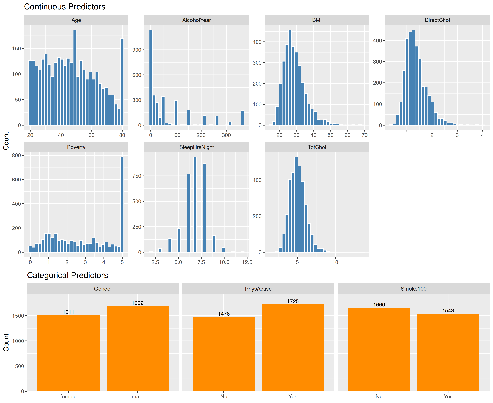

```{r setup, include=FALSE, cache=FALSE}
knitr::opts_chunk$set(echo = TRUE, warning = FALSE, message = FALSE,
                      fig.align = "center",
                      fig.path = "results/",
                      dev = "png",
                      dev.args = list(bg = "white"))
dir.create("results", showWarnings = FALSE)
```

```{r packages, cache=FALSE}
####################################
### uncomment and run once, then comment back ###
## ALL YOUR TESTS WILL FAIL IF YOU LEAVE THESE LINES UNCOMMENTED ##
# install.packages("NHANES")
# install.packages("cowplot")
# install.packages("car")
####################################
library(NHANES)
library(dplyr)
library(tidyr)
library(ggplot2)
library(broom)
library(knitr)
library(cowplot)
library(car)
```

## 1. Data Preparation

```{r data-prep}
model_vars <- c("BPSysAve", "Age", "BMI", "DirectChol", "TotChol", "Poverty",
                "SleepHrsNight", "AlcoholYear", "Gender", "Smoke100", "PhysActive")

adult_cc <- NHANES %>%
  filter(Age >= 20) %>%
  select(ID, all_of(model_vars)) %>%
  na.omit()

stopifnot(nrow(distinct(adult_cc)) == n_distinct(adult_cc$ID))

nhanes_adult <- adult_cc %>%
  distinct(ID, .keep_all = TRUE) %>%
  select(-ID)

cat("Adults 20+, complete cases (with repeats): n =", nrow(adult_cc), "\n")
cat("Model sample, unique participants:         n =", nrow(nhanes_adult), "\n")
```

## 2. Predictor Variables

### 2.1 Numeric Predictors

```{r num-summary}
num_vars <- c("Age", "BMI", "DirectChol", "TotChol",
              "Poverty", "SleepHrsNight", "AlcoholYear")

skewness <- function(x) {
  x <- x[!is.na(x)]
  mean((x - mean(x))^3) / sd(x)^3
}

nhanes_adult %>%
  select(all_of(num_vars)) %>%
  pivot_longer(everything(), names_to = "Variable", values_to = "x") %>%
  group_by(Variable) %>%
  summarise(
    Mean     = round(mean(x, na.rm = TRUE), 2),
    SD       = round(sd(x, na.rm = TRUE), 2),
    Median   = round(median(x, na.rm = TRUE), 2),
    IQR      = round(IQR(x, na.rm = TRUE), 2),
    Min      = round(min(x, na.rm = TRUE), 2),
    Max      = round(max(x, na.rm = TRUE), 2),
    Skewness = round(skewness(x), 2),
    .groups  = "drop"
  ) %>%
  kable(caption = paste0("Summary statistics for numeric predictors (model sample, n = ", format(nrow(nhanes_adult), big.mark = ","), ")."))
```

```{r hist-predictors, fig.width = 10, fig.height = 5}
p_hist_pred <- nhanes_adult %>%
  select(all_of(num_vars)) %>%
  pivot_longer(everything(), names_to = "Variable", values_to = "value") %>%
  ggplot(aes(x = value)) +
  geom_histogram(bins = 30, fill = "grey70", colour = "white") +
  facet_wrap(~ Variable, scales = "free", ncol = 4) +
  labs(title = "Histograms of Numeric Predictors", x = NULL, y = "Count") +
  theme_bw()
print(p_hist_pred)
```

```{r box-predictors, fig.width = 10, fig.height = 5}
nhanes_adult %>%
  select(all_of(num_vars)) %>%
  pivot_longer(everything(), names_to = "Variable", values_to = "value") %>%
  ggplot(aes(y = value)) +
  geom_boxplot(fill = "grey85") +
  facet_wrap(~ Variable, scales = "free", ncol = 4) +
  labs(title = "Boxplots of Numeric Predictors", y = NULL) +
  theme_bw() +
  theme(axis.text.x = element_blank(), axis.ticks.x = element_blank())
```

### 2.2 Categorical Predictors

```{r cat-summary}
cat_vars <- c("Gender", "Smoke100", "PhysActive")

nhanes_adult %>%
  select(all_of(cat_vars)) %>%
  mutate(across(everything(), as.character)) %>%
  pivot_longer(everything(), names_to = "Variable", values_to = "Level") %>%
  count(Variable, Level) %>%
  group_by(Variable) %>%
  mutate(Percent = round(100 * n / sum(n), 1)) %>%
  ungroup() %>%
  rename(N = n) %>%
  kable(caption = "Frequency counts for categorical predictors (model sample).")
```

```{r bar-predictors, fig.width = 8, fig.height = 3.5}
nhanes_adult %>%
  select(all_of(cat_vars)) %>%
  mutate(across(everything(), as.character)) %>%
  pivot_longer(everything(), names_to = "Variable", values_to = "Level") %>%
  ggplot(aes(x = Level)) +
  geom_bar(fill = "grey70") +
  facet_wrap(~ Variable, scales = "free_x", ncol = 3) +
  labs(title = "Categorical Predictors", x = NULL, y = "Count") +
  theme_bw()
```

## 3. Research Question: SBP vs Age by Gender

```{r sbp-age-lm, fig.width = 7, fig.height = 4.5}
p_sbp_age <- ggplot(nhanes_adult,
       aes(x = Age, y = BPSysAve, colour = Gender)) +
  geom_point(alpha = 0.15, size = 0.8) +
  geom_smooth(method = "lm", se = TRUE, linewidth = 1.2) +
  labs(title = "SBP vs Age by Gender (Linear Fits)",
       x = "Age (years)", y = "Systolic BP (mm Hg)") +
  theme_bw()
print(p_sbp_age)
```

```{r sbp-age-loess, fig.width = 7, fig.height = 4.5}
ggplot(nhanes_adult,
       aes(x = Age, y = BPSysAve, colour = Gender)) +
  geom_smooth(method = "loess", se = TRUE, linewidth = 1.2) +
  labs(title = "Mean SBP by Age and Gender (Loess)",
       x = "Age (years)", y = "Systolic BP (mm Hg)") +
  theme_bw()
```

```{r gender-slopes}
nhanes_adult %>%
  group_by(Gender) %>%
  summarise(
    `Age slope (β)` = round(coef(lm(BPSysAve ~ Age))[2], 3),
    n = n()
  ) %>%
  kable(caption = "Simple age slope within each gender group.")
```

## 4. Data Cleaning and Analysis

### 4.1 Cleaning steps

```{r cleaning}
n0 <- nrow(NHANES)
n1 <- NHANES %>% filter(Age >= 20) %>% nrow()
n2 <- NHANES %>% filter(Age >= 20) %>%
  select(ID, all_of(model_vars)) %>% na.omit() %>% nrow()
n3 <- nrow(nhanes_adult)

cleaning_log <- tibble(
  Step = c("Raw data",
           "Age >= 20",
           "Complete cases (no missing in any model variable)",
           "Unique participant IDs"),
  `Rows remaining` = c(n0, n1, n2, n3),
  `Rows removed`   = c(NA, n0 - n1, n1 - n2, n2 - n3)
)

kable(cleaning_log, caption = "Number of rows remaining after each cleaning step.")
write.csv(cleaning_log, "results/cleaning_log.csv", row.names = FALSE)
```

### 4.2 Cleaned response variable

```{r fig-response, fig.width = 10, fig.height = 4.5}
par(mfrow = c(1, 2))
hist(nhanes_adult$BPSysAve, breaks = 40, freq = FALSE, col = "steelblue", border = "white",
     main = "Distribution of SBP", xlab = "Systolic BP (mm Hg)")
lines(density(nhanes_adult$BPSysAve), lwd = 1.5)
qqnorm(nhanes_adult$BPSysAve, main = "Normal Q-Q Plot of SBP")
qqline(nhanes_adult$BPSysAve, col = "red")
par(mfrow = c(1, 1))
```

### 4.3 Cleaned predictor variables

```{r fig-predictors, fig.show = "hide", cache=FALSE}
cont_long <- nhanes_adult %>%
  select(all_of(num_vars)) %>%
  pivot_longer(everything(), names_to = "variable", values_to = "value")

cat_long <- nhanes_adult %>%
  select(all_of(cat_vars)) %>%
  mutate(across(everything(), as.character)) %>%
  pivot_longer(everything(), names_to = "variable", values_to = "level")

p2a <- ggplot(cont_long, aes(value)) +
  geom_histogram(bins = 30, fill = "steelblue", colour = "white") +
  facet_wrap(~ variable, scales = "free", ncol = 4) +
  labs(title = "Continuous Predictors", x = NULL, y = "Count")

p2b <- ggplot(cat_long, aes(level)) +
  geom_bar(fill = "darkorange") +
  geom_text(stat = "count", aes(label = after_stat(count)),
            vjust = -0.3, size = 3) +
  facet_wrap(~ variable, scales = "free_x", nrow = 1) +
  scale_y_continuous(expand = expansion(mult = c(0, 0.12))) +
  labs(title = "Categorical Predictors", x = NULL, y = "Count")

ggsave("results/s04-3_cleaned_pred_combined.png",
       plot_grid(p2a, p2b, ncol = 1, rel_heights = c(2, 1)),
       width = 11, height = 9, bg = "white")
```

```{r fig-predictors-show, echo = FALSE}

```

```{r fig-boxplots, fig.width = 10, fig.height = 6}
ggplot(cont_long, aes(x = "", y = value)) +
  geom_boxplot(fill = "lightblue", outlier.colour = "red", outlier.alpha = 0.4) +
  facet_wrap(~ variable, scales = "free_y", nrow = 2) +
  labs(title = "Boxplots of Continuous Predictors", x = NULL, y = NULL)
```

```{r summary-table}
nhanes_adult %>%
  select(BPSysAve, all_of(num_vars)) %>%
  pivot_longer(everything(), names_to = "Variable", values_to = "value") %>%
  group_by(Variable) %>%
  summarise(
    Mean   = round(mean(value), 2),
    SD     = round(sd(value), 2),
    Min    = round(min(value), 2),
    Median = round(median(value), 2),
    Max    = round(max(value), 2),
    .groups = "drop"
  ) %>%
  kable(caption = "Summary statistics for SBP and the continuous predictors (cleaned data).")
```

### 4.4 Cleaned age by gender interaction

```{r fig-age-gender, fig.width = 7, fig.height = 4.5}
ggplot(nhanes_adult, aes(x = Age, y = BPSysAve, colour = Gender)) +
  geom_point(alpha = 0.15, size = 0.8) +
  geom_smooth(method = "lm", se = TRUE, linewidth = 1.1) +
  labs(title = "SBP vs Age by Gender",
       x = "Age (years)", y = "Systolic BP (mm Hg)") +
  theme_bw()
```

### 4.5 Save the cleaned data

```{r save-clean, cache=FALSE}
write.csv(nhanes_adult, "NHANES_cleaned.csv", row.names = FALSE)
```

## 5. Preliminary Model

```{r fit-model}
model_prelim <- lm(
  BPSysAve ~ Age + BMI + DirectChol + TotChol + Poverty +
    SleepHrsNight + AlcoholYear +
    Gender + Smoke100 + PhysActive +
    Gender:Age,
  data = nhanes_adult
)

b <- coef(model_prelim)
slope_f   <- unname(b["Age"])
slope_m   <- unname(b["Age"] + b["Age:Gendermale"])
cross_age <- unname(-b["Gendermale"] / b["Age:Gendermale"])
mean_age  <- mean(nhanes_adult$Age)
gap_mean  <- unname(b["Gendermale"] + b["Age:Gendermale"] * mean_age)

kable(
  tibble(
    Quantity = c("Female age slope (mm Hg/yr)", "Male age slope (mm Hg/yr)",
                 "Male − female gap at mean age (mm Hg)",
                 "Age at which fitted gap reaches 0",
                 "Participants in model sample"),
    Value = c(sprintf("%.3f", slope_f), sprintf("%.3f", slope_m),
              sprintf("%.2f", gap_mean), sprintf("%.1f", cross_age),
              format(nrow(nhanes_adult), big.mark = ","))
  ),
  caption = "Quantities derived from the preliminary model, used in the written discussion."
)
```

## 6. Model Results

```{r model-table}
term_labels <- c(
  "(Intercept)"    = "Intercept",
  "Age"            = "Age (years) [female slope]",
  "BMI"            = "BMI (kg/m²)",
  "DirectChol"     = "HDL cholesterol (mmol/L)",
  "TotChol"        = "Total cholesterol (mmol/L)",
  "Poverty"        = "Poverty ratio",
  "SleepHrsNight"  = "Sleep (hours/night)",
  "AlcoholYear"    = "Alcohol (days/year)",
  "Gendermale"     = "Male (ref = female)",
  "Smoke100Yes"    = "Ever smoked 100+ cigarettes (ref = no)",
  "PhysActiveYes"  = "Physically active (ref = no)",
  "Age:Gendermale" = "Age × Male"
)

coef_tab <- tidy(model_prelim, conf.int = TRUE) %>%
  mutate(
    term    = dplyr::recode(term, !!!term_labels),
    `95% CI` = sprintf("[%.3f, %.3f]", conf.low, conf.high),
    p.value = ifelse(p.value < 0.001, "< 0.001", sprintf("%.3f", p.value))
  ) %>%
  select(Predictor = term, Estimate = estimate, SE = std.error,
         `95% CI`, `p-value` = p.value)

fit <- glance(model_prelim)

kable(
  coef_tab, digits = 3, align = "lrrcr",
  caption = sprintf(
    "Table 1. Preliminary model of systolic blood pressure (mm Hg), adults 20+, n = %s. R² = %.3f, adjusted R² = %.3f, residual SE = %.2f.",
    format(nobs(model_prelim), big.mark = ","), fit$r.squared,
    fit$adj.r.squared, fit$sigma)
)
write.csv(coef_tab, "results/table1_coefficients.csv", row.names = FALSE)
```

```{r save-table-png, include = FALSE, cache=FALSE}
if (requireNamespace("gridExtra", quietly = TRUE)) {
  png("table1_coefficients.png", width = 1700, height = 750, res = 200)
  gridExtra::grid.table(coef_tab %>% mutate(across(c(Estimate, SE), ~ round(.x, 3))),
                        rows = NULL)
  dev.off()
}
```

## 7. Assumption Assessment

### 7.1 Conditions

```{r conditions, fig.width = 6, fig.height = 5}
plot(fitted(model_prelim), nhanes_adult$BPSysAve,
     main = "Observed vs Fitted", xlab = "Fitted SBP (mm Hg)",
     ylab = "Observed SBP (mm Hg)", pch = ".", col = rgb(0, 0, 0, 0.3))
abline(0, 1, col = "red", lty = 2)
```

```{r pairs-plot, fig.width = 7, fig.height = 7}
pairs(nhanes_adult[, num_vars], pch = ".", col = rgb(0, 0, 0, 0.3),
      main = "Pairwise plots of numeric predictors", gap = 0.3)
```

### 7.2 Residual plots

```{r resid-fitted-qq, fig.width = 10, fig.height = 4}
par(mfrow = c(1, 2))
plot(fitted(model_prelim), resid(model_prelim),
     main = "Residuals vs Fitted", xlab = "Fitted SBP (mm Hg)", ylab = "Residuals",
     pch = ".", col = rgb(0, 0, 0, 0.3))
abline(h = 0, col = "red", lty = 2)
qqnorm(rstandard(model_prelim), main = "Normal Q-Q",
       xlab = "Theoretical quantiles", ylab = "Standardized residuals",
       pch = ".", col = rgb(0, 0, 0, 0.3))
qqline(rstandard(model_prelim), col = "red", lty = 2)
par(mfrow = c(1, 1))
```

```{r resid-predictors-num, fig.width = 11, fig.height = 5}
par(mfrow = c(2, 4))
for (v in num_vars) {
  plot(nhanes_adult[[v]], resid(model_prelim),
       main = paste("Residuals vs", v), xlab = v, ylab = "Residuals",
       pch = ".", col = rgb(0, 0, 0, 0.3))
  abline(h = 0, col = "red", lty = 2)
}
par(mfrow = c(1, 1))
```

```{r resid-predictors-cat, fig.width = 8, fig.height = 3.5}
par(mfrow = c(1, 3))
for (v in cat_vars) {
  boxplot(resid(model_prelim) ~ nhanes_adult[[v]],
          main = paste("Residuals vs", v), xlab = v, ylab = "Residuals",
          col = "grey85")
  abline(h = 0, col = "red", lty = 2)
}
par(mfrow = c(1, 1))
```

```{r spread-check}
diag_df <- augment(model_prelim)
diag_df %>%
  mutate(`Fitted quintile` = ntile(.fitted, 5)) %>%
  group_by(`Fitted quintile`) %>%
  summarise(`Fitted range` = sprintf("%.0f–%.0f", min(.fitted), max(.fitted)),
            `Residual SD` = round(sd(.resid), 2), .groups = "drop") %>%
  kable(caption = "Residual spread by fitted-value quintile.")
```

## 8. Addressing Non-linearity in Age

```{r fit-quad}
model_quad <- lm(
  BPSysAve ~ Age + I(Age^2) + BMI + DirectChol + TotChol + Poverty +
    SleepHrsNight + AlcoholYear +
    Gender + Smoke100 + PhysActive +
    Gender:Age + Gender:I(Age^2),
  data = nhanes_adult
)
```

```{r compare-models}
fit_prelim <- glance(model_prelim)
fit_quad   <- glance(model_quad)

tibble(
  Model        = c("Linear Age", "Quadratic Age"),
  `R²`         = round(c(fit_prelim$r.squared, fit_quad$r.squared), 4),
  `Adj. R²`    = round(c(fit_prelim$adj.r.squared, fit_quad$adj.r.squared), 4),
  AIC          = round(c(fit_prelim$AIC, fit_quad$AIC), 1),
  `Resid. SE`  = round(c(fit_prelim$sigma, fit_quad$sigma), 3)
) %>%
  kable(caption = "Model comparison: linear vs quadratic Age term.")
```

```{r resid-quad, fig.width = 10, fig.height = 4}
par(mfrow = c(1, 2))
plot(fitted(model_quad), resid(model_quad),
     main = "Residuals vs Fitted (Quadratic)", xlab = "Fitted SBP (mm Hg)", ylab = "Residuals",
     pch = ".", col = rgb(0, 0, 0, 0.3))
abline(h = 0, col = "red", lty = 2)
plot(nhanes_adult$Age, resid(model_quad),
     main = "Residuals vs Age (Quadratic)", xlab = "Age (years)", ylab = "Residuals",
     pch = ".", col = rgb(0, 0, 0, 0.3))
abline(h = 0, col = "red", lty = 2)
par(mfrow = c(1, 1))
```

## 9. Box-Cox Transformation

### 9.1 Response Transformation

```{r boxcox-response, fig.width = 6, fig.height = 4.5}
####################################
### uncomment and run to view Box-Cox profile, then comment back ###
# summary(powerTransform(model_prelim))
# MASS::boxcox(model_prelim, lambda = seq(-2, 2, by = 0.05))
####################################

suppressWarnings(summary(powerTransform(model_prelim)))
MASS::boxcox(model_prelim, lambda = seq(-2, 2, by = 0.05))
```

```{r boxcox-apply}
SBP_inv <- 1 / nhanes_adult$BPSysAve

model_bc <- lm(
  SBP_inv ~ Age + BMI + DirectChol + TotChol + Poverty +
    SleepHrsNight + AlcoholYear +
    Gender + Smoke100 + PhysActive +
    Gender:Age,
  data = nhanes_adult
)
```

#### Residuals vs Fitted and Q-Q Plot

```{r bc-resid-qq, fig.width = 10, fig.height = 4}
par(mfrow = c(1, 2))
plot(fitted(model_bc), resid(model_bc),
     main = "Residuals vs Fitted (Inverse SBP)",
     xlab = "Fitted 1/SBP", ylab = "Residuals",
     pch = ".", col = rgb(0, 0, 0, 0.3))
abline(h = 0, col = "red", lty = 2)
qqnorm(rstandard(model_bc), main = "Normal Q-Q (Inverse SBP)",
       xlab = "Theoretical quantiles", ylab = "Standardized residuals",
       pch = ".", col = rgb(0, 0, 0, 0.3))
qqline(rstandard(model_bc), col = "red", lty = 2)
par(mfrow = c(1, 1))
```

#### Residuals vs Predictors

```{r bc-resid-num, fig.width = 11, fig.height = 5}
par(mfrow = c(2, 4))
for (v in num_vars) {
  plot(nhanes_adult[[v]], resid(model_bc),
       main = paste("Residuals vs", v), xlab = v, ylab = "Residuals",
       pch = ".", col = rgb(0, 0, 0, 0.3))
  abline(h = 0, col = "red", lty = 2)
}
par(mfrow = c(1, 1))
```

```{r bc-resid-cat, fig.width = 8, fig.height = 3.5}
par(mfrow = c(1, 3))
for (v in cat_vars) {
  boxplot(resid(model_bc) ~ nhanes_adult[[v]],
          main = paste("Residuals vs", v), xlab = v, ylab = "Residuals",
          col = "grey85")
  abline(h = 0, col = "red", lty = 2)
}
par(mfrow = c(1, 1))
```

#### Constant Variance Check

```{r bc-spread-check}
data.frame(fitted_bc = fitted(model_bc), resid_bc = resid(model_bc)) %>%
  mutate(quintile = ntile(fitted_bc, 5)) %>%
  group_by(quintile) %>%
  summarise(`Fitted range` = sprintf("%.5f–%.5f", min(fitted_bc), max(fitted_bc)),
            `Residual SD` = round(sd(resid_bc), 6), .groups = "drop") %>%
  kable(caption = "Residual spread by fitted-value quintile (inverse SBP model).")
```

### 9.2 Predictor Transformations

```{r power-transform}
pos_vars <- c("Age", "BMI", "DirectChol", "TotChol", "SleepHrsNight")

####################################
### uncomment and run to view suggested lambdas, then comment back ###
# summary(powerTransform(nhanes_adult[, pos_vars]))
####################################
# AlcoholYear and Poverty contain zeros, so powerTransform cannot be applied; left untransformed.
# BMI: suggested lambda is near 1 (identity transformation); left untransformed.
```

```{r power-transform-apply}
Age_bc        <- nhanes_adult$Age^(1/3)
DirectChol_bc <- log(nhanes_adult$DirectChol)
TotChol_bc    <- log(nhanes_adult$TotChol)
SleepHrs_bc   <- nhanes_adult$SleepHrsNight^(3/2)

model_all_bc <- lm(
  SBP_inv ~ Age_bc + BMI + DirectChol_bc + TotChol_bc + Poverty +
    SleepHrs_bc + AlcoholYear +
    Gender + Smoke100 + PhysActive +
    Gender:Age_bc,
  data = nhanes_adult
)
```

### 9.3 Model Comparison

```{r boxcox-compare, fig.width = 10, fig.height = 13}
par(mfrow = c(5, 3))

plot(fitted(model_prelim), resid(model_prelim), main = "Untransformed",
     xlab = "Fitted", ylab = "Residuals", pch = ".", col = rgb(0,0,0,0.3))
abline(h = 0, col = "red", lty = 2)
plot(fitted(model_bc), resid(model_bc), main = "Transformed Y only",
     xlab = "Fitted", ylab = "Residuals", pch = ".", col = rgb(0,0,0,0.3))
abline(h = 0, col = "red", lty = 2)
plot(fitted(model_all_bc), resid(model_all_bc), main = "All Transformed",
     xlab = "Fitted", ylab = "Residuals", pch = ".", col = rgb(0,0,0,0.3))
abline(h = 0, col = "red", lty = 2)

plot(nhanes_adult$Age, resid(model_prelim), main = "Untransformed",
     xlab = "Age", ylab = "Residuals", pch = ".", col = rgb(0,0,0,0.3))
abline(h = 0, col = "red", lty = 2)
plot(nhanes_adult$Age, resid(model_bc), main = "Transformed Y only",
     xlab = "Age", ylab = "Residuals", pch = ".", col = rgb(0,0,0,0.3))
abline(h = 0, col = "red", lty = 2)
plot(Age_bc, resid(model_all_bc), main = "All Transformed",
     xlab = "Age^(1/3)", ylab = "Residuals", pch = ".", col = rgb(0,0,0,0.3))
abline(h = 0, col = "red", lty = 2)

plot(nhanes_adult$DirectChol, resid(model_prelim), main = "Untransformed",
     xlab = "DirectChol", ylab = "Residuals", pch = ".", col = rgb(0,0,0,0.3))
abline(h = 0, col = "red", lty = 2)
plot(nhanes_adult$DirectChol, resid(model_bc), main = "Transformed Y only",
     xlab = "DirectChol", ylab = "Residuals", pch = ".", col = rgb(0,0,0,0.3))
abline(h = 0, col = "red", lty = 2)
plot(DirectChol_bc, resid(model_all_bc), main = "All Transformed",
     xlab = "log(DirectChol)", ylab = "Residuals", pch = ".", col = rgb(0,0,0,0.3))
abline(h = 0, col = "red", lty = 2)

plot(nhanes_adult$TotChol, resid(model_prelim), main = "Untransformed",
     xlab = "TotChol", ylab = "Residuals", pch = ".", col = rgb(0,0,0,0.3))
abline(h = 0, col = "red", lty = 2)
plot(nhanes_adult$TotChol, resid(model_bc), main = "Transformed Y only",
     xlab = "TotChol", ylab = "Residuals", pch = ".", col = rgb(0,0,0,0.3))
abline(h = 0, col = "red", lty = 2)
plot(TotChol_bc, resid(model_all_bc), main = "All Transformed",
     xlab = "log(TotChol)", ylab = "Residuals", pch = ".", col = rgb(0,0,0,0.3))
abline(h = 0, col = "red", lty = 2)

plot(nhanes_adult$SleepHrsNight, resid(model_prelim), main = "Untransformed",
     xlab = "SleepHrsNight", ylab = "Residuals", pch = ".", col = rgb(0,0,0,0.3))
abline(h = 0, col = "red", lty = 2)
plot(nhanes_adult$SleepHrsNight, resid(model_bc), main = "Transformed Y only",
     xlab = "SleepHrsNight", ylab = "Residuals", pch = ".", col = rgb(0,0,0,0.3))
abline(h = 0, col = "red", lty = 2)
plot(SleepHrs_bc, resid(model_all_bc), main = "All Transformed",
     xlab = "Sleep^(3/2)", ylab = "Residuals", pch = ".", col = rgb(0,0,0,0.3))
abline(h = 0, col = "red", lty = 2)

par(mfrow = c(1, 1))
```

```{r boxcox-qq, fig.width = 10, fig.height = 4}
par(mfrow = c(1, 3))
qqnorm(rstandard(model_prelim), main = "Untransformed",
       pch = ".", col = rgb(0,0,0,0.3))
qqline(rstandard(model_prelim), col = "red", lty = 2)
qqnorm(rstandard(model_bc), main = "Transformed Y only",
       pch = ".", col = rgb(0,0,0,0.3))
qqline(rstandard(model_bc), col = "red", lty = 2)
qqnorm(rstandard(model_all_bc), main = "All Transformed",
       pch = ".", col = rgb(0,0,0,0.3))
qqline(rstandard(model_all_bc), col = "red", lty = 2)
par(mfrow = c(1, 1))
```

## 10. Leverage, Outliers, Influence and Collinearity

```{r work-data}
nhanes_t <- nhanes_adult %>%
  mutate(SBP_inv       = 1 / BPSysAve,
         Age_bc        = Age^(1/3),
         DirectChol_bc = log(DirectChol),
         TotChol_bc    = log(TotChol),
         SleepHrs_bc   = SleepHrsNight^(3/2))

model_work <- lm(
  SBP_inv ~ Age_bc + BMI + DirectChol_bc + TotChol_bc + Poverty +
    SleepHrs_bc + AlcoholYear + Gender + Smoke100 + PhysActive +
    Gender:Age_bc,
  data = nhanes_t
)

n <- nobs(model_work)
p <- length(coef(model_work)) - 1
```

### 10.1 Leverage

```{r leverage, fig.width = 8, fig.height = 4}
h <- hatvalues(model_work)
h_cut <- 2 * (p + 1) / n

cat("Cutoff 2(p+1)/n =", round(h_cut, 4), "\n")
cat("High leverage points (> 2(p+1)/n):", sum(h > h_cut), "\n")
cat("Very high leverage (> 3(p+1)/n):  ", sum(h > 1.5 * h_cut), "\n")
cat("Maximum leverage:", round(max(h), 4), "\n")

plot(h, pch = ".", cex = 3, col = rgb(0, 0, 0, 0.4),
     main = "Leverage (hat values)", xlab = "Observation", ylab = expression(h[ii]))
abline(h = c(h_cut, 1.5 * h_cut), col = c("orange", "red"), lty = 2)
```

```{r leverage-who}
nhanes_t %>%
  mutate(row = row_number(), leverage = h) %>%
  arrange(desc(leverage)) %>%
  select(row, leverage, BPSysAve, Age, BMI, DirectChol, TotChol, Poverty,
         SleepHrsNight, AlcoholYear, Gender) %>%
  head(15) %>%
  { lev_tab <<- .; . } %>%
  kable(digits = 3, caption = "15 highest-leverage observations.")
write.csv(lev_tab, "results/leverage_top15.csv", row.names = FALSE)
```

### 10.2 Outliers (standardized residuals)

```{r outliers, fig.width = 10, fig.height = 4}
r <- rstandard(model_work)

tibble(Threshold = c("|r| > 2", "|r| > 3", "|r| > 4"),
       Count     = c(sum(abs(r) > 2), sum(abs(r) > 3), sum(abs(r) > 4)),
       Percent   = round(100 * Count / n, 2),
       `Expected if normal (%)` = c(4.55, 0.27, 0.006)) %>%
  kable(caption = "Standardized-residual outliers.")

par(mfrow = c(1, 2))
plot(fitted(model_work), r, pch = ".", cex = 3, col = rgb(0, 0, 0, 0.4),
     main = "Standardized residuals vs Fitted", xlab = "Fitted 1/SBP", ylab = "Standardized residual")
abline(h = c(-4, 4), col = "red", lty = 2)
plot(h, r, pch = ".", cex = 3, col = rgb(0, 0, 0, 0.4),
     main = "Leverage vs standardized residual", xlab = "Leverage", ylab = "Standardized residual")
abline(h = c(-4, 4), v = h_cut, col = "red", lty = 2)
par(mfrow = c(1, 1))
```

```{r outliers-who}
nhanes_t %>%
  mutate(row = row_number(), std_resid = r) %>%
  filter(abs(std_resid) > 4) %>%
  arrange(desc(abs(std_resid))) %>%
  select(row, std_resid, BPSysAve, Age, Gender, BMI, DirectChol, TotChol, Poverty) %>%
  head(20) %>%
  { out_tab <<- .; . } %>%
  kable(digits = 2, caption = "Observations with |standardized residual| > 4 (course cutoff for n >= 50).")
write.csv(out_tab, "results/outliers_std_resid.csv", row.names = FALSE)
```

### 10.3 Influence

```{r influence, fig.width = 10, fig.height = 4}
cd <- cooks.distance(model_work)
dffits_v <- dffits(model_work)
dfb <- dfbetas(model_work)

cd_cut     <- qf(0.5, p + 1, n - p - 1)
dffits_cut <- 2 * sqrt((p + 1) / n)
dfb_cut    <- 2 / sqrt(n)
int_col    <- "Age_bc:Gendermale"

cat("Cook's D cutoff qf(0.5, p+1, n-p-1) =", round(cd_cut, 4), "\n")
cat("Cook's D > cutoff:", sum(cd > cd_cut), "  Max Cook's D:", round(max(cd), 4), "\n")
cat("|DFFITS| > 2*sqrt((p+1)/n):", sum(abs(dffits_v) > dffits_cut), "\n")
cat("|DFBETAS| > 2/sqrt(n) (any coefficient):", sum(apply(abs(dfb) > dfb_cut, 1, any)), "\n\n")

cat("Leverage h_ii > cutoff:\n"); print(unname(which(h > h_cut)))
cat("Outliers |r_i| > 4:\n"); print(unname(which(abs(r) > 4)))
cat("Cook's D > cutoff:\n"); print(unname(which(cd > cd_cut)))
cat("|DFFITS| > cutoff:\n"); print(unname(which(abs(dffits_v) > dffits_cut)))
for (j in seq_len(ncol(dfb))) {
  cat("|DFBETAS| Beta", j - 1, "(", colnames(dfb)[j], "):\n")
  print(unname(which(abs(dfb[, j]) > dfb_cut)))
}

par(mfrow = c(1, 2))
plot(cd, type = "h", main = "Cook's distance", xlab = "Observation", ylab = "Cook's D")
abline(h = cd_cut, col = "red", lty = 2)
plot(dfb[, int_col], type = "h", main = "DFBETAS: Age x Male", xlab = "Observation", ylab = "DFBETAS")
abline(h = c(-dfb_cut, dfb_cut), col = "red", lty = 2)
par(mfrow = c(1, 1))
```

### 10.4 Refit without unusual points

```{r refit-without}
drop_idx <- which(cd > cd_cut | (h > h_cut & abs(r) > 4))
cat("Observations flagged by primary criterion:", length(drop_idx),
    sprintf("(%.1f%% of n)\n", 100 * length(drop_idx) / n))

if (length(drop_idx) > 0) {
  model_trim <- update(model_work, data = nhanes_t[-drop_idx, ])

  comp <- bind_rows(
    tidy(model_work, conf.int = TRUE) %>% mutate(Model = "Full"),
    tidy(model_trim, conf.int = TRUE) %>% mutate(Model = "Without flagged")
  ) %>%
    select(Model, term, estimate, conf.low, conf.high, p.value) %>%
    pivot_wider(names_from = Model,
                values_from = c(estimate, conf.low, conf.high, p.value)) %>%
    mutate(`% change in estimate` =
             round(100 * (`estimate_Without flagged` - estimate_Full) / abs(estimate_Full), 1))

  comp %>%
    select(term, estimate_Full, `estimate_Without flagged`, `% change in estimate`,
           p.value_Full, `p.value_Without flagged`) %>%
    kable(digits = 5, caption = "Coefficients with and without influential points.")

  comp %>%
    filter((p.value_Full < 0.05) != (`p.value_Without flagged` < 0.05) |
             sign(estimate_Full) != sign(`estimate_Without flagged`)) %>%
    select(term, estimate_Full, `estimate_Without flagged`, p.value_Full, `p.value_Without flagged`)
} else {
  cat("No observations meet the primary criterion.\n")
  cat("Alternative check: dropping", sum(abs(r) > 4), "outliers (|r| > 4) and",
      sum(h > 1.5 * h_cut), "very-high-leverage points (> 3(p+1)/n).\n\n")

  drop_alt <- which(abs(r) > 4 | h > 1.5 * h_cut)
  model_trim <- update(model_work, data = nhanes_t[-drop_alt, ])

  comp <- bind_rows(
    tidy(model_work, conf.int = TRUE) %>% mutate(Model = "Full"),
    tidy(model_trim, conf.int = TRUE) %>% mutate(Model = "Sensitivity")
  ) %>%
    select(Model, term, estimate, conf.low, conf.high, p.value) %>%
    pivot_wider(names_from = Model,
                values_from = c(estimate, conf.low, conf.high, p.value)) %>%
    mutate(`% change` =
             round(100 * (estimate_Sensitivity - estimate_Full) / abs(estimate_Full), 1))

  comp %>%
    select(term, estimate_Full, estimate_Sensitivity, `% change`,
           p.value_Full, p.value_Sensitivity) %>%
    kable(digits = 5, caption = "Coefficients: full model vs alternative sensitivity check (outliers + very-high-leverage removed).")

  comp %>%
    filter((p.value_Full < 0.05) != (p.value_Sensitivity < 0.05) |
             sign(estimate_Full) != sign(estimate_Sensitivity)) %>%
    select(term, estimate_Full, estimate_Sensitivity, p.value_Full, p.value_Sensitivity)
}
```

```{r refit-plots, fig.width = 10, fig.height = 4}
par(mfrow = c(1, 2))
plot(fitted(model_trim), resid(model_trim), pch = ".", cex = 3, col = rgb(0, 0, 0, 0.4),
     main = "Residuals vs Fitted (sensitivity check)", xlab = "Fitted", ylab = "Residuals")
abline(h = 0, col = "red", lty = 2)
qqnorm(rstandard(model_trim), pch = ".", cex = 3, col = rgb(0, 0, 0, 0.4),
       main = "Normal Q-Q (sensitivity check)")
qqline(rstandard(model_trim), col = "red", lty = 2)
par(mfrow = c(1, 1))
```

### 10.5 Collinearity

```{r collinearity}
cor_mat <- cor(nhanes_t[, c("Age", "BMI", "DirectChol", "TotChol", "Poverty",
                            "SleepHrsNight", "AlcoholYear")])
kable(round(cor_mat, 2), caption = "Correlation matrix of numeric predictors (original scale).")

cor_bc <- cor(nhanes_t[, c("Age_bc", "BMI", "DirectChol_bc", "TotChol_bc",
                            "Poverty", "SleepHrs_bc", "AlcoholYear")])
kable(round(cor_bc, 2), caption = "Correlation matrix of numeric predictors (transformed scale, as used in model_work).")
write.csv(as.data.frame(round(cor_bc, 2)), "results/correlation_matrix_transformed.csv")

model_noint <- update(model_work, . ~ . - Gender:Age_bc)
vif_tab <- car::vif(model_noint)
kable(round(vif_tab, 2), caption = "VIF (GVIF for factors) from the model without the interaction. > 5 is a concern, > 10 is severe.")
write.csv(as.data.frame(round(vif_tab, 2)), "results/vif_model_work.csv")

fs <- summary(model_work)$fstatistic
cat("Overall F =", round(fs[1], 1), "on", fs[2], "and", fs[3], "df, p =",
    format.pval(pf(fs[1], fs[2], fs[3], lower.tail = FALSE)), "\n")
cat("Predictors with t-test p < 0.05:", sum(tidy(model_work)$p.value[-1] < 0.05), "of", p, "\n")


```

### 10.6 Summary of findings

```{r section11-summary, cache=FALSE}
sink("results/section11_results.txt")
cat("=== Section 10: Leverage, Outliers, Influence, Collinearity ===\n\n")

cat("--- 10.1 Leverage ---\n")
cat("Cutoff 2(p+1)/n =", round(h_cut, 4), "\n")
cat("High leverage (> 2(p+1)/n):", sum(h > h_cut), "\n")
cat("Very high leverage (> 3(p+1)/n):", sum(h > 1.5 * h_cut), "\n")
cat("Maximum leverage:", round(max(h), 4), "\n\n")

cat("--- 10.2 Outliers ---\n")
cat("|r| > 2:", sum(abs(r) > 2), sprintf("(%.1f%%)\n", 100 * sum(abs(r) > 2) / n))
cat("|r| > 3:", sum(abs(r) > 3), sprintf("(%.1f%%)\n", 100 * sum(abs(r) > 3) / n))
cat("|r| > 4:", sum(abs(r) > 4), sprintf("(%.1f%%)\n\n", 100 * sum(abs(r) > 4) / n))

cat("--- 10.3 Influence ---\n")
cat("Cook's D cutoff qf(0.5, p+1, n-p-1) =", round(cd_cut, 4), "\n")
cat("Cook's D > cutoff:", sum(cd > cd_cut), "\n")
cat("Cook's D > 0.5:", sum(cd > 0.5), "  Max:", round(max(cd), 4), "\n")
cat("|DFFITS| > cutoff:", sum(abs(dffits_v) > dffits_cut), "\n")
cat("|DFBETAS| > cutoff (any coeff):", sum(apply(abs(dfb) > dfb_cut, 1, any)), "\n\n")

cat("--- 10.4 Refit sensitivity ---\n")
cat("Observations flagged for removal:", length(drop_idx),
    sprintf("(%.1f%% of n)\n\n", 100 * length(drop_idx) / n))

cat("--- 10.5 Collinearity ---\n")
cat("VIF table:\n")
print(round(vif_tab, 2))
cat("Overall F significant, number of significant t-tests:",
    sum(tidy(model_work)$p.value[-1] < 0.05), "of", p, "\n")
sink()
cat("Results written to results/section11_results.txt\n")
```

## 11. Final Model: Predictor Selection, Interaction Retest, Curvature and Final Checks


### 11.1 Reduced model: partial F-test and the size of the dropped effects

```{r reduced-model}
model_red <- update(model_work,
                    . ~ . - DirectChol_bc - SleepHrs_bc - Smoke100 - PhysActive)

# Both main effects of the interaction stay in the model
c(Age_bc_kept = "Age_bc" %in% names(coef(model_red)),
  Gender_kept = "Gendermale" %in% names(coef(model_red)))

# Partial F-test. H0: the four dropped coefficients are all 0
pf_out <- anova(model_red, model_work)
cat(sprintf("Partial F-test (drop DirectChol, SleepHrs, Smoke100, PhysActive): F(%d, %d) = %.3f, p = %.3f\n",
            pf_out$Df[2], pf_out$Res.Df[2], pf_out$F[2], pf_out$`Pr(>F)`[2]))

# Overall F-test of each model (H0: all slopes = 0), to quote in the text
overall_F <- function(m, label) {
  fs <- summary(m)$fstatistic
  cat(sprintf("Overall F-test, %s: F(%d, %d) = %.1f, p = %.2g\n", label, fs[2], fs[3], fs[1],
              pf(fs[1], fs[2], fs[3], lower.tail = FALSE)))
}
overall_F(model_work, "full"); overall_F(model_red, "reduced")

coef_cmp <- full_join(
  tidy(model_work, conf.int = TRUE) %>%
    transmute(term, Full_est = estimate, Full_SE = std.error,
              Full_CI = sprintf("[%.5f, %.5f]", conf.low, conf.high), Full_p = p.value),
  tidy(model_red, conf.int = TRUE) %>%
    transmute(term, Red_est = estimate, Red_SE = std.error,
              Red_CI = sprintf("[%.5f, %.5f]", conf.low, conf.high), Red_p = p.value),
  by = "term")
kable(coef_cmp, digits = 5, caption = "Coefficients, full vs reduced model (NA = predictor dropped).")
```

```{r dropped-yardstick}
drop_terms <- c("DirectChol_bc", "SleepHrs_bc", "Smoke100Yes", "PhysActiveYes")
spread_used <- c(DirectChol_bc = IQR(nhanes_t$DirectChol_bc), SleepHrs_bc = IQR(nhanes_t$SleepHrs_bc),
                 Smoke100Yes = 1, PhysActiveYes = 1)
ci_full <- confint(model_work)[drop_terms, ]
age_effect <- abs(unname(coef(model_work)["Age_bc"])) * IQR(nhanes_t$Age_bc)

yard <- tibble(Predictor = drop_terms, Spread = unname(spread_used),
               CI_low = ci_full[, 1], CI_high = ci_full[, 2]) %>%
  mutate(`Largest plausible effect` = pmax(abs(CI_low), abs(CI_high)) * Spread,
         `% of Age effect` = 100 * `Largest plausible effect` / age_effect)
kable(yard, digits = c(0, 3, 5, 5, 6, 1),
      caption = "Largest plausible effect of each dropped predictor, compared with the Age effect (women, Age IQR).")
```

### 11.2 Retest the Age x Gender interaction (first look: reduced model, linear in Age^(1/3))

```{r interaction-plot, fig.width = 7, fig.height = 4.5}
ggplot(nhanes_t, aes(x = Age_bc, y = SBP_inv, colour = Gender)) +
  geom_point(alpha = 0.15, size = 0.8) +
  geom_smooth(method = "lm", se = FALSE, linewidth = 1.1) +
  labs(title = "1/SBP vs Age^(1/3) by gender (unadjusted)", x = "Age^(1/3)", y = "1/SBP") +
  theme_bw()
```

```{r interaction-retest}
int_name <- "Age_bc:Gendermale"

# t-test of H0: beta_int = 0, conditional on the other predictors in each model
get_int <- function(m, label, term = int_name) {
  s  <- summary(m)$coefficients[term, ]
  ci <- confint(m)[term, ]
  tibble(Model = label, Term = term, Estimate = unname(s["Estimate"]), SE = unname(s["Std. Error"]),
         t = unname(s["t value"]), df = df.residual(m), p = unname(s["Pr(>|t|)"]),
         CI_low = unname(ci[1]), CI_high = unname(ci[2]))
}
kable(bind_rows(get_int(model_work, "Full"), get_int(model_red, "Reduced")),
      digits = 6, caption = "First look: t-test of the Age x Gender interaction (1/SBP scale), linear models.")

# Age slope for each gender: female = beta_Age, male = beta_Age + beta_int
# (the CI uses Var and Cov of the estimates)
slope_tab <- function(m, label) {
  b <- coef(m); V <- vcov(m); tq <- qt(0.975, df.residual(m))
  f_est <- unname(b["Age_bc"]);               f_se <- sqrt(V["Age_bc", "Age_bc"])
  m_est <- unname(b["Age_bc"] + b[int_name])
  m_se  <- sqrt(V["Age_bc", "Age_bc"] + V[int_name, int_name] + 2 * V["Age_bc", int_name])
  tibble(Model = label, Group = c("Female", "Male"), Slope = c(f_est, m_est), SE = c(f_se, m_se),
         CI_low = Slope - tq * SE, CI_high = Slope + tq * SE)
}
kable(bind_rows(slope_tab(model_work, "Full"), slope_tab(model_red, "Reduced")),
      digits = 6, caption = "First look: slope of 1/SBP per unit of Age^(1/3) by gender (linear models).")

# VIF (Module 7): VIF_j = 1 / (1 - R_j^2), where R_j^2 comes from regressing predictor j on the
# remaining predictors. Numeric predictors only; the interaction is left out (structural
# multicollinearity). Concern if VIF > 5.
num_f <- c("Age_bc", "BMI", "TotChol_bc", "Poverty", "AlcoholYear")
vif_num <- sapply(num_f, function(v) {
  others <- c(setdiff(num_f, v), "Gender")
  r2 <- summary(lm(reformulate(others, response = v), data = nhanes_t))$r.squared
  1 / (1 - r2)
})
kable(data.frame(VIF = round(vif_num, 2)),
      caption = "VIF of the numeric predictors, reduced model without the interaction.")
```

### 11.3 Curvature in Age: do we need Age^2 and Age^2 x Gender?

```{r age2-models}
# candidates: linear -> + Age^2 -> + Age^2 x Gender
model_qc1   <- lm(SBP_inv ~ Age_bc + I(Age_bc^2) + Gender + Age_bc:Gender +
                    BMI + TotChol_bc + Poverty + AlcoholYear, data = nhanes_t)
model_qfull <- lm(SBP_inv ~ Age_bc + I(Age_bc^2) + Gender + Age_bc:Gender + I(Age_bc^2):Gender +
                    BMI + TotChol_bc + Poverty + AlcoholYear, data = nhanes_t)
# quadratic model with NO Age x Gender terms, to test whether any interaction remains
model_qn    <- lm(SBP_inv ~ Age_bc + I(Age_bc^2) + Gender +
                    BMI + TotChol_bc + Poverty + AlcoholYear, data = nhanes_t)

# Pairwise partial F-tests: in each, the larger model supplies the residual mean square
a_age2  <- anova(model_red, model_qc1)       # H0: Age^2 coefficient = 0
a_age2g <- anova(model_qc1, model_qfull)     # H0: Age^2 x Gender coefficient = 0
a_int   <- anova(model_qn, model_qfull)      # H0: both Age x Gender terms = 0
a_2df   <- anova(model_red, model_qfull)     # H0: both Age^2 terms = 0 (2-df joint test)
kable(tibble(
  Test = c("Age^2 (same curvature for both genders)", "Age^2 x Gender (curvature differs by gender)",
           "Any Age x Gender term (both interaction terms = 0)",
           "Any Age^2 term: Age^2 + Age^2 x Gender (2-df joint test)"),
  df1 = c(a_age2$Df[2], a_age2g$Df[2], a_int$Df[2], a_2df$Df[2]),
  df2 = c(a_age2$Res.Df[2], a_age2g$Res.Df[2], a_int$Res.Df[2], a_2df$Res.Df[2]),
  F   = c(a_age2$F[2], a_age2g$F[2], a_int$F[2], a_2df$F[2]),
  p   = c(a_age2$`Pr(>F)`[2], a_age2g$`Pr(>F)`[2], a_int$`Pr(>F)`[2], a_2df$`Pr(>F)`[2])
), digits = 4, caption = "Partial F-tests for the Age^2 terms and for the Age x Gender interaction.")

mod_stats <- function(m, label) {
  s <- summary(m)
  tibble(Model = label, n = nobs(m), p = length(coef(m)) - 1,
         Adj_R2 = s$adj.r.squared, Residual_SE = s$sigma,
         AIC = extractAIC(m, k = 2)[2], BIC = extractAIC(m, k = log(nobs(m)))[2])
}
kable(bind_rows(mod_stats(model_work, "Full, linear"), mod_stats(model_red, "Reduced, linear"),
                mod_stats(model_qc1, "Reduced + Age^2"), mod_stats(model_qfull, "Reduced + Age^2 + Age^2 x Gender")),
      digits = 3, caption = "Model selection criteria (response 1/SBP): lower AIC/BIC and higher Adj R^2 are better.")
```

```{r choose-model}
alpha <- 0.05
p_age2  <- a_age2$`Pr(>F)`[2]; p_age2g <- a_age2g$`Pr(>F)`[2]
p_2df   <- a_2df$`Pr(>F)`[2]
if (p_age2 < alpha && p_age2g < alpha) {
  model_chosen <- model_qfull; chosen_label <- "Reduced + Age^2 + Age^2 x Gender"
} else if (p_age2 < alpha) {
  model_chosen <- model_qc1;   chosen_label <- "Reduced + Age^2"
} else if (p_2df < alpha) {
  # Age^2 alone is non-significant but the 2-df joint test detects gender-specific curvature
  model_chosen <- model_qfull; chosen_label <- "Reduced + Age^2 + Age^2 x Gender"
} else {
  model_chosen <- model_red;   chosen_label <- "Reduced, linear"
}
cat("Chosen model:", chosen_label, "\n")
overall_F(model_chosen, "chosen model")

# interaction terms of the chosen model, and the same model without them (used for the headline joint test)
term_labels <- attr(terms(model_chosen), "term.labels")
int_labels  <- grep(":", term_labels, value = TRUE)
int_coefs   <- grep(":", names(coef(model_chosen)), value = TRUE)
model_chosen_noint <- update(model_chosen, reformulate(setdiff(term_labels, int_labels), response = "SBP_inv"))

a_head <- anova(model_chosen_noint, model_chosen)
cat(sprintf("Headline test, any Age x Gender term in the chosen model: F(%d, %d) = %.2f, p = %.2g\n",
            a_head$Df[2], a_head$Res.Df[2], a_head$F[2], a_head$`Pr(>F)`[2]))
```

```{r vif-final}
# GVIF from car::vif; for terms with df > 1, GVIF^(1/(2*df)) is comparable to sqrt(VIF)
vif_final <- car::vif(model_chosen)
print(round(vif_final, 3))
# Age_bc, I(Age_bc^2) and their interactions have high GVIF because Age_bc in [2.7, 4.3]
# (not centred), making Age_bc and Age_bc^2 nearly collinear. This is structural: joint
# F-tests and fitted curves are unaffected. Non-Age predictors (BMI, TotChol_bc,
# Poverty, AlcoholYear, Gender) should all be below 5.
non_age <- c("BMI", "TotChol_bc", "Poverty", "AlcoholYear")
vif_non_age <- sapply(non_age, function(v) {
  others <- c(setdiff(non_age, v), "Gender")
  r2 <- summary(lm(reformulate(others, response = v), data = nhanes_t))$r.squared
  1 / (1 - r2)
})
kable(data.frame(VIF = round(vif_non_age, 2)),
      caption = "VIF of non-Age numeric predictors in the chosen model (structural Age collinearity excluded).")
```

### 11.4 What the Age^2 terms change

```{r age2-curves, fig.width = 7.5, fig.height = 4.5}
ages_grid <- seq(20, 80, by = 0.5)

mk_nd <- function(ages, g) {
  tibble(Age = ages, Age_bc = ages^(1/3)) %>%
    mutate(Gender = factor(g, levels = levels(nhanes_t$Gender)),
           BMI = mean(nhanes_t$BMI), TotChol_bc = mean(nhanes_t$TotChol_bc),
           Poverty = mean(nhanes_t$Poverty), AlcoholYear = mean(nhanes_t$AlcoholYear)) %>%
    as.data.frame()
}
pred_curve <- function(m, label) {
  bind_rows(lapply(c("female", "male"), function(g)
    tibble(Model = label, Gender = g, Age = ages_grid, fit = predict(m, mk_nd(ages_grid, g)))))
}
curves <- bind_rows(pred_curve(model_red, "Linear (reduced)"), pred_curve(model_chosen, "Chosen model"))

ggplot(curves, aes(Age, fit, colour = Gender, linetype = Model)) +
  geom_line(linewidth = 1) +
  labs(title = "Fitted 1/SBP by age and gender: linear vs chosen model",
       subtitle = "Other predictors held at their means", x = "Age (years)", y = "Fitted 1/SBP") +
  theme_bw()
```

```{r age2-gap, fig.width = 7.5, fig.height = 4.5}
gap_curve <- function(m, ages, label) {
  tt <- delete.response(terms(m))
  D  <- model.matrix(tt, mk_nd(ages, "male")) - model.matrix(tt, mk_nd(ages, "female"))
  est <- drop(D %*% coef(m))
  se  <- sqrt(rowSums((D %*% vcov(m)) * D))
  tq  <- qt(0.975, df.residual(m))
  tibble(Model = label, Age = ages, est = est, lo = est - tq * se, hi = est + tq * se)
}

# Where the estimated difference changes sign, and where the 95% CI excludes 0
gap_summary <- function(gd) {
  gd %>% group_by(Model) %>%
    summarise(`Estimate crosses 0 at age` = paste(Age[which(diff(sign(est)) != 0)], collapse = ", "),
              `Men clearly higher up to age` = ifelse(any(hi < 0), max(Age[hi < 0]), NA),
              `Women clearly higher from age` = ifelse(any(lo > 0), min(Age[lo > 0]), NA),
              .groups = "drop")
}

gap_df <- bind_rows(gap_curve(model_red, ages_grid, "Linear (reduced)"),
                    gap_curve(model_chosen, ages_grid, "Chosen model"))

ggplot(gap_df, aes(Age, est, colour = Model, fill = Model)) +
  geom_hline(yintercept = 0, linetype = 2) +
  geom_ribbon(aes(ymin = lo, ymax = hi), alpha = 0.15, colour = NA) +
  geom_line(linewidth = 1) +
  labs(title = "Male minus female difference in 1/SBP, with 95% CI",
       subtitle = "Below 0 = men have higher SBP", x = "Age (years)", y = "Male - female (1/SBP)") +
  theme_bw()

gap_df %>% filter(Model == "Chosen model", Age %in% c(30, 40, 50, 60, 70, 80)) %>%
  select(Age, `Male - female (1/SBP)` = est, CI_low = lo, CI_high = hi) %>%
  kable(digits = 6, caption = "Chosen model: male - female difference (1/SBP) at selected ages.")
kable(gap_summary(gap_df),
      caption = "Where the difference changes sign and where its 95% CI excludes 0 (nearest 0.5 year; NA = never).")
```

```{r age2-gap-mmhg}
ages_sel <- c(30, 40, 50, 60, 70, 80)
female_fit <- predict(model_chosen, mk_nd(ages_sel, "female"))  # fitted 1/SBP for female

gap_sel <- gap_df %>%
  filter(Model == "Chosen model", Age %in% ages_sel) %>%
  arrange(Age) %>%
  mutate(
    female_fit   = female_fit,
    # 1/y is monotone decreasing: add est to 1/SBP_female gives male 1/SBP
    # so male SBP = 1/(female_fit + est); gap in mm Hg = male_SBP - female_SBP
    male_fit     = female_fit + est,
    gap_mmhg     = 1 / male_fit - 1 / female_fit,
    # CI endpoints swap because 1/y reverses order
    gap_lo_mmhg  = 1 / (female_fit + hi) - 1 / female_fit,
    gap_hi_mmhg  = 1 / (female_fit + lo) - 1 / female_fit
  )

gap_sel %>%
  select(Age,
         `Male - female (mm Hg)` = gap_mmhg,
         `95% CI low`             = gap_lo_mmhg,
         `95% CI high`            = gap_hi_mmhg) %>%
  kable(digits = 2,
        caption = "Chosen model: male minus female gap in SBP (mm Hg) at selected ages. These are medians (1/E[1/SBP]), not means. CI endpoints swap because 1/y is monotone decreasing.")
```

### 11.5 Confirm the final model: problematic observations

```{r influence-final}
n_f <- nobs(model_chosen); p_f <- length(coef(model_chosen)) - 1
h_f  <- hatvalues(model_chosen); r_f <- rstandard(model_chosen)
cd_f <- cooks.distance(model_chosen); dff_f <- dffits(model_chosen); dfb_f <- dfbetas(model_chosen)

h_cut   <- 2 * (p_f + 1) / n_f
r_cut   <- 4                                      # n >= 50: standardized residual outside [-4, 4]
cd_cut  <- qf(0.5, p_f + 1, n_f - p_f - 1)        # median of F(p+1, n-p-1)
dff_cut <- 2 * sqrt((p_f + 1) / n_f)
dfb_cut <- 2 / sqrt(n_f)

base_rows <- tibble(
  Measure = c("Leverage h_ii", "|Standardized residual|", "Cook's D", "|DFFITS|"),
  Cutoff  = c("2(p+1)/n", "4 (n >= 50)", "F_0.5(p+1, n-p-1)", "2*sqrt((p+1)/n)"),
  Value   = round(c(h_cut, r_cut, cd_cut, dff_cut), 5),
  Count   = c(sum(h_f > h_cut), sum(abs(r_f) > r_cut), sum(cd_f > cd_cut), sum(abs(dff_f) > dff_cut)))
dfb_rows <- tibble(
  Measure = paste0("|DFBETAS| (", int_coefs, ")"), Cutoff = "2/sqrt(n)", Value = round(dfb_cut, 5),
  Count   = sapply(int_coefs, function(k) sum(abs(dfb_f[, k]) > dfb_cut)))
any_row <- tibble(Measure = "|DFBETAS| (any coefficient)", Cutoff = "2/sqrt(n)", Value = round(dfb_cut, 5),
                  Count = sum(apply(abs(dfb_f) > dfb_cut, 1, any)))
kable(bind_rows(base_rows, dfb_rows, any_row), caption = "Problematic points in the chosen model.")
cat("Maximum Cook's D:", round(max(cd_f), 4), "\n")
```

```{r leverage-good-bad}
tibble(h = h_f, r = r_f) %>%
  filter(h > h_cut) %>%
  mutate(Type = ifelse(abs(r) > r_cut, "Bad leverage (|r| > 4)", "Good leverage (|r| <= 4)")) %>%
  count(Type, name = "Count") %>%
  kable(caption = "High-leverage points (h_ii > 2(p+1)/n), classified by standardized residual.")

nhanes_t %>%
  mutate(row = row_number(), leverage = h_f, std_resid = r_f, cooks_D = cd_f) %>%
  filter(rank(-leverage) <= 10 | abs(std_resid) > r_cut) %>%
  arrange(desc(leverage)) %>%
  select(row, leverage, std_resid, cooks_D, BPSysAve, Age, Gender, BMI, TotChol, Poverty, AlcoholYear) %>%
  kable(digits = 3, caption = "Ten highest-leverage observations and all |standardized residual| > 4, original scale.")
```

```{r sensitivity}
drop_f <- which(cd_f > cd_cut | (h_f > h_cut & abs(r_f) > r_cut))
drop_g <- which(abs(dff_f) > dff_cut | rowSums(abs(dfb_f[, int_coefs, drop = FALSE]) > dfb_cut) > 0)

refit_check <- function(drop_idx, label) {
  d  <- if (length(drop_idx) > 0) nhanes_t[-drop_idx, ] else nhanes_t   # guard: x[-integer(0), ] would drop everything
  m  <- update(model_chosen, data = d)
  m0 <- update(model_chosen_noint, data = d)
  aj <- anova(m0, m)
  list(int   = bind_rows(lapply(int_coefs, function(k) get_int(m, label, k))),
       joint = tibble(Check = label, Removed = length(drop_idx), F = aj$F[2], df1 = aj$Df[2],
                      df2 = aj$Res.Df[2], p = aj$`Pr(>F)`[2]),
       gap   = gap_curve(m, ages_grid, label))
}
chk <- list(refit_check(integer(0), "1. Chosen model, nothing removed"),
            refit_check(drop_f,     "2. Without Cook's D / bad-leverage points"),
            refit_check(drop_g,     "3. Without DFFITS / DFBETAS-flagged points"))

cat("Removed in check 2:", length(drop_f), sprintf("(%.1f%% of n)\n", 100 * length(drop_f) / n_f))
cat("Removed in check 3:", length(drop_g), sprintf("(%.1f%% of n)\n", 100 * length(drop_g) / n_f))

kable(bind_rows(lapply(chk, `[[`, "int")), digits = 6,
      caption = "Interaction terms of the chosen model with and without the flagged points.")
kable(bind_rows(lapply(chk, `[[`, "joint")), digits = 4,
      caption = "Joint test of all Age x Gender terms with and without the flagged points.")
kable(gap_summary(bind_rows(lapply(chk, `[[`, "gap"))),
      caption = "Sign change and CI-based ages with and without the flagged points.")
```

### 11.6 Final residual plots

```{r final-resid-main, fig.width = 9, fig.height = 4}
par(mfrow = c(1, 2))
plot(fitted(model_chosen), resid(model_chosen), pch = ".", col = rgb(0, 0, 0, 0.3),
     main = "Final: Residuals vs Fitted", xlab = "Fitted 1/SBP", ylab = "Residuals")
abline(h = 0, col = "red", lty = 2)
qqnorm(rstandard(model_chosen), pch = ".", col = rgb(0, 0, 0, 0.3),
       main = "Final: Normal Q-Q", xlab = "Theoretical quantiles", ylab = "Standardized residuals")
qqline(rstandard(model_chosen), col = "red", lty = 2)
par(mfrow = c(1, 1))
```

```{r final-resid-pred, fig.width = 11, fig.height = 6}
par(mfrow = c(2, 3))
for (v in c("Age_bc", "BMI", "TotChol_bc", "Poverty", "AlcoholYear")) {
  plot(nhanes_t[[v]], resid(model_chosen), pch = ".", col = rgb(0, 0, 0, 0.3),
       main = paste0("Residuals vs ", v), xlab = v, ylab = "Residuals")
  abline(h = 0, col = "red", lty = 2)
}
boxplot(resid(model_chosen) ~ nhanes_t$Gender, main = "Residuals vs Gender",
        xlab = "Gender", ylab = "Residuals", col = "grey85")
abline(h = 0, col = "red", lty = 2)
par(mfrow = c(1, 1))
```

```{r final-compare, fig.width = 10, fig.height = 6.5}
mods <- list(list(model_prelim, "Preliminary"), list(model_bc, "Transformed Y only"),
             list(model_chosen, "Final"))
par(mfrow = c(2, 3))
for (pair in mods) {
  plot(fitted(pair[[1]]), resid(pair[[1]]), pch = ".", col = rgb(0, 0, 0, 0.3),
       main = paste0(pair[[2]], ": Residuals vs Fitted"), xlab = "Fitted", ylab = "Residuals")
  abline(h = 0, col = "red", lty = 2)
}
for (pair in mods) {
  qqnorm(rstandard(pair[[1]]), pch = ".", col = rgb(0, 0, 0, 0.3), main = paste0(pair[[2]], ": Normal Q-Q"))
  qqline(rstandard(pair[[1]]), col = "red", lty = 2)
}
par(mfrow = c(1, 1))
```

```{r boxcox-recheck, fig.width = 6, fig.height = 4.5}
bc_formula <- reformulate(attr(terms(model_chosen), "term.labels"), response = "BPSysAve")
bc_check   <- lm(bc_formula, data = nhanes_t)
summary(car::powerTransform(bc_check))
MASS::boxcox(bc_check, lambda = seq(-2, 1, by = 0.05))
abline(v = -1, col = "red", lty = 2)
```

### 11.7 Answer to the research question

```{r answer}
cat(sprintf("Chosen model: %s (adjusted R^2 = %.4f, n = %d)\n", chosen_label,
            summary(model_chosen)$adj.r.squared, nobs(model_chosen)))
cat(sprintf("Does the age-SBP association differ by gender? Joint test of all Age x Gender terms: F(%d, %d) = %.2f, p = %.2g\n",
            a_head$Df[2], a_head$Res.Df[2], a_head$F[2], a_head$`Pr(>F)`[2]))
cat("The size and direction of the difference are shown by the male - female gap (11.4):\n")
gap_df %>% filter(Model == "Chosen model", Age %in% c(30, 40, 50, 60, 70, 80)) %>%
  select(Age, `Male - female (1/SBP)` = est, CI_low = lo, CI_high = hi) %>%
  kable(digits = 6, caption = "Answer: male - female difference in 1/SBP by age (negative = men higher SBP).")
```

### Appendix: Conditions 1 and 2 (chosen model)

```{r appendix-conditions, fig.width = 6, fig.height = 5}
# Condition 1: 1/SBP vs fitted values
plot(fitted(model_chosen), nhanes_t$SBP_inv, pch = ".", col = rgb(0, 0, 0, 0.3),
     main = "Condition 1: 1/SBP vs fitted (final)", xlab = "Fitted 1/SBP", ylab = "Observed 1/SBP")
abline(0, 1, col = "red", lty = 2)
```

```{r appendix-pairs, fig.width = 7, fig.height = 7}
# Condition 2: pairs plot of the numeric predictors in the chosen model
pairs(nhanes_t[, c("Age_bc", "BMI", "TotChol_bc", "Poverty", "AlcoholYear")],
      pch = ".", col = rgb(0, 0, 0, 0.3), gap = 0.3,
      main = "Pairwise plots of numeric predictors (final model)")
```
