``` r
####################################
### uncomment and run once, then comment back ###
## ALL YOUR TESTS WILL FAIL IF YOU LEAVE THESE LINES UNCOMMENTED ##
# install.packages("NHANES")
# install.packages("patchwork")
# install.packages("car")
####################################
library(NHANES)
library(dplyr)
library(tidyr)
library(readr)
```

```
## Error in `library()`:
## ! there is no package called 'readr'
```

``` r
library(ggplot2)
library(broom)
library(knitr)
library(patchwork)
```

```
## Error in `library()`:
## ! there is no package called 'patchwork'
```

``` r
library(car)
```

## 1. Data Preparation

We use two versions of the data:
\begin{itemize}
  \item \textbf{\texttt{dat}} --- all participants with a measured SBP, used for exploratory plots.
  \item \textbf{\texttt{nhanes\_adult}} --- restricted to age $\geq$ 20 (required for \texttt{Smoke100} and \texttt{AlcoholYear}), complete cases across all model variables, and \textbf{one row per participant}, used for modelling.
\end{itemize}

The `NHANES` package was built by resampling `NHANESraw` with replacement, so the
same participant (`ID`) can appear in several identical rows. Following the
instructor's guidance, we aggregate to one row per individual. Repeated rows are
identical on every model variable, so this is the same as keeping the first row.


``` r
dat <- NHANES %>%
  filter(!is.na(BPSysAve))

model_vars <- c("BPSysAve", "Age", "BMI", "DirectChol", "TotChol", "Poverty",
                "SleepHrsNight", "AlcoholYear", "Gender", "Smoke100", "PhysActive")

adult_cc <- NHANES %>%
  filter(Age >= 20) %>%
  select(ID, all_of(model_vars)) %>%
  na.omit()

# duplicated IDs have identical values on every model variable
stopifnot(nrow(distinct(adult_cc)) == n_distinct(adult_cc$ID))

nhanes_adult <- adult_cc %>%
  distinct(ID, .keep_all = TRUE) %>%   # one row per participant
  select(-ID)

cat("Exploratory sample (dat):                  n =", nrow(dat), "\n")
```

```
## Exploratory sample (dat):                  n = 8551
```

``` r
cat("Adults 20+, complete cases (with repeats): n =", nrow(adult_cc), "\n")
```

```
## Adults 20+, complete cases (with repeats): n = 5131
```

``` r
cat("Model sample, unique participants:         n =", nrow(nhanes_adult), "\n")
```

```
## Model sample, unique participants:         n = 3203
```

## 2. Response Variable: Systolic Blood Pressure


``` r
sbp <- dat$BPSysAve
summary(sbp)
```

```
##    Min. 1st Qu.  Median    Mean 3rd Qu.    Max. 
##    76.0   106.0   116.0   118.2   127.0   226.0
```

``` r
cat("SD:", round(sd(sbp), 2), "\n")
```

```
## SD: 17.25
```


``` r
par(mfrow = c(1, 2))
hist(sbp, breaks = 40, freq = FALSE, col = "grey80", border = "white",
     main = "Distribution of SBP", xlab = "Systolic BP (mm Hg)")
lines(density(sbp), lwd = 1.5)
curve(dnorm(x, mean(sbp), sd(sbp)), col = "red", lty = 2, lwd = 1.5, add = TRUE)
legend("topright", legend = c("Empirical", "Normal"), lty = c(1, 2),
       col = c("black", "red"), bty = "n", cex = 0.8)

qqnorm(sbp, main = "Q–Q Plot of SBP"); qqline(sbp, col = "red")
```

<div class="figure" style="text-align: center">

<p class="caption">plot of chunk sbp-plots</p>
</div>

``` r
par(mfrow = c(1, 1))
```

## 3. Predictor Variables

### 3.1 Numeric Predictors


``` r
num_vars <- c("Age", "BMI", "DirectChol", "TotChol",
              "Poverty", "SleepHrsNight", "AlcoholYear")

skewness <- function(x) {
  x <- x[!is.na(x)]
  mean((x - mean(x))^3) / sd(x)^3
}

nhanes_adult %>%
  select(all_of(num_vars)) %>%
  pivot_longer(everything(), names_to = "Variable", values_to = "x") %>%
  group_by(Variable) %>%
  summarise(
    Mean     = round(mean(x, na.rm = TRUE), 2),
    SD       = round(sd(x, na.rm = TRUE), 2),
    Median   = round(median(x, na.rm = TRUE), 2),
    IQR      = round(IQR(x, na.rm = TRUE), 2),
    Min      = round(min(x, na.rm = TRUE), 2),
    Max      = round(max(x, na.rm = TRUE), 2),
    Skewness = round(skewness(x), 2),
    .groups  = "drop"
  ) %>%
  kable(caption = paste0("Summary statistics for numeric predictors (model sample, n = ", format(nrow(nhanes_adult), big.mark = ","), ")."))
```


Table: Summary statistics for numeric predictors (model sample, n = 3,203).

|Variable      |  Mean|     SD| Median|    IQR|   Min|    Max| Skewness|
|:-------------|-----:|------:|------:|------:|-----:|------:|--------:|
|Age           | 47.05|  17.04|  46.00|  27.50| 20.00|  80.00|     0.26|
|AlcoholYear   | 72.08| 101.52|  24.00| 101.50|  0.00| 364.00|     1.65|
|BMI           | 28.93|   6.66|  27.87|   7.92| 15.02|  69.00|     1.25|
|DirectChol    |  1.36|   0.42|   1.29|   0.52|  0.39|   4.03|     1.08|
|Poverty       |  2.88|   1.66|   2.77|   3.50|  0.00|   5.00|    -0.02|
|SleepHrsNight |  6.87|   1.34|   7.00|   2.00|  2.00|  12.00|    -0.29|
|TotChol       |  5.07|   1.07|   4.99|   1.43|  1.53|  13.65|     0.76|


``` r
p_hist_pred <- nhanes_adult %>%
  select(all_of(num_vars)) %>%
  pivot_longer(everything(), names_to = "Variable", values_to = "value") %>%
  ggplot(aes(x = value)) +
  geom_histogram(bins = 30, fill = "grey70", colour = "white") +
  facet_wrap(~ Variable, scales = "free", ncol = 4) +
  labs(title = "Histograms of Numeric Predictors", x = NULL, y = "Count") +
  theme_bw()
print(p_hist_pred)
```

<div class="figure" style="text-align: center">
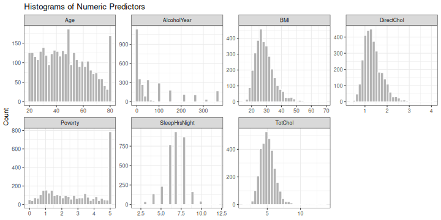
<p class="caption">plot of chunk hist-predictors</p>
</div>


``` r
nhanes_adult %>%
  select(all_of(num_vars)) %>%
  pivot_longer(everything(), names_to = "Variable", values_to = "value") %>%
  ggplot(aes(y = value)) +
  geom_boxplot(fill = "grey85") +
  facet_wrap(~ Variable, scales = "free", ncol = 4) +
  labs(title = "Boxplots of Numeric Predictors", y = NULL) +
  theme_bw() +
  theme(axis.text.x = element_blank(), axis.ticks.x = element_blank())
```

<div class="figure" style="text-align: center">
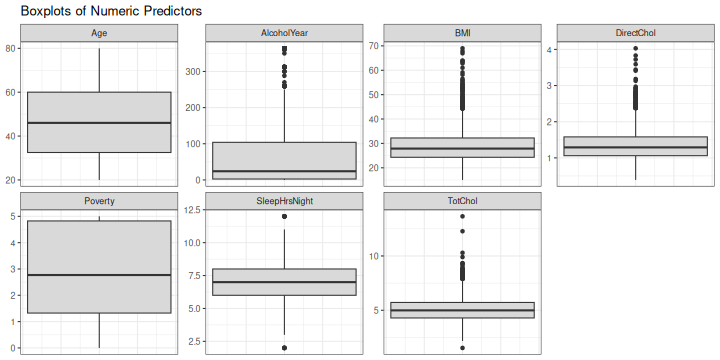
<p class="caption">plot of chunk box-predictors</p>
</div>

### 3.2 Categorical Predictors


``` r
cat_vars <- c("Gender", "Smoke100", "PhysActive")

nhanes_adult %>%
  select(all_of(cat_vars)) %>%
  mutate(across(everything(), as.character)) %>%
  pivot_longer(everything(), names_to = "Variable", values_to = "Level") %>%
  count(Variable, Level) %>%
  group_by(Variable) %>%
  mutate(Percent = round(100 * n / sum(n), 1)) %>%
  ungroup() %>%
  rename(N = n) %>%
  kable(caption = "Frequency counts for categorical predictors (model sample).")
```


Table: Frequency counts for categorical predictors (model sample).

|Variable   |Level  |    N| Percent|
|:----------|:------|----:|-------:|
|Gender     |female | 1511|    47.2|
|Gender     |male   | 1692|    52.8|
|PhysActive |No     | 1478|    46.1|
|PhysActive |Yes    | 1725|    53.9|
|Smoke100   |No     | 1660|    51.8|
|Smoke100   |Yes    | 1543|    48.2|


``` r
nhanes_adult %>%
  select(all_of(cat_vars)) %>%
  mutate(across(everything(), as.character)) %>%
  pivot_longer(everything(), names_to = "Variable", values_to = "Level") %>%
  ggplot(aes(x = Level)) +
  geom_bar(fill = "grey70") +
  facet_wrap(~ Variable, scales = "free_x", ncol = 3) +
  labs(title = "Categorical Predictors", x = NULL, y = "Count") +
  theme_bw()
```

<div class="figure" style="text-align: center">
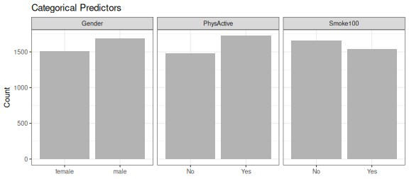
<p class="caption">plot of chunk bar-predictors</p>
</div>

## 4. Research Question: SBP vs Age by Gender


``` r
p_sbp_age <- ggplot(dat %>% filter(!is.na(Gender)),
       aes(x = Age, y = BPSysAve, colour = Gender)) +
  geom_point(alpha = 0.15, size = 0.8) +
  geom_smooth(method = "lm", se = TRUE, linewidth = 1.2) +
  labs(title = "SBP vs Age by Gender (Linear Fits)",
       x = "Age (years)", y = "Systolic BP (mm Hg)") +
  theme_bw()
print(p_sbp_age)
```

<div class="figure" style="text-align: center">
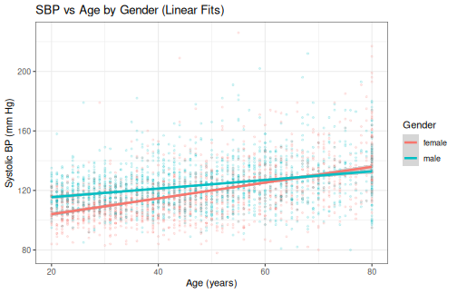
<p class="caption">plot of chunk sbp-age-lm</p>
</div>


``` r
ggplot(dat %>% filter(!is.na(Gender)),
       aes(x = Age, y = BPSysAve, colour = Gender)) +
  geom_smooth(method = "loess", se = TRUE, linewidth = 1.2) +
  labs(title = "Mean SBP by Age and Gender (Loess)",
       x = "Age (years)", y = "Systolic BP (mm Hg)") +
  theme_bw()
```

<div class="figure" style="text-align: center">
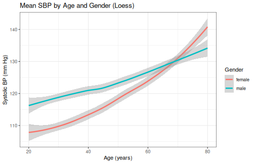
<p class="caption">plot of chunk sbp-age-loess</p>
</div>


``` r
nhanes_adult %>%
  group_by(Gender) %>%
  summarise(
    `Age slope (β)` = round(coef(lm(BPSysAve ~ Age))[2], 3),
    n = n()
  ) %>%
  kable(caption = "Simple age slope within each gender group.")
```


Table: Simple age slope within each gender group.

|Gender | Age slope (β)|    n|
|:------|-------------:|----:|
|female |         0.530| 1511|
|male   |         0.289| 1692|

## 5. Data Cleaning and Analysis

Cleaning follows three rules:
\begin{itemize}
  \item keep participants aged 20 years and older
  \item exclude rows with a missing value in any model variable, since the model can only be fit on complete cases
  \item remove duplicated IDs so that each participant appears once, ensuring independence of observations
\end{itemize}


``` r
vars_cont <- c("Age", "AlcoholYear", "BMI", "DirectChol",
               "Poverty", "SleepHrsNight", "TotChol")
vars_cat  <- c("Gender", "PhysActive", "Smoke100")

dat_raw <- NHANES %>%
  select(ID, SBP = BPSysAve, all_of(vars_cont), all_of(vars_cat))
```

### 5.1 Cleaning steps


``` r
n0 <- nrow(dat_raw)

dat_adult <- dat_raw %>% filter(Age >= 20)
n1 <- nrow(dat_adult)

dat_cc <- dat_adult %>% drop_na()
n2 <- nrow(dat_cc)

dat <- dat_cc %>% distinct(ID, .keep_all = TRUE)
n3 <- nrow(dat)

cleaning_log <- tibble(
  Step = c("Raw data",
           "Age >= 20",
           "Complete cases (no missing in any model variable)",
           "Unique participant IDs"),
  `Rows remaining` = c(n0, n1, n2, n3),
  `Rows removed`   = c(NA, n0 - n1, n1 - n2, n2 - n3)
)

kable(cleaning_log, caption = "Number of rows remaining after each cleaning step.")
```


Table: Number of rows remaining after each cleaning step.

|Step                                              | Rows remaining| Rows removed|
|:-------------------------------------------------|--------------:|------------:|
|Raw data                                          |          10000|           NA|
|Age >= 20                                         |           7235|         2765|
|Complete cases (no missing in any model variable) |           5131|         2104|
|Unique participant IDs                            |           3203|         1928|

``` r
write.csv(cleaning_log, "results/cleaning_log.csv", row.names = FALSE)
```

### 5.2 Cleaned response variable


``` r
par(mfrow = c(1, 2))
hist(dat$SBP, breaks = 40, freq = FALSE, col = "steelblue", border = "white",
     main = "Distribution of SBP", xlab = "Systolic BP (mm Hg)")
lines(density(dat$SBP), lwd = 1.5)
qqnorm(dat$SBP, main = "Normal Q-Q Plot of SBP")
qqline(dat$SBP, col = "red")
```

<div class="figure" style="text-align: center">
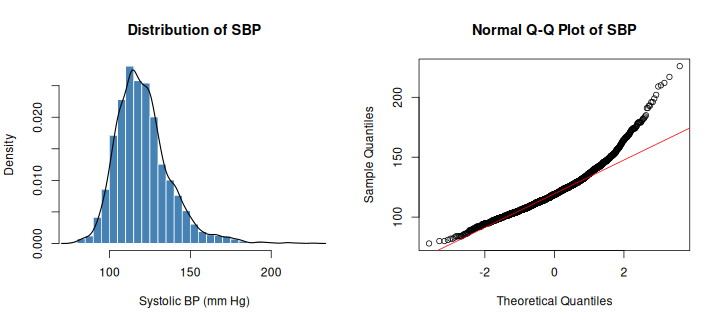
<p class="caption">plot of chunk fig-response</p>
</div>

``` r
par(mfrow = c(1, 1))
```

### 5.3 Cleaned predictor variables


``` r
cont_long <- dat %>%
  select(all_of(vars_cont)) %>%
  pivot_longer(everything(), names_to = "variable", values_to = "value")

cat_long <- dat %>%
  select(all_of(vars_cat)) %>%
  mutate(across(everything(), as.character)) %>%
  pivot_longer(everything(), names_to = "variable", values_to = "level")

p2a <- ggplot(cont_long, aes(value)) +
  geom_histogram(bins = 30, fill = "steelblue", colour = "white") +
  facet_wrap(~ variable, scales = "free", ncol = 4) +
  labs(title = "Continuous Predictors", x = NULL, y = "Count")

p2b <- ggplot(cat_long, aes(level)) +
  geom_bar(fill = "darkorange") +
  geom_text(stat = "count", aes(label = after_stat(count)),
            vjust = -0.3, size = 3) +
  facet_wrap(~ variable, scales = "free_x", nrow = 1) +
  scale_y_continuous(expand = expansion(mult = c(0, 0.12))) +
  labs(title = "Categorical Predictors", x = NULL, y = "Count")

p2a / p2b + plot_layout(heights = c(2, 1))
```

```
## Error:
## ! Can't find method for generic `/(e1, e2)`:
## - e1: <ggplot2::ggplot>
## - e2: <ggplot2::ggplot>
```


``` r
ggplot(cont_long, aes(x = "", y = value)) +
  geom_boxplot(fill = "lightblue", outlier.colour = "red", outlier.alpha = 0.4) +
  facet_wrap(~ variable, scales = "free_y", nrow = 2) +
  labs(title = "Boxplots of Continuous Predictors", x = NULL, y = NULL)
```

<div class="figure" style="text-align: center">
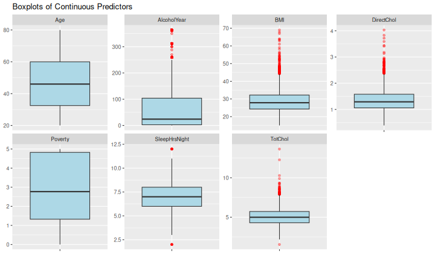
<p class="caption">plot of chunk fig-boxplots</p>
</div>


``` r
dat %>%
  select(SBP, all_of(vars_cont)) %>%
  pivot_longer(everything(), names_to = "Variable", values_to = "value") %>%
  group_by(Variable) %>%
  summarise(
    Mean   = round(mean(value), 2),
    SD     = round(sd(value), 2),
    Min    = round(min(value), 2),
    Median = round(median(value), 2),
    Max    = round(max(value), 2),
    .groups = "drop"
  ) %>%
  kable(caption = "Summary statistics for SBP and the continuous predictors (cleaned data).")
```


Table: Summary statistics for SBP and the continuous predictors (cleaned data).

|Variable      |   Mean|     SD|   Min| Median|    Max|
|:-------------|------:|------:|-----:|------:|------:|
|Age           |  47.05|  17.04| 20.00|  46.00|  80.00|
|AlcoholYear   |  72.08| 101.52|  0.00|  24.00| 364.00|
|BMI           |  28.93|   6.66| 15.02|  27.87|  69.00|
|DirectChol    |   1.36|   0.42|  0.39|   1.29|   4.03|
|Poverty       |   2.88|   1.66|  0.00|   2.77|   5.00|
|SBP           | 121.00|  16.97| 78.00| 119.00| 226.00|
|SleepHrsNight |   6.87|   1.34|  2.00|   7.00|  12.00|
|TotChol       |   5.07|   1.07|  1.53|   4.99|  13.65|

### 5.4 Cleaned age by gender interaction


``` r
ggplot(dat, aes(x = Age, y = SBP, colour = Gender)) +
  geom_point(alpha = 0.15, size = 0.8) +
  geom_smooth(method = "lm", se = TRUE, linewidth = 1.1) +
  labs(title = "SBP vs Age by Gender",
       x = "Age (years)", y = "Systolic BP (mm Hg)") +
  theme_bw()
```

<div class="figure" style="text-align: center">
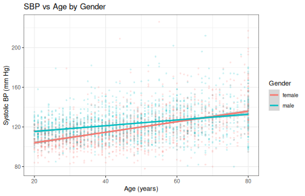
<p class="caption">plot of chunk fig-age-gender</p>
</div>

### 5.5 Save the cleaned data


``` r
write_csv(dat, "NHANES_cleaned.csv")
```

```
## Error in `write_csv()`:
## ! could not find function "write_csv"
```

## 6. Preliminary Model


``` r
model_prelim <- lm(
  BPSysAve ~ Age + BMI + DirectChol + TotChol + Poverty +
    SleepHrsNight + AlcoholYear +
    Gender + Smoke100 + PhysActive +
    Gender:Age,
  data = nhanes_adult
)

b <- coef(model_prelim)
slope_f   <- unname(b["Age"])                                # female age slope
slope_m   <- unname(b["Age"] + b["Age:Gendermale"])          # male age slope
cross_age <- unname(-b["Gendermale"] / b["Age:Gendermale"])  # age where gap = 0
mean_age  <- mean(nhanes_adult$Age)
gap_mean  <- unname(b["Gendermale"] + b["Age:Gendermale"] * mean_age)

kable(
  tibble(
    Quantity = c("Female age slope (mm Hg/yr)", "Male age slope (mm Hg/yr)",
                 "Male − female gap at mean age (mm Hg)",
                 "Age at which fitted gap reaches 0",
                 "Participants in model sample"),
    Value = c(round(slope_f, 3), round(slope_m, 3),
              round(gap_mean, 2), round(cross_age, 1),
              nrow(nhanes_adult))
  ),
  caption = "Quantities derived from the preliminary model, used in the written discussion."
)
```


Table: Quantities derived from the preliminary model, used in the written discussion.

|Quantity                              |    Value|
|:-------------------------------------|--------:|
|Female age slope (mm Hg/yr)           |    0.522|
|Male age slope (mm Hg/yr)             |    0.301|
|Male − female gap at mean age (mm Hg) |    5.140|
|Age at which fitted gap reaches 0     |   70.300|
|Participants in model sample          | 3203.000|

## 7. Model Results


``` r
term_labels <- c(
  "(Intercept)"    = "Intercept",
  "Age"            = "Age (years) [female slope]",
  "BMI"            = "BMI (kg/m²)",
  "DirectChol"     = "HDL cholesterol (mmol/L)",
  "TotChol"        = "Total cholesterol (mmol/L)",
  "Poverty"        = "Poverty ratio",
  "SleepHrsNight"  = "Sleep (hours/night)",
  "AlcoholYear"    = "Alcohol (days/year)",
  "Gendermale"     = "Male (ref = female)",
  "Smoke100Yes"    = "Ever smoked 100+ cigarettes (ref = no)",
  "PhysActiveYes"  = "Physically active (ref = no)",
  "Age:Gendermale" = "Age × Male"
)

coef_tab <- tidy(model_prelim, conf.int = TRUE) %>%
  mutate(
    term    = dplyr::recode(term, !!!term_labels),
    `95% CI` = sprintf("[%.3f, %.3f]", conf.low, conf.high),
    p.value = ifelse(p.value < 0.001, "< 0.001", sprintf("%.3f", p.value))
  ) %>%
  select(Predictor = term, Estimate = estimate, SE = std.error,
         `95% CI`, `p-value` = p.value)

fit <- glance(model_prelim)

kable(
  coef_tab, digits = 3, align = "lrrcr",
  caption = sprintf(
    "Table 1. Preliminary model of systolic blood pressure (mm Hg), adults 20+, n = %s. R² = %.3f, adjusted R² = %.3f, residual SE = %.2f.",
    format(nobs(model_prelim), big.mark = ","), fit$r.squared,
    fit$adj.r.squared, fit$sigma)
)
```


Table: Table 1. Preliminary model of systolic blood pressure (mm Hg), adults 20+, n = 3,203. R² = 0.225, adjusted R² = 0.223, residual SE = 14.96.

|Predictor                              | Estimate|    SE|      95% CI      | p-value|
|:--------------------------------------|--------:|-----:|:----------------:|-------:|
|Intercept                              |   83.135| 2.769| [77.707, 88.564] | < 0.001|
|Age (years) [female slope]             |    0.522| 0.023|  [0.476, 0.567]  | < 0.001|
|BMI (kg/m²)                            |    0.246| 0.043|  [0.161, 0.331]  | < 0.001|
|HDL cholesterol (mmol/L)               |    1.075| 0.764| [-0.423, 2.572]  |   0.159|
|Total cholesterol (mmol/L)             |    0.934| 0.257|  [0.430, 1.437]  | < 0.001|
|Poverty ratio                          |   -1.081| 0.170| [-1.414, -0.748] | < 0.001|
|Sleep (hours/night)                    |   -0.103| 0.199| [-0.494, 0.288]  |   0.606|
|Alcohol (days/year)                    |    0.008| 0.003|  [0.003, 0.014]  |   0.004|
|Male (ref = female)                    |   15.542| 1.575| [12.454, 18.629] | < 0.001|
|Ever smoked 100+ cigarettes (ref = no) |    0.117| 0.553| [-0.967, 1.201]  |   0.833|
|Physically active (ref = no)           |    0.820| 0.565| [-0.289, 1.928]  |   0.147|
|Age × Male                             |   -0.221| 0.031| [-0.283, -0.159] | < 0.001|

``` r
write.csv(coef_tab, "results/table1_coefficients.csv", row.names = FALSE)
```


## 8. Assumption Assessment

**We do not correct any violations at this stage.**

We first check the two conditions that tell us whether residual plots can be trusted,
then the four assumptions.

### 8.1 Conditions


``` r
plot(fitted(model_prelim), nhanes_adult$BPSysAve,
     main = "Observed vs Fitted", xlab = "Fitted SBP (mm Hg)",
     ylab = "Observed SBP (mm Hg)", pch = ".", col = rgb(0, 0, 0, 0.3))
abline(0, 1, col = "red", lty = 2)
```

<div class="figure" style="text-align: center">
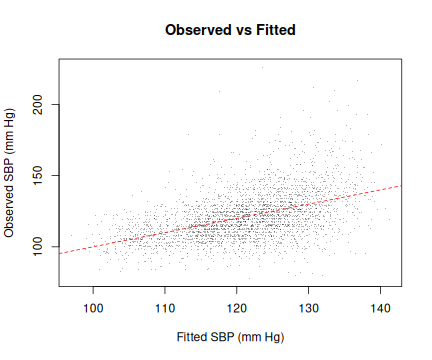
<p class="caption">plot of chunk conditions</p>
</div>


``` r
pairs(nhanes_adult[, num_vars], pch = ".", col = rgb(0, 0, 0, 0.3),
      main = "Pairwise plots of numeric predictors", gap = 0.3)
```

<div class="figure" style="text-align: center">
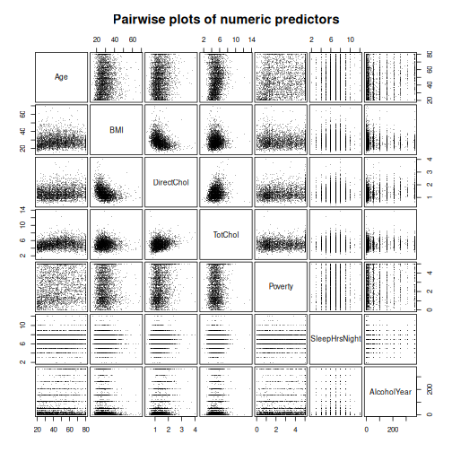
<p class="caption">plot of chunk pairs-plot</p>
</div>

### 8.2 Residual plots


``` r
par(mfrow = c(1, 2))
plot(fitted(model_prelim), resid(model_prelim),
     main = "Residuals vs Fitted", xlab = "Fitted SBP (mm Hg)", ylab = "Residuals",
     pch = ".", col = rgb(0, 0, 0, 0.3))
abline(h = 0, col = "red", lty = 2)
qqnorm(rstandard(model_prelim), main = "Normal Q-Q",
       xlab = "Theoretical quantiles", ylab = "Standardized residuals",
       pch = ".", col = rgb(0, 0, 0, 0.3))
qqline(rstandard(model_prelim), col = "red", lty = 2)
```

<div class="figure" style="text-align: center">
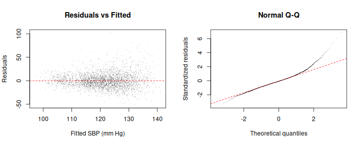
<p class="caption">plot of chunk resid-fitted-qq</p>
</div>

``` r
par(mfrow = c(1, 1))
```


``` r
par(mfrow = c(2, 4))
for (v in num_vars) {
  plot(nhanes_adult[[v]], resid(model_prelim),
       main = paste("Residuals vs", v), xlab = v, ylab = "Residuals",
       pch = ".", col = rgb(0, 0, 0, 0.3))
  abline(h = 0, col = "red", lty = 2)
}
par(mfrow = c(1, 1))
```

<div class="figure" style="text-align: center">
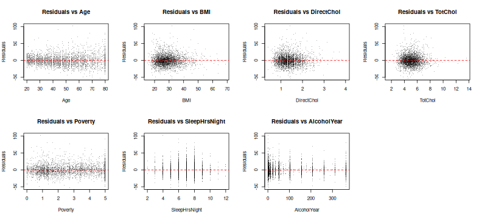
<p class="caption">plot of chunk resid-predictors-num</p>
</div>


``` r
par(mfrow = c(1, 3))
for (v in cat_vars) {
  boxplot(resid(model_prelim) ~ nhanes_adult[[v]],
          main = paste("Residuals vs", v), xlab = v, ylab = "Residuals",
          col = "grey85")
  abline(h = 0, col = "red", lty = 2)
}
```

<div class="figure" style="text-align: center">
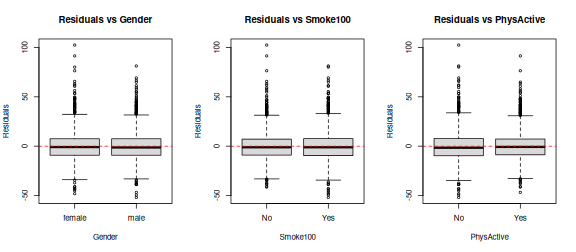
<p class="caption">plot of chunk resid-predictors-cat</p>
</div>

``` r
par(mfrow = c(1, 1))
```


``` r
diag_df <- augment(model_prelim)
diag_df %>%
  mutate(`Fitted quintile` = ntile(.fitted, 5)) %>%
  group_by(`Fitted quintile`) %>%
  summarise(`Fitted range` = sprintf("%.0f–%.0f", min(.fitted), max(.fitted)),
            `Residual SD` = round(sd(.resid), 2), .groups = "drop") %>%
  kable(caption = "Residual spread by fitted-value quintile.")
```


Table: Residual spread by fitted-value quintile.

| Fitted quintile|Fitted range | Residual SD|
|---------------:|:------------|-----------:|
|               1|97–114       |       10.67|
|               2|114–119      |       12.63|
|               3|119–124      |       14.12|
|               4|124–128      |       15.90|
|               5|128–141      |       19.70|

## 9. Addressing Non-linearity in Age

The residuals vs Age plot in Section 8 shows a U-shaped pattern, suggesting the relationship between SBP and Age is not purely linear. We add a quadratic term `I(Age^2)` and its interaction with Gender to allow the curvature to differ by sex.


``` r
model_quad <- lm(
  BPSysAve ~ Age + I(Age^2) + BMI + DirectChol + TotChol + Poverty +
    SleepHrsNight + AlcoholYear +
    Gender + Smoke100 + PhysActive +
    Gender:Age + Gender:I(Age^2),
  data = nhanes_adult
)
```


``` r
fit_prelim <- glance(model_prelim)
fit_quad   <- glance(model_quad)

tibble(
  Model        = c("Linear Age", "Quadratic Age"),
  `R²`         = round(c(fit_prelim$r.squared, fit_quad$r.squared), 4),
  `Adj. R²`    = round(c(fit_prelim$adj.r.squared, fit_quad$adj.r.squared), 4),
  AIC          = round(c(fit_prelim$AIC, fit_quad$AIC), 1),
  `Resid. SE`  = round(c(fit_prelim$sigma, fit_quad$sigma), 3)
) %>%
  kable(caption = "Model comparison: linear vs quadratic Age term.")
```


Table: Model comparison: linear vs quadratic Age term.

|Model         |     R²| Adj. R²|     AIC| Resid. SE|
|:-------------|------:|-------:|-------:|---------:|
|Linear Age    | 0.2253|  0.2226| 26435.8|    14.963|
|Quadratic Age | 0.2341|  0.2309| 26403.4|    14.883|

Adding the quadratic Age terms yields a modest improvement in fit: R² increases from 0.2253 to 0.2341 (a gain of 0.0088), and adjusted R² from 0.2226 to 0.2309. The AIC drops by 32.4 points, which is considered substantial (> 10), and residual SE decreases from 14.963 to 14.883 mm Hg. While the absolute gain in explained variance is small, the consistent improvement across all metrics suggests the quadratic term is capturing a real, if modest, non-linearity in the age–SBP relationship.


``` r
par(mfrow = c(1, 2))
plot(fitted(model_quad), resid(model_quad),
     main = "Residuals vs Fitted (Quadratic)", xlab = "Fitted SBP (mm Hg)", ylab = "Residuals",
     pch = ".", col = rgb(0, 0, 0, 0.3))
abline(h = 0, col = "red", lty = 2)
plot(nhanes_adult$Age, resid(model_quad),
     main = "Residuals vs Age (Quadratic)", xlab = "Age (years)", ylab = "Residuals",
     pch = ".", col = rgb(0, 0, 0, 0.3))
abline(h = 0, col = "red", lty = 2)
```

<div class="figure" style="text-align: center">
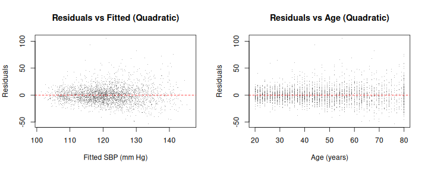
<p class="caption">plot of chunk resid-quad</p>
</div>

``` r
par(mfrow = c(1, 1))
```

## 10. Box-Cox Transformation

### 10.1 Response Transformation

We apply Box-Cox to the preliminary model to determine whether a transformation of SBP would better satisfy the normality assumption.


``` r
####################################
### uncomment and run to view Box-Cox profile, then comment back ###
# summary(powerTransform(model_prelim))
# MASS::boxcox(model_prelim, lambda = seq(-2, 2, by = 0.05))
####################################

suppressWarnings(summary(powerTransform(model_prelim)))
```

```
## bcPower Transformation to Normality 
##    Est Power Rounded Pwr Wald Lwr Bnd Wald Upr Bnd
## Y1   -0.9496          -1      -1.1332      -0.7661
## 
## Likelihood ratio test that transformation parameter is equal to 0
##  (log transformation)
##                            LRT df       pval
## LR test, lambda = (0) 105.9884  1 < 2.22e-16
## 
## Likelihood ratio test that no transformation is needed
##                            LRT df       pval
## LR test, lambda = (1) 462.2178  1 < 2.22e-16
```

``` r
MASS::boxcox(model_prelim, lambda = seq(-2, 2, by = 0.05))
```

<div class="figure" style="text-align: center">
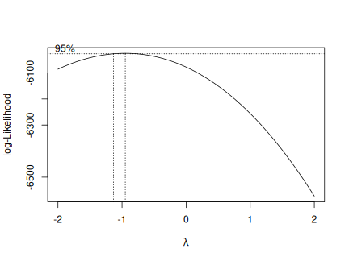
<p class="caption">plot of chunk boxcox-response</p>
</div>

The output suggests $\lambda \approx -1$, and $\lambda = 1$ (no transformation) falls outside the 95% CI. We round to the nearest interpretable value: $\lambda = -1$, i.e. an **inverse transformation** $1/\text{SBP}$ (n = 3203).


``` r
SBP_inv <- 1 / nhanes_adult$BPSysAve

model_bc <- lm(
  SBP_inv ~ Age + BMI + DirectChol + TotChol + Poverty +
    SleepHrsNight + AlcoholYear +
    Gender + Smoke100 + PhysActive +
    Gender:Age,
  data = nhanes_adult
)
```

#### Residuals vs Fitted and Q-Q Plot


``` r
par(mfrow = c(1, 2))
plot(fitted(model_bc), resid(model_bc),
     main = "Residuals vs Fitted (Inverse SBP)",
     xlab = "Fitted 1/SBP", ylab = "Residuals",
     pch = ".", col = rgb(0, 0, 0, 0.3))
abline(h = 0, col = "red", lty = 2)
qqnorm(rstandard(model_bc), main = "Normal Q-Q (Inverse SBP)",
       xlab = "Theoretical quantiles", ylab = "Standardized residuals",
       pch = ".", col = rgb(0, 0, 0, 0.3))
qqline(rstandard(model_bc), col = "red", lty = 2)
```

<div class="figure" style="text-align: center">
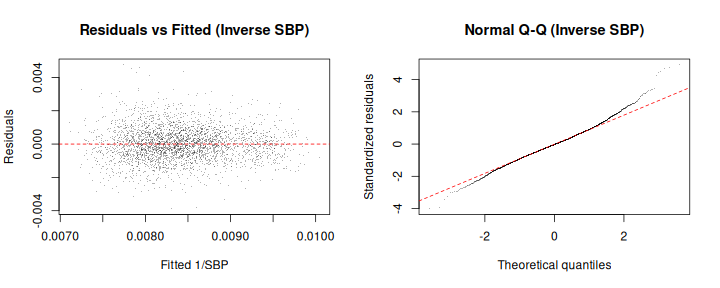
<p class="caption">plot of chunk bc-resid-qq</p>
</div>

``` r
par(mfrow = c(1, 1))
```

#### Residuals vs Predictors


``` r
par(mfrow = c(2, 4))
for (v in num_vars) {
  plot(nhanes_adult[[v]], resid(model_bc),
       main = paste("Residuals vs", v), xlab = v, ylab = "Residuals",
       pch = ".", col = rgb(0, 0, 0, 0.3))
  abline(h = 0, col = "red", lty = 2)
}
par(mfrow = c(1, 1))
```

<div class="figure" style="text-align: center">
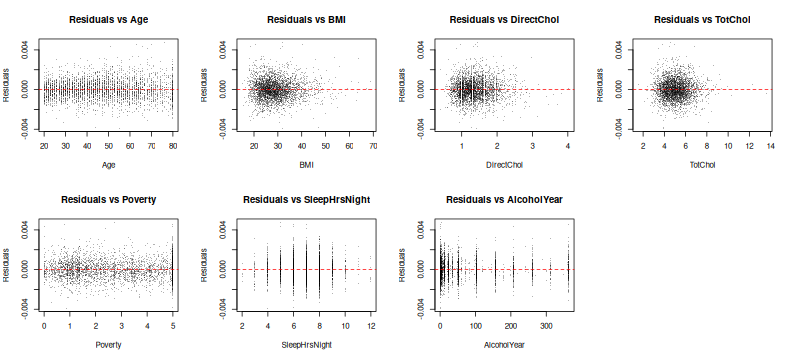
<p class="caption">plot of chunk bc-resid-num</p>
</div>


``` r
par(mfrow = c(1, 3))
for (v in cat_vars) {
  boxplot(resid(model_bc) ~ nhanes_adult[[v]],
          main = paste("Residuals vs", v), xlab = v, ylab = "Residuals",
          col = "grey85")
  abline(h = 0, col = "red", lty = 2)
}
```

<div class="figure" style="text-align: center">
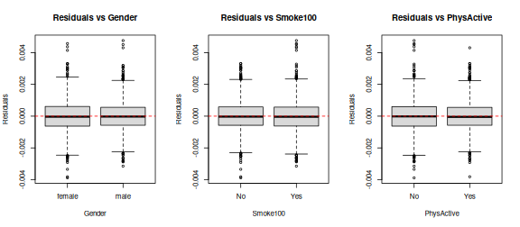
<p class="caption">plot of chunk bc-resid-cat</p>
</div>

``` r
par(mfrow = c(1, 1))
```

#### Constant Variance Check


``` r
data.frame(fitted_bc = fitted(model_bc), resid_bc = resid(model_bc)) %>%
  mutate(quintile = ntile(fitted_bc, 5)) %>%
  group_by(quintile) %>%
  summarise(`Fitted range` = sprintf("%.5f–%.5f", min(fitted_bc), max(fitted_bc)),
            `Residual SD` = round(sd(resid_bc), 6), .groups = "drop") %>%
  kable(caption = "Residual spread by fitted-value quintile (inverse SBP model).")
```


Table: Residual spread by fitted-value quintile (inverse SBP model).

| quintile|Fitted range    | Residual SD|
|--------:|:---------------|-----------:|
|        1|0.00710–0.00796 |    0.001121|
|        2|0.00796–0.00823 |    0.000984|
|        3|0.00823–0.00849 |    0.000954|
|        4|0.00849–0.00884 |    0.000881|
|        5|0.00884–0.01005 |    0.000875|

### 10.2 Predictor Transformations

`MASS::boxcox()` only assesses the response. We use `car::powerTransform()` to check whether any numeric predictors also need transforming. `AlcoholYear` and `Poverty` contain zeros and are excluded.


``` r
pos_vars <- c("Age", "BMI", "DirectChol", "TotChol", "SleepHrsNight")

####################################
### uncomment and run to view suggested lambdas, then comment back ###
# summary(powerTransform(nhanes_adult[, pos_vars]))
####################################
```

The output suggests: Age $\approx 1/3$ (cube root), DirectChol $\approx 0$ (log), TotChol $\approx 0$ (log), SleepHrsNight $\approx 3/2$. BMI's CI does not include a clean value so it is left untransformed.


``` r
Age_bc        <- nhanes_adult$Age^(1/3)
DirectChol_bc <- log(nhanes_adult$DirectChol)
TotChol_bc    <- log(nhanes_adult$TotChol)
SleepHrs_bc   <- nhanes_adult$SleepHrsNight^(3/2)

model_all_bc <- lm(
  SBP_inv ~ Age_bc + BMI + DirectChol_bc + TotChol_bc + Poverty +
    SleepHrs_bc + AlcoholYear +
    Gender + Smoke100 + PhysActive +
    Gender:Age_bc,
  data = nhanes_adult
)
```

### 10.3 Model Comparison

We compare three models side by side: untransformed, response-only transformed (1/SBP), and fully transformed (1/SBP + predictor transformations). Each row shows residuals against a different variable; each column is a model.


``` r
par(mfrow = c(5, 3))

plot(fitted(model_prelim), resid(model_prelim), main = "Untransformed",
     xlab = "Fitted", ylab = "Residuals", pch = ".", col = rgb(0,0,0,0.3))
abline(h = 0, col = "red", lty = 2)
plot(fitted(model_bc), resid(model_bc), main = "Transformed Y only",
     xlab = "Fitted", ylab = "Residuals", pch = ".", col = rgb(0,0,0,0.3))
abline(h = 0, col = "red", lty = 2)
plot(fitted(model_all_bc), resid(model_all_bc), main = "All Transformed",
     xlab = "Fitted", ylab = "Residuals", pch = ".", col = rgb(0,0,0,0.3))
abline(h = 0, col = "red", lty = 2)

plot(nhanes_adult$Age, resid(model_prelim), main = "Untransformed",
     xlab = "Age", ylab = "Residuals", pch = ".", col = rgb(0,0,0,0.3))
abline(h = 0, col = "red", lty = 2)
plot(nhanes_adult$Age, resid(model_bc), main = "Transformed Y only",
     xlab = "Age", ylab = "Residuals", pch = ".", col = rgb(0,0,0,0.3))
abline(h = 0, col = "red", lty = 2)
plot(Age_bc, resid(model_all_bc), main = "All Transformed",
     xlab = "Age^(1/3)", ylab = "Residuals", pch = ".", col = rgb(0,0,0,0.3))
abline(h = 0, col = "red", lty = 2)

plot(nhanes_adult$DirectChol, resid(model_prelim), main = "Untransformed",
     xlab = "DirectChol", ylab = "Residuals", pch = ".", col = rgb(0,0,0,0.3))
abline(h = 0, col = "red", lty = 2)
plot(nhanes_adult$DirectChol, resid(model_bc), main = "Transformed Y only",
     xlab = "DirectChol", ylab = "Residuals", pch = ".", col = rgb(0,0,0,0.3))
abline(h = 0, col = "red", lty = 2)
plot(DirectChol_bc, resid(model_all_bc), main = "All Transformed",
     xlab = "log(DirectChol)", ylab = "Residuals", pch = ".", col = rgb(0,0,0,0.3))
abline(h = 0, col = "red", lty = 2)

plot(nhanes_adult$TotChol, resid(model_prelim), main = "Untransformed",
     xlab = "TotChol", ylab = "Residuals", pch = ".", col = rgb(0,0,0,0.3))
abline(h = 0, col = "red", lty = 2)
plot(nhanes_adult$TotChol, resid(model_bc), main = "Transformed Y only",
     xlab = "TotChol", ylab = "Residuals", pch = ".", col = rgb(0,0,0,0.3))
abline(h = 0, col = "red", lty = 2)
plot(TotChol_bc, resid(model_all_bc), main = "All Transformed",
     xlab = "log(TotChol)", ylab = "Residuals", pch = ".", col = rgb(0,0,0,0.3))
abline(h = 0, col = "red", lty = 2)

plot(nhanes_adult$SleepHrsNight, resid(model_prelim), main = "Untransformed",
     xlab = "SleepHrsNight", ylab = "Residuals", pch = ".", col = rgb(0,0,0,0.3))
abline(h = 0, col = "red", lty = 2)
plot(nhanes_adult$SleepHrsNight, resid(model_bc), main = "Transformed Y only",
     xlab = "SleepHrsNight", ylab = "Residuals", pch = ".", col = rgb(0,0,0,0.3))
abline(h = 0, col = "red", lty = 2)
plot(SleepHrs_bc, resid(model_all_bc), main = "All Transformed",
     xlab = "Sleep^(3/2)", ylab = "Residuals", pch = ".", col = rgb(0,0,0,0.3))
abline(h = 0, col = "red", lty = 2)
```

<div class="figure" style="text-align: center">
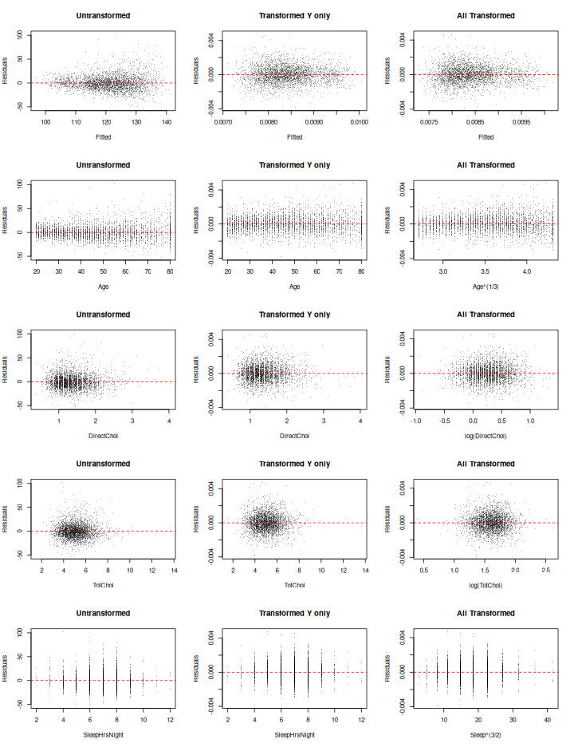
<p class="caption">plot of chunk boxcox-compare</p>
</div>

``` r
par(mfrow = c(1, 1))
```


``` r
par(mfrow = c(1, 3))
qqnorm(rstandard(model_prelim), main = "Untransformed",
       pch = ".", col = rgb(0,0,0,0.3))
qqline(rstandard(model_prelim), col = "red", lty = 2)
qqnorm(rstandard(model_bc), main = "Transformed Y only",
       pch = ".", col = rgb(0,0,0,0.3))
qqline(rstandard(model_bc), col = "red", lty = 2)
qqnorm(rstandard(model_all_bc), main = "All Transformed",
       pch = ".", col = rgb(0,0,0,0.3))
qqline(rstandard(model_all_bc), col = "red", lty = 2)
```

<div class="figure" style="text-align: center">
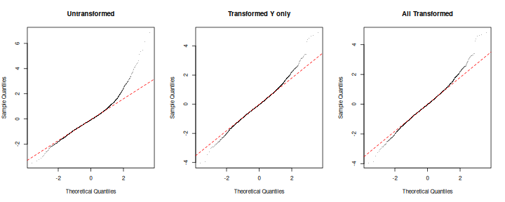
<p class="caption">plot of chunk boxcox-qq</p>
</div>

``` r
par(mfrow = c(1, 1))
```

## 11. Leverage, Outliers, Influence and Collinearity

Note: use the current working model: 1/SBP response, transformed predictors, Age x Gender interaction.
(If we add Age^2 or switch to log(BMI) etc. later, rebuild `nhanes_t` and `model_work` and rerun this section.)


``` r
# Put every transformed variable INSIDE a data frame, so that refits on a subset
# (dropping unusual points) and influence measures work properly.
nhanes_t <- nhanes_adult %>%
  mutate(SBP_inv       = 1 / BPSysAve,
         Age_bc        = Age^(1/3),
         DirectChol_bc = log(DirectChol),
         TotChol_bc    = log(TotChol),
         SleepHrs_bc   = SleepHrsNight^(3/2))

model_work <- lm(
  SBP_inv ~ Age_bc + BMI + DirectChol_bc + TotChol_bc + Poverty +
    SleepHrs_bc + AlcoholYear + Gender + Smoke100 + PhysActive +
    Gender:Age_bc,
  data = nhanes_t
)

n <- nobs(model_work)
p <- length(coef(model_work)) - 1          # number of predictors (columns of X minus intercept)
```

### 11.1 Leverage

High leverage = unusual combination of predictor values.
Rule of thumb: h_ii > 2(p+1)/n is "high", h_ii > 3(p+1)/n is "very high"; h_ii close to 1 is extreme.


``` r
h <- hatvalues(model_work)
h_cut <- 2 * (p + 1) / n

cat("Cutoff 2(p+1)/n =", round(h_cut, 4), "\n")
```

```
## Cutoff 2(p+1)/n = 0.0075
```

``` r
cat("High leverage points (> 2(p+1)/n):", sum(h > h_cut), "\n")
```

```
## High leverage points (> 2(p+1)/n): 63
```

``` r
cat("Very high leverage (> 3(p+1)/n):  ", sum(h > 1.5 * h_cut), "\n")
```

```
## Very high leverage (> 3(p+1)/n):   15
```

``` r
cat("Maximum leverage:", round(max(h), 4), "\n")
```

```
## Maximum leverage: 0.016
```

``` r
plot(h, pch = ".", cex = 3, col = rgb(0, 0, 0, 0.4),
     main = "Leverage (hat values)", xlab = "Observation", ylab = expression(h[ii]))
abline(h = c(h_cut, 1.5 * h_cut), col = c("orange", "red"), lty = 2)
```

<div class="figure" style="text-align: center">
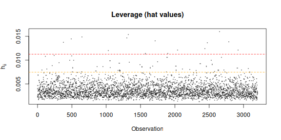
<p class="caption">plot of chunk leverage</p>
</div>


``` r
# Which predictor values make these points unusual?
nhanes_t %>%
  mutate(row = row_number(), leverage = h) %>%
  arrange(desc(leverage)) %>%
  select(row, leverage, BPSysAve, Age, BMI, DirectChol, TotChol, Poverty,
         SleepHrsNight, AlcoholYear, Gender) %>%
  head(15) %>%
  { lev_tab <<- .; . } %>%
  kable(digits = 3, caption = "15 highest-leverage observations.")
```


Table: 15 highest-leverage observations.

|  row| leverage| BPSysAve| Age|   BMI| DirectChol| TotChol| Poverty| SleepHrsNight| AlcoholYear|Gender |
|----:|--------:|--------:|---:|-----:|----------:|-------:|-------:|-------------:|-----------:|:------|
| 2653|    0.016|      148|  46| 62.80|       1.55|    5.56|    3.78|             4|         364|female |
| 1323|    0.015|      124|  39| 67.83|       0.96|    6.10|    1.02|            10|           2|female |
|  647|    0.015|      134|  60| 66.96|       1.84|    5.38|    0.84|             6|          12|female |
| 1300|    0.015|       92|  37| 63.91|       1.37|    3.96|    1.81|             3|         104|male   |
|  491|    0.014|       95|  70| 53.78|       2.97|    5.15|    5.00|             7|         364|female |
| 1712|    0.014|      139|  43| 28.82|       0.62|   13.65|    1.12|             8|         208|male   |
| 2784|    0.014|      108|  30| 69.00|       0.96|    4.42|    1.52|             8|           5|female |
|  375|    0.014|      124|  70| 63.89|       1.40|    3.70|    3.43|             5|           0|female |
| 2473|    0.014|       98|  25| 21.50|       0.83|    1.53|    0.22|             5|           2|female |
| 2439|    0.012|      129|  80| 23.50|       0.67|    2.30|    1.63|             8|           0|female |
| 2919|    0.012|      132|  31| 63.30|       0.93|    3.90|    2.72|             6|         156|male   |
| 2040|    0.012|      120|  50| 36.50|       0.70|   12.28|    0.73|             5|           0|female |
| 1031|    0.012|      141|  80| 15.86|       2.38|    6.36|    5.00|            12|          12|female |
| 1896|    0.011|      132|  72| 41.70|       0.67|    2.40|    1.12|             5|           0|female |
| 1569|    0.011|      103|  22| 61.01|       0.80|    3.49|    0.66|             6|           1|female |

``` r
write.csv(lev_tab, "results/leverage_top15.csv", row.names = FALSE)
```

### 11.2 Outliers (standardized residuals)

Under normal errors, about 5% of |r_i| exceed 2 and about 0.3% exceed 3. Many more than that, or any beyond ~4,
deserve a look.


``` r
r <- rstandard(model_work)

tibble(Threshold = c("|r| > 2", "|r| > 3", "|r| > 4"),
       Count     = c(sum(abs(r) > 2), sum(abs(r) > 3), sum(abs(r) > 4)),
       Percent   = round(100 * Count / n, 2),
       `Expected if normal (%)` = c(4.55, 0.27, 0.006)) %>%
  kable(caption = "Standardized-residual outliers.")
```


Table: Standardized-residual outliers.

|Threshold         | Count| Percent| Expected if normal (%)|
|:-----------------|-----:|-------:|----------------------:|
|&#124;r&#124; > 2 |   171|    5.34|                  4.550|
|&#124;r&#124; > 3 |    25|    0.78|                  0.270|
|&#124;r&#124; > 4 |     6|    0.19|                  0.006|

``` r
par(mfrow = c(1, 2))
plot(fitted(model_work), r, pch = ".", cex = 3, col = rgb(0, 0, 0, 0.4),
     main = "Standardized residuals vs Fitted", xlab = "Fitted 1/SBP", ylab = "Standardized residual")
abline(h = c(-3, 3), col = "red", lty = 2)
plot(h, r, pch = ".", cex = 3, col = rgb(0, 0, 0, 0.4),
     main = "Leverage vs standardized residual", xlab = "Leverage", ylab = "Standardized residual")
abline(h = c(-3, 3), v = h_cut, col = "red", lty = 2)
```

<div class="figure" style="text-align: center">
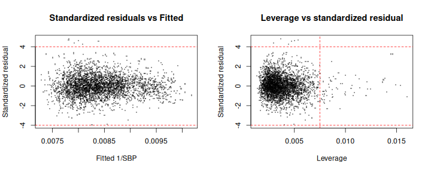
<p class="caption">plot of chunk outliers</p>
</div>

``` r
par(mfrow = c(1, 1))
```


``` r
nhanes_t %>%
  mutate(row = row_number(), std_resid = r) %>%
  filter(abs(std_resid) > 3) %>%
  arrange(desc(abs(std_resid))) %>%
  select(row, std_resid, BPSysAve, Age, Gender, BMI, DirectChol, TotChol, Poverty) %>%
  head(20) %>%
  { out_tab <<- .; . } %>%
  kable(digits = 2, caption = "Observations with |standardized residual| > 3.")
```


Table: Observations with |standardized residual| > 3.

|  row| std_resid| BPSysAve| Age|Gender |   BMI| DirectChol| TotChol| Poverty|
|----:|---------:|--------:|---:|:------|-----:|----------:|-------:|-------:|
|  451|      4.82|       80|  76|male   | 32.15|       1.45|    4.60|    2.75|
| 2564|      4.67|       81|  63|male   | 20.60|       1.40|    4.97|    0.81|
|   47|      4.63|       80|  70|female | 40.46|       0.98|    3.80|    5.00|
| 1172|      4.56|       78|  51|female | 18.62|       1.32|    6.88|    0.00|
|  266|      4.39|       82|  66|male   | 32.14|       1.45|    4.47|    5.00|
|  278|      4.23|       82|  68|female | 31.04|       0.85|    3.47|    2.40|
|  603|     -3.94|      226|  55|female | 31.98|       1.42|    3.90|    0.85|
| 2217|     -3.88|      209|  44|female | 47.00|       1.29|    3.96|    5.00|
| 1052|     -3.47|      179|  29|female | 30.64|       0.93|    8.15|    0.27|
| 1602|      3.42|       89|  64|female | 23.89|       1.91|    5.40|    0.01|
|   82|      3.38|       86|  61|female | 23.07|       2.12|    6.05|    5.00|
| 2532|      3.31|       84|  48|female | 23.20|       1.24|    4.22|    5.00|
|   11|      3.29|       90|  54|male   | 36.32|       1.60|    4.81|    3.28|
| 1300|      3.26|       92|  37|male   | 63.91|       1.37|    3.96|    1.81|
|  302|     -3.25|      212|  68|male   | 18.41|       2.17|    3.88|    1.29|
|  491|      3.25|       95|  70|female | 53.78|       2.97|    5.15|    5.00|
| 1295|      3.23|       89|  46|male   | 18.19|       1.53|    4.76|    0.66|
| 2137|      3.19|       86|  49|female | 23.10|       1.40|    5.02|    3.36|
| 2845|      3.15|       85|  26|male   | 24.20|       1.14|    3.52|    0.81|
| 1078|     -3.14|      210|  80|female | 19.87|       1.58|    4.91|    2.75|

``` r
write.csv(out_tab, "results/outliers_std_resid.csv", row.names = FALSE)
```

### 11.3 Influence

A point matters most when it has BOTH high leverage and a large residual. Cook's distance and DFFITS combine
the two; DFBETAS shows the effect on each coefficient (we care most about the Age x Gender term).


``` r
cd <- cooks.distance(model_work)
dffits_v <- dffits(model_work)
dfb <- dfbetas(model_work)

cd_cut     <- qf(0.5, p + 1, n - p - 1)   # median of F(p+1, n-p-1) — class cutoff
dffits_cut <- 2 * sqrt((p + 1) / n)
dfb_cut    <- 2 / sqrt(n)
int_col    <- "Age_bc:Gendermale"

cat("Cook's D cutoff qf(0.5, p+1, n-p-1) =", round(cd_cut, 4), "\n")
```

```
## Cook's D cutoff qf(0.5, p+1, n-p-1) = 0.9452
```

``` r
cat("Cook's D > cutoff:", sum(cd > cd_cut), "  Max Cook's D:", round(max(cd), 4), "\n")
```

```
## Cook's D > cutoff: 0   Max Cook's D: 0.0131
```

``` r
cat("|DFFITS| > 2*sqrt((p+1)/n):", sum(abs(dffits_v) > dffits_cut), "\n")
```

```
## |DFFITS| > 2*sqrt((p+1)/n): 187
```

``` r
cat("|DFBETAS| > 2/sqrt(n) (any coefficient):", sum(apply(abs(dfb) > dfb_cut, 1, any)), "\n\n")
```

```
## |DFBETAS| > 2/sqrt(n) (any coefficient): 750
```

``` r
# Which observations are flagged by each measure?
cat("Leverage h_ii > cutoff:\n"); print(which(h > h_cut))
```

```
## Leverage h_ii > cutoff:
```

```
##   67  115  136  214  240  316  375  470  491  495  508  514  524  643  647  850 
##   67  115  136  214  240  316  375  470  491  495  508  514  524  643  647  850 
##  866  953 1031 1056 1062 1174 1191 1197 1198 1203 1300 1323 1337 1492 1519 1523 
##  866  953 1031 1056 1062 1174 1191 1197 1198 1203 1300 1323 1337 1492 1519 1523 
## 1569 1642 1676 1712 1749 1878 1887 1896 2015 2020 2040 2110 2218 2310 2370 2439 
## 1569 1642 1676 1712 1749 1878 1887 1896 2015 2020 2040 2110 2218 2310 2370 2439 
## 2460 2473 2527 2542 2582 2633 2653 2678 2715 2731 2784 2910 2919 2973 3067 
## 2460 2473 2527 2542 2582 2633 2653 2678 2715 2731 2784 2910 2919 2973 3067
```

``` r
cat("Outliers |r_i| > 4:\n"); print(which(abs(r) > 4))
```

```
## Outliers |r_i| > 4:
```

```
##   47  266  278  451 1172 2564 
##   47  266  278  451 1172 2564
```

``` r
cat("Cook's D > cutoff:\n"); print(which(cd > cd_cut))
```

```
## Cook's D > cutoff:
```

```
## named integer(0)
```

``` r
cat("|DFFITS| > cutoff:\n"); print(which(abs(dffits_v) > dffits_cut))
```

```
## |DFFITS| > cutoff:
```

```
##   11   17   41   47   53   56   71   82   95  100  162  174  199  229  245  252 
##   11   17   41   47   53   56   71   82   95  100  162  174  199  229  245  252 
##  266  278  300  302  307  313  316  378  410  411  417  431  446  451  452  456 
##  266  278  300  302  307  313  316  378  410  411  417  431  446  451  452  456 
##  475  491  508  530  562  580  603  610  624  637  643  676  696  705  719  755 
##  475  491  508  530  562  580  603  610  624  637  643  676  696  705  719  755 
##  778  788  807  827  848  849  866  880  888  915  936  961 1002 1009 1022 1036 
##  778  788  807  827  848  849  866  880  888  915  936  961 1002 1009 1022 1036 
## 1052 1062 1066 1075 1078 1095 1130 1133 1172 1191 1197 1198 1210 1216 1295 1296 
## 1052 1062 1066 1075 1078 1095 1130 1133 1172 1191 1197 1198 1210 1216 1295 1296 
## 1300 1303 1308 1332 1386 1408 1414 1428 1431 1435 1437 1438 1447 1448 1464 1489 
## 1300 1303 1308 1332 1386 1408 1414 1428 1431 1435 1437 1438 1447 1448 1464 1489 
## 1518 1521 1524 1557 1558 1567 1572 1584 1587 1602 1603 1608 1715 1746 1800 1816 
## 1518 1521 1524 1557 1558 1567 1572 1584 1587 1602 1603 1608 1715 1746 1800 1816 
## 1844 1846 1867 1911 1921 1923 1947 1974 2031 2037 2046 2052 2090 2098 2137 2175 
## 1844 1846 1867 1911 1921 1923 1947 1974 2031 2037 2046 2052 2090 2098 2137 2175 
## 2180 2194 2196 2205 2207 2217 2230 2299 2341 2380 2386 2412 2426 2515 2520 2530 
## 2180 2194 2196 2205 2207 2217 2230 2299 2341 2380 2386 2412 2426 2515 2520 2530 
## 2532 2534 2537 2564 2588 2592 2593 2603 2629 2637 2641 2647 2653 2658 2660 2673 
## 2532 2534 2537 2564 2588 2592 2593 2603 2629 2637 2641 2647 2653 2658 2660 2673 
## 2706 2715 2807 2814 2836 2842 2843 2845 2856 2877 2906 2913 2915 2936 2944 2973 
## 2706 2715 2807 2814 2836 2842 2843 2845 2856 2877 2906 2913 2915 2936 2944 2973 
## 3020 3031 3049 3057 3058 3067 3088 3092 3094 3155 3190 
## 3020 3031 3049 3057 3058 3067 3088 3092 3094 3155 3190
```

``` r
for (j in seq_len(ncol(dfb))) {
  cat("|DFBETAS| Beta", j - 1, "(", colnames(dfb)[j], "):\n")
  print(which(abs(dfb[, j]) > dfb_cut))
}
```

```
## |DFBETAS| Beta 0 ( (Intercept) ):
##   22   30   41   47   53   56   72   77   82  138  157  162  174  200  225  254 
##   22   30   41   47   53   56   72   77   82  138  157  162  174  200  225  254 
##  281  288  302  307  319  358  387  418  434  441  446  464  475  478  491  510 
##  281  288  302  307  319  358  387  418  434  441  446  464  475  478  491  510 
##  524  562  575  580  586  593  603  610  616  676  682  687  709  719  730  755 
##  524  562  575  580  586  593  603  610  616  676  682  687  709  719  730  755 
##  773  788  798  827  880  936  961  964  966 1009 1015 1027 1031 1036 1056 1064 
##  773  788  798  827  880  936  961  964  966 1009 1015 1027 1031 1036 1056 1064 
## 1078 1095 1130 1164 1188 1198 1224 1264 1300 1301 1321 1329 1338 1361 1408 1428 
## 1078 1095 1130 1164 1188 1198 1224 1264 1300 1301 1321 1329 1338 1361 1408 1428 
## 1438 1444 1466 1491 1493 1587 1602 1608 1676 1698 1699 1736 1738 1746 1767 1795 
## 1438 1444 1466 1491 1493 1587 1602 1608 1676 1698 1699 1736 1738 1746 1767 1795 
## 1800 1805 1833 1845 1846 1867 1921 1947 1963 1967 1974 1993 2037 2074 2098 2163 
## 1800 1805 1833 1845 1846 1867 1921 1947 1963 1967 1974 1993 2037 2074 2098 2163 
## 2175 2180 2182 2195 2196 2201 2205 2212 2243 2276 2291 2294 2295 2299 2313 2324 
## 2175 2180 2182 2195 2196 2201 2205 2212 2243 2276 2291 2294 2295 2299 2313 2324 
## 2350 2355 2376 2404 2412 2414 2463 2514 2534 2537 2540 2558 2564 2582 2584 2588 
## 2350 2355 2376 2404 2412 2414 2463 2514 2534 2537 2540 2558 2564 2582 2584 2588 
## 2592 2619 2623 2628 2629 2649 2658 2660 2661 2715 2724 2749 2756 2782 2843 2876 
## 2592 2619 2623 2628 2629 2649 2658 2660 2661 2715 2724 2749 2756 2782 2843 2876 
## 2877 2878 2895 2899 2906 2909 2913 2914 2925 2934 2936 2944 2953 2963 2973 2993 
## 2877 2878 2895 2899 2906 2909 2913 2914 2925 2934 2936 2944 2953 2963 2973 2993 
## 3013 3029 3030 3043 3049 3051 3057 3058 3070 3088 3093 3094 3113 3126 3139 3174 
## 3013 3029 3030 3043 3049 3051 3057 3058 3070 3088 3093 3094 3113 3126 3139 3174 
## 3190 
## 3190 
## |DFBETAS| Beta 1 ( Age_bc ):
##   22   30   47   53   77   82   83   95  115  138  143  157  161  162  174  214 
##   22   30   47   53   77   82   83   95  115  138  143  157  161  162  174  214 
##  227  254  263  278  281  288  316  319  324  343  358  387  418  446  491  493 
##  227  254  263  278  281  288  316  319  324  343  358  387  418  446  491  493 
##  508  517  562  567  580  593  597  603  615  616  624  635  673  677  682  700 
##  508  517  562  567  580  593  597  603  615  616  624  635  673  677  682  700 
##  709  710  730  750  755  772  773  788  793  798  830  848  849  890  906  936 
##  709  710  730  750  755  772  773  788  793  798  830  848  849  890  906  936 
##  961  964  987 1002 1009 1014 1015 1027 1036 1052 1064 1075 1078 1080 1095 1098 
##  961  964  987 1002 1009 1014 1015 1027 1036 1052 1064 1075 1078 1080 1095 1098 
## 1111 1164 1179 1198 1216 1224 1227 1297 1301 1321 1361 1408 1428 1444 1464 1482 
## 1111 1164 1179 1198 1216 1224 1227 1297 1301 1321 1361 1408 1428 1444 1464 1482 
## 1491 1518 1521 1543 1560 1561 1584 1587 1602 1604 1608 1625 1698 1699 1736 1771 
## 1491 1518 1521 1543 1560 1561 1584 1587 1602 1604 1608 1625 1698 1699 1736 1771 
## 1782 1785 1795 1800 1842 1845 1867 1921 1927 1930 1963 1967 2035 2037 2074 2090 
## 1782 1785 1795 1800 1842 1845 1867 1921 1927 1930 1963 1967 2035 2037 2074 2090 
## 2123 2161 2163 2175 2180 2194 2195 2205 2221 2243 2250 2294 2295 2301 2324 2330 
## 2123 2161 2163 2175 2180 2194 2195 2205 2221 2243 2250 2294 2295 2301 2324 2330 
## 2342 2350 2375 2376 2404 2414 2426 2451 2463 2465 2497 2537 2540 2558 2574 2584 
## 2342 2350 2375 2376 2404 2414 2426 2451 2463 2465 2497 2537 2540 2558 2574 2584 
## 2628 2629 2649 2690 2724 2749 2756 2843 2876 2877 2895 2909 2912 2913 2915 2925 
## 2628 2629 2649 2690 2724 2749 2756 2843 2876 2877 2895 2909 2912 2913 2915 2925 
## 2934 2944 2948 2953 2960 2963 3009 3010 3013 3029 3030 3043 3049 3051 3058 3066 
## 2934 2944 2948 2953 2960 2963 3009 3010 3013 3029 3030 3043 3049 3051 3058 3066 
## 3086 3088 3092 3094 3102 3126 3160 3174 3190 3199 
## 3086 3088 3092 3094 3102 3126 3160 3174 3190 3199 
## |DFBETAS| Beta 2 ( BMI ):
##   11   47   48   53   56   62   93  115  150  162  174  211  214  225  233  266 
##   11   47   48   53   56   62   93  115  150  162  174  211  214  225  233  266 
##  270  278  284  288  294  300  302  307  316  323  333  375  377  431  446  451 
##  270  278  284  288  294  300  302  307  316  323  333  375  377  431  446  451 
##  452  456  457  460  465  470  475  491  508  562  579  595  597  610  624  643 
##  452  456  457  460  465  470  475  491  508  562  579  595  597  610  624  643 
##  699  708  719  728  788  807  847  866  892  915  922  936  956  961 1009 1052 
##  699  708  719  728  788  807  847  866  892  915  922  936  956  961 1009 1052 
## 1075 1078 1095 1108 1120 1135 1154 1172 1174 1178 1198 1216 1264 1288 1295 1300 
## 1075 1078 1095 1108 1120 1135 1154 1172 1174 1178 1198 1216 1264 1288 1295 1300 
## 1308 1414 1431 1464 1521 1529 1543 1549 1555 1567 1569 1622 1629 1664 1669 1707 
## 1308 1414 1431 1464 1521 1529 1543 1549 1555 1567 1569 1622 1629 1664 1669 1707 
## 1715 1746 1753 1788 1805 1846 1878 1884 1906 1954 1963 1974 2035 2046 2060 2066 
## 1715 1746 1753 1788 1805 1846 1878 1884 1906 1954 1963 1974 2035 2046 2060 2066 
## 2090 2096 2107 2137 2163 2170 2201 2205 2217 2230 2263 2299 2347 2380 2443 2463 
## 2090 2096 2107 2137 2163 2170 2201 2205 2217 2230 2263 2299 2347 2380 2443 2463 
## 2507 2515 2520 2527 2532 2534 2537 2564 2567 2588 2623 2637 2653 2657 2673 2690 
## 2507 2515 2520 2527 2532 2534 2537 2564 2567 2588 2623 2637 2653 2657 2673 2690 
## 2715 2767 2784 2797 2842 2859 2877 2912 2913 2925 2936 3020 3049 3057 3060 3088 
## 2715 2767 2784 2797 2842 2859 2877 2912 2913 2925 2936 3020 3049 3057 3060 3088 
## 3093 3094 3107 3133 3139 3179 3190 
## 3093 3094 3107 3133 3139 3179 3190 
## |DFBETAS| Beta 3 ( DirectChol_bc ):
##    4   11   14   30   47   56   64   71   76   82   95  125  127  157  200  211 
##    4   11   14   30   47   56   64   71   76   82   95  125  127  157  200  211 
##  214  246  252  254  266  278  285  288  300  302  333  370  393  419  446  451 
##  214  246  252  254  266  278  285  288  300  302  333  370  393  419  446  451 
##  452  456  475  491  577  579  643  651  665  676  682  696  699  705  708  719 
##  452  456  475  491  577  579  643  651  665  676  682  696  699  705  708  719 
##  730  738  739  754  763  764  781  788  798  825  941  956  961 1005 1009 1022 
##  730  738  739  754  763  764  781  788  798  825  941  956  961 1005 1009 1022 
## 1027 1052 1062 1066 1074 1095 1133 1154 1172 1174 1181 1197 1210 1216 1230 1233 
## 1027 1052 1062 1066 1074 1095 1133 1154 1172 1174 1181 1197 1210 1216 1230 1233 
## 1263 1288 1296 1300 1303 1306 1308 1343 1346 1354 1368 1426 1435 1437 1438 1441 
## 1263 1288 1296 1300 1303 1306 1308 1343 1346 1354 1368 1426 1435 1437 1438 1441 
## 1445 1447 1464 1489 1507 1529 1555 1557 1558 1572 1583 1587 1589 1599 1602 1603 
## 1445 1447 1464 1489 1507 1529 1555 1557 1558 1572 1583 1587 1589 1599 1602 1603 
## 1633 1667 1681 1685 1712 1715 1721 1758 1800 1867 1903 1904 1911 1936 1954 1960 
## 1633 1667 1681 1685 1712 1715 1721 1758 1800 1867 1903 1904 1911 1936 1954 1960 
## 1974 1982 2031 2035 2037 2090 2137 2163 2175 2180 2197 2207 2217 2220 2334 2343 
## 1974 1982 2031 2035 2037 2090 2137 2163 2175 2180 2197 2207 2217 2220 2334 2343 
## 2386 2482 2483 2532 2534 2547 2548 2567 2576 2582 2584 2588 2589 2606 2612 2629 
## 2386 2482 2483 2532 2534 2547 2548 2567 2576 2582 2584 2588 2589 2606 2612 2629 
## 2636 2637 2647 2673 2710 2715 2749 2756 2797 2802 2807 2814 2827 2842 2925 2936 
## 2636 2637 2647 2673 2710 2715 2749 2756 2797 2802 2807 2814 2827 2842 2925 2936 
## 2964 3020 3058 3112 3123 3124 3141 3190 
## 2964 3020 3058 3112 3123 3124 3141 3190 
## |DFBETAS| Beta 4 ( TotChol_bc ):
##   41   47   54   72   93   95  161  162  199  225  235  240  254  266  278  285 
##   41   47   54   72   93   95  161  162  199  225  235  240  254  266  278  285 
##  300  302  316  326  411  417  452  456  464  475  491  516  517  520  562  595 
##  300  302  316  326  411  417  452  456  464  475  491  516  517  520  562  595 
##  603  610  637  643  676  705  788  807  827  848  849  864  866  880  890  915 
##  603  610  637  643  676  705  788  807  827  848  849  864  866  880  890  915 
##  922  939  961  969  987  994 1003 1005 1009 1022 1027 1029 1036 1052 1075 1095 
##  922  939  961  969  987  994 1003 1005 1009 1022 1027 1029 1036 1052 1075 1095 
## 1098 1130 1154 1172 1174 1175 1179 1185 1202 1210 1259 1260 1297 1300 1303 1308 
## 1098 1130 1154 1172 1174 1175 1179 1185 1202 1210 1259 1260 1297 1300 1303 1308 
## 1311 1332 1338 1348 1361 1379 1386 1427 1428 1435 1438 1447 1480 1500 1509 1518 
## 1311 1332 1338 1348 1361 1379 1386 1427 1428 1435 1438 1447 1480 1500 1509 1518 
## 1524 1529 1536 1538 1542 1557 1560 1586 1587 1589 1603 1606 1608 1625 1666 1670 
## 1524 1529 1536 1538 1542 1557 1560 1586 1587 1589 1603 1606 1608 1625 1666 1670 
## 1699 1712 1746 1785 1805 1844 1846 1885 1921 1923 1947 1960 1972 2046 2052 2066 
## 1699 1712 1746 1785 1805 1844 1846 1885 1921 1923 1947 1960 1972 2046 2052 2066 
## 2087 2098 2109 2110 2170 2194 2196 2201 2203 2205 2207 2212 2217 2220 2231 2238 
## 2087 2098 2109 2110 2170 2194 2196 2201 2203 2205 2207 2212 2217 2220 2231 2238 
## 2341 2342 2375 2386 2412 2426 2473 2527 2532 2538 2582 2583 2588 2592 2593 2603 
## 2341 2342 2375 2386 2412 2426 2473 2527 2532 2538 2582 2583 2588 2592 2593 2603 
## 2606 2619 2629 2636 2647 2658 2660 2673 2706 2767 2809 2836 2837 2845 2926 2936 
## 2606 2619 2629 2636 2647 2658 2660 2673 2706 2767 2809 2836 2837 2845 2926 2936 
## 2943 2944 2968 2973 2993 3010 3020 3042 3067 3068 3088 3092 3143 
## 2943 2944 2968 2973 2993 3010 3020 3042 3067 3068 3088 3092 3143 
## |DFBETAS| Beta 5 ( Poverty ):
##   30   41   42   47   62   82  143  199  229  252  266  300  302  313  316  378 
##   30   41   42   47   62   82  143  199  229  252  266  300  302  313  316  378 
##  387  410  417  431  437  446  491  516  530  585  589  593  601  603  615  616 
##  387  410  417  431  437  446  491  516  530  585  589  593  601  603  615  616 
##  624  637  643  651  665  676  696  699  778  788  847  848  850  860  864  866 
##  624  637  643  651  665  676  696  699  778  788  847  848  850  860  864  866 
##  888  915  948  961  967  994 1000 1002 1009 1052 1053 1062 1064 1066 1075 1078 
##  888  915  948  961  967  994 1000 1002 1009 1052 1053 1062 1064 1066 1075 1078 
## 1095 1106 1108 1115 1130 1154 1172 1181 1202 1207 1210 1292 1295 1296 1332 1343 
## 1095 1106 1108 1115 1130 1154 1172 1181 1202 1207 1210 1292 1295 1296 1332 1343 
## 1354 1370 1379 1386 1402 1431 1437 1447 1448 1462 1464 1491 1524 1541 1557 1558 
## 1354 1370 1379 1386 1402 1431 1437 1447 1448 1462 1464 1491 1524 1541 1557 1558 
## 1568 1572 1574 1587 1602 1603 1608 1685 1746 1758 1800 1805 1816 1842 1867 1947 
## 1568 1572 1574 1587 1602 1603 1608 1685 1746 1758 1800 1805 1816 1842 1867 1947 
## 1974 1982 2031 2032 2044 2048 2052 2060 2066 2074 2109 2149 2196 2205 2207 2217 
## 1974 1982 2031 2032 2044 2048 2052 2060 2066 2074 2109 2149 2196 2205 2207 2217 
## 2220 2243 2248 2341 2380 2416 2442 2515 2517 2520 2532 2537 2538 2564 2593 2603 
## 2220 2243 2248 2341 2380 2416 2442 2515 2517 2520 2532 2537 2538 2564 2593 2603 
## 2623 2637 2641 2649 2658 2660 2673 2706 2712 2715 2726 2753 2756 2782 2825 2836 
## 2623 2637 2641 2649 2658 2660 2673 2706 2712 2715 2726 2753 2756 2782 2825 2836 
## 2842 2843 2845 2877 2883 2887 2915 2943 2993 3023 3049 3057 3058 3067 3088 3092 
## 2842 2843 2845 2877 2883 2887 2915 2943 2993 3023 3049 3057 3058 3067 3088 3092 
## 3094 3141 3167 3174 3183 3190 3203 
## 3094 3141 3167 3174 3183 3190 3203 
## |DFBETAS| Beta 6 ( SleepHrs_bc ):
##    5   11   14   22   53   54   80   82   87  100  127  162  174  178  237  240 
##    5   11   14   22   53   54   80   82   87  100  127  162  174  178  237  240 
##  252  266  286  290  302  307  316  326  378  386  410  411  440  446  451  457 
##  252  266  286  290  302  307  316  326  378  386  410  411  440  446  451  457 
##  475  478  495  508  524  530  567  603  632  661  665  666  673  676  694  696 
##  475  478  495  508  524  530  567  603  632  661  665  666  673  676  694  696 
##  719  755  773  778  783  788  819  850  939  961  967  983  989 1000 1002 1008 
##  719  755  773  778  783  788  819  850  939  961  967  983  989 1000 1002 1008 
## 1031 1052 1057 1066 1073 1106 1130 1133 1160 1172 1181 1191 1198 1207 1260 1288 
## 1031 1052 1057 1066 1073 1106 1130 1133 1160 1172 1181 1191 1198 1207 1260 1288 
## 1295 1296 1300 1325 1329 1338 1343 1386 1431 1437 1445 1447 1521 1547 1562 1584 
## 1295 1296 1300 1325 1329 1338 1343 1386 1431 1437 1445 1447 1521 1547 1562 1584 
## 1598 1602 1608 1642 1669 1676 1701 1715 1732 1739 1745 1746 1771 1800 1805 1816 
## 1598 1602 1608 1642 1669 1676 1701 1715 1732 1739 1745 1746 1771 1800 1805 1816 
## 1846 1867 1884 1903 1906 1921 1923 1963 1965 1974 1985 1993 2015 2046 2059 2090 
## 1846 1867 1884 1903 1906 1921 1923 1963 1965 1974 1985 1993 2015 2046 2059 2090 
## 2134 2144 2163 2194 2217 2230 2243 2299 2350 2376 2460 2482 2515 2520 2564 2583 
## 2134 2144 2163 2194 2217 2230 2243 2299 2350 2376 2460 2482 2515 2520 2564 2583 
## 2588 2592 2612 2618 2637 2641 2653 2657 2658 2660 2673 2680 2706 2715 2797 2807 
## 2588 2592 2612 2618 2637 2641 2653 2657 2658 2660 2673 2680 2706 2715 2797 2807 
## 2845 2901 2915 2937 2943 2944 2964 2978 2998 3009 3010 3029 3049 3082 3092 3094 
## 2845 2901 2915 2937 2943 2944 2964 2978 2998 3009 3010 3029 3049 3082 3092 3094 
## 3106 3155 3193 
## 3106 3155 3193 
## |DFBETAS| Beta 7 ( AlcoholYear ):
##   10   17   56   62   66   76   82   83   90   95  115  125  127  162  164  174 
##   10   17   56   62   66   76   82   83   90   95  115  125  127  162  164  174 
##  199  229  245  252  262  266  287  300  302  313  316  386  410  411  451  457 
##  199  229  245  252  262  266  287  300  302  313  316  386  410  411  451  457 
##  491  495  501  507  558  562  580  633  665  676  696  738  745  749  818  866 
##  491  495  501  507  558  562  580  633  665  676  696  738  745  749  818  866 
##  874  888  954  974 1000 1009 1020 1022 1056 1062 1075 1082 1127 1130 1133 1191 
##  874  888  954  974 1000 1009 1020 1022 1056 1062 1075 1082 1127 1130 1133 1191 
## 1197 1210 1216 1218 1230 1239 1252 1259 1295 1308 1332 1357 1391 1407 1408 1414 
## 1197 1210 1216 1218 1230 1239 1252 1259 1295 1308 1332 1357 1391 1407 1408 1414 
## 1448 1480 1492 1518 1519 1521 1524 1541 1549 1558 1567 1572 1576 1584 1597 1642 
## 1448 1480 1492 1518 1519 1521 1524 1541 1549 1558 1567 1572 1576 1584 1597 1642 
## 1673 1715 1758 1800 1816 1883 1884 1885 1891 1904 1907 1911 1923 1936 1947 1954 
## 1673 1715 1758 1800 1816 1883 1884 1885 1891 1904 1907 1911 1923 1936 1947 1954 
## 2098 2134 2137 2140 2174 2194 2198 2203 2207 2242 2268 2278 2334 2341 2347 2368 
## 2098 2134 2137 2140 2174 2194 2198 2203 2207 2242 2268 2278 2334 2341 2347 2368 
## 2380 2383 2390 2412 2419 2448 2489 2520 2532 2548 2559 2564 2574 2603 2629 2641 
## 2380 2383 2390 2412 2419 2448 2489 2520 2532 2548 2559 2564 2574 2603 2629 2641 
## 2647 2653 2658 2660 2731 2777 2797 2805 2825 2835 2836 2842 2843 2906 2924 2934 
## 2647 2653 2658 2660 2731 2777 2797 2805 2825 2835 2836 2842 2843 2906 2924 2934 
## 2937 2958 2960 2975 3025 3031 3038 3049 3058 3067 3078 3155 
## 2937 2958 2960 2975 3025 3031 3038 3049 3058 3067 3078 3155 
## |DFBETAS| Beta 8 ( Gendermale ):
##   17   22   30   47   53   80   82   83   95  100  157  161  162  174  199  229 
##   17   22   30   47   53   80   82   83   95  100  157  161  162  174  199  229 
##  240  245  254  265  266  278  285  300  302  313  316  319  358  378  410  411 
##  240  245  254  265  266  278  285  300  302  313  316  319  358  378  410  411 
##  418  446  451  475  491  494  508  530  580  597  603  610  637  643  673  677 
##  418  446  451  475  491  494  508  530  580  597  603  610  637  643  673  677 
##  696  700  709  719  730  754  755  788  827  830  849  880  888  890  936  961 
##  696  700  709  719  730  754  755  788  827  830  849  880  888  890  936  961 
##  987 1027 1036 1052 1066 1078 1080 1095 1164 1179 1210 1216 1224 1254 1264 1300 
##  987 1027 1036 1052 1066 1078 1080 1095 1164 1179 1210 1216 1224 1254 1264 1300 
## 1301 1319 1321 1332 1339 1386 1417 1428 1444 1462 1464 1491 1587 1602 1603 1604 
## 1301 1319 1321 1332 1339 1386 1417 1428 1444 1462 1464 1491 1587 1602 1603 1604 
## 1608 1625 1698 1699 1715 1729 1746 1753 1756 1771 1800 1832 1842 1844 1867 1884 
## 1608 1625 1698 1699 1715 1729 1746 1753 1756 1771 1800 1832 1842 1844 1867 1884 
## 1904 1911 1921 1927 1963 1967 2037 2063 2074 2090 2109 2128 2161 2163 2172 2175 
## 1904 1911 1921 1927 1963 1967 2037 2063 2074 2090 2109 2128 2161 2163 2172 2175 
## 2180 2194 2201 2205 2243 2250 2294 2324 2342 2350 2414 2426 2442 2451 2530 2537 
## 2180 2194 2201 2205 2243 2250 2294 2324 2342 2350 2414 2426 2442 2451 2530 2537 
## 2538 2540 2548 2558 2564 2582 2593 2618 2628 2629 2649 2658 2660 2749 2756 2814 
## 2538 2540 2548 2558 2564 2582 2593 2618 2628 2629 2649 2658 2660 2749 2756 2814 
## 2843 2845 2856 2858 2872 2877 2909 2912 2913 2924 2925 2939 2944 3030 3031 3043 
## 2843 2845 2856 2858 2872 2877 2909 2912 2913 2924 2925 2939 2944 3030 3031 3043 
## 3049 3051 3058 3067 3088 3092 3094 3126 3155 3167 3174 3178 3190 
## 3049 3051 3058 3067 3088 3092 3094 3126 3155 3167 3174 3178 3190 
## |DFBETAS| Beta 9 ( Smoke100Yes ):
##   11   23   30   41   42   47   56   95  100  102  125  161  162  245  266  278 
##   11   23   30   41   42   47   56   95  100  102  125  161  162  245  266  278 
##  307  364  386  410  411  417  431  446  451  464  475  478  491  494  530  562 
##  307  364  386  410  411  417  431  446  451  464  475  478  491  494  530  562 
##  579  580  585  593  603  624  637  696  705  709  745  778  807  827  847  849 
##  579  580  585  593  603  624  637  696  705  709  745  778  807  827  847  849 
##  866  880  888  906  935  939  961  967  994 1002 1009 1022 1052 1053 1066 1075 
##  866  880  888  906  935  939  961  967  994 1002 1009 1022 1052 1053 1066 1075 
## 1078 1095 1130 1160 1172 1191 1197 1207 1210 1216 1223 1232 1254 1296 1300 1308 
## 1078 1095 1130 1160 1172 1191 1197 1207 1210 1216 1223 1232 1254 1296 1300 1308 
## 1343 1361 1386 1417 1426 1431 1437 1438 1462 1464 1489 1518 1521 1524 1529 1541 
## 1343 1361 1386 1417 1426 1431 1437 1438 1462 1464 1489 1518 1521 1524 1529 1541 
## 1555 1558 1567 1587 1602 1608 1685 1699 1715 1739 1746 1800 1805 1833 1842 1844 
## 1555 1558 1567 1587 1602 1608 1685 1699 1715 1739 1746 1800 1805 1833 1842 1844 
## 1846 1873 1921 1947 1954 1974 2031 2037 2044 2046 2048 2052 2066 2090 2103 2109 
## 1846 1873 1921 1947 1954 1974 2031 2037 2044 2046 2048 2052 2066 2090 2103 2109 
## 2137 2180 2196 2205 2230 2291 2299 2328 2334 2347 2375 2380 2390 2412 2426 2463 
## 2137 2180 2196 2205 2230 2291 2299 2328 2334 2347 2375 2380 2390 2412 2426 2463 
## 2484 2517 2520 2530 2532 2537 2574 2593 2603 2637 2647 2673 2706 2756 2814 2825 
## 2484 2517 2520 2530 2532 2537 2574 2593 2603 2637 2647 2673 2706 2756 2814 2825 
## 2836 2842 2845 2858 2877 2906 2913 2915 2936 2943 2971 2993 3020 3029 3049 3057 
## 2836 2842 2845 2858 2877 2906 2913 2915 2936 2943 2971 2993 3020 3029 3049 3057 
## 3058 3067 3092 3094 3106 3155 
## 3058 3067 3092 3094 3106 3155 
## |DFBETAS| Beta 10 ( PhysActiveYes ):
##   11   17   41   47   48   54   56   80   82   95  100  162  164  174  229  245 
##   11   17   41   47   48   54   56   80   82   95  100  162  164  174  229  245 
##  252  266  278  296  300  302  307  313  347  393  410  411  417  431  437  440 
##  252  266  278  296  300  302  307  313  347  393  410  411  417  431  437  440 
##  446  451  452  491  494  579  589  593  603  610  615  616  624  637  665  676 
##  446  451  452  491  494  579  589  593  603  610  615  616  624  637  665  676 
##  750  788  827  848  863  864  866  915  928  936  961  967  994 1002 1009 1036 
##  750  788  827  848  863  864  866  915  928  936  961  967  994 1002 1009 1036 
## 1052 1053 1062 1064 1066 1073 1078 1080 1095 1130 1143 1172 1198 1202 1207 1210 
## 1052 1053 1062 1064 1066 1073 1078 1080 1095 1130 1143 1172 1198 1202 1207 1210 
## 1216 1264 1295 1296 1303 1332 1339 1343 1414 1417 1428 1431 1437 1438 1447 1448 
## 1216 1264 1295 1296 1303 1332 1339 1343 1414 1417 1428 1431 1437 1438 1447 1448 
## 1464 1489 1555 1557 1559 1567 1572 1587 1597 1602 1603 1604 1608 1666 1685 1699 
## 1464 1489 1555 1557 1559 1567 1572 1587 1597 1602 1603 1604 1608 1666 1685 1699 
## 1715 1739 1805 1832 1842 1844 1867 1921 1923 1965 2031 2037 2044 2052 2066 2098 
## 1715 1739 1805 1832 1842 1844 1867 1921 1923 1965 2031 2037 2044 2052 2066 2098 
## 2101 2103 2137 2140 2180 2205 2217 2220 2230 2250 2299 2324 2334 2341 2347 2380 
## 2101 2103 2137 2140 2180 2205 2217 2220 2230 2250 2299 2324 2334 2341 2347 2380 
## 2386 2390 2442 2515 2520 2534 2537 2548 2564 2582 2588 2603 2606 2623 2637 2647 
## 2386 2390 2442 2515 2520 2534 2537 2548 2564 2582 2588 2603 2606 2623 2637 2647 
## 2712 2720 2726 2805 2836 2842 2845 2856 2876 2877 2913 2926 2936 2943 2967 3025 
## 2712 2720 2726 2805 2836 2842 2845 2856 2876 2877 2913 2926 2936 2943 2967 3025 
## 3029 3030 3049 3058 3063 3067 3082 3092 3094 3124 3140 3155 3190 
## 3029 3030 3049 3058 3063 3067 3082 3092 3094 3124 3140 3155 3190 
## |DFBETAS| Beta 11 ( Age_bc:Gendermale ):
##   17   22   30   47   53   80   82   83   95  100  143  157  161  162  174  199 
##   17   22   30   47   53   80   82   83   95  100  143  157  161  162  174  199 
##  229  240  245  265  266  278  285  300  302  313  316  319  358  378  410  411 
##  229  240  245  265  266  278  285  300  302  313  316  319  358  378  410  411 
##  418  446  451  475  491  493  494  508  530  562  580  597  603  610  616  637 
##  418  446  451  475  491  493  494  508  530  562  580  597  603  610  616  637 
##  643  673  677  696  700  709  719  730  754  755  784  788  827  830  849  880 
##  643  673  677  696  700  709  719  730  754  755  784  788  827  830  849  880 
##  888  890  936  961  987  994 1001 1027 1036 1052 1066 1075 1078 1080 1095 1179 
##  888  890  936  961  987  994 1001 1027 1036 1052 1066 1075 1078 1080 1095 1179 
## 1210 1216 1224 1225 1254 1264 1300 1301 1319 1321 1332 1339 1386 1417 1428 1431 
## 1210 1216 1224 1225 1254 1264 1300 1301 1319 1321 1332 1339 1386 1417 1428 1431 
## 1444 1462 1464 1491 1521 1584 1602 1603 1604 1608 1625 1698 1699 1715 1729 1746 
## 1444 1462 1464 1491 1521 1584 1602 1603 1604 1608 1625 1698 1699 1715 1729 1746 
## 1753 1756 1771 1800 1832 1844 1867 1884 1904 1911 1921 1923 1927 1963 1967 2035 
## 1753 1756 1771 1800 1832 1844 1867 1884 1904 1911 1921 1923 1927 1963 1967 2035 
## 2037 2063 2074 2090 2109 2128 2163 2175 2180 2194 2201 2205 2243 2250 2324 2350 
## 2037 2063 2074 2090 2109 2128 2163 2175 2180 2194 2201 2205 2243 2250 2324 2350 
## 2380 2414 2426 2442 2517 2530 2537 2538 2540 2548 2558 2564 2582 2592 2593 2612 
## 2380 2414 2426 2442 2517 2530 2537 2538 2540 2548 2558 2564 2582 2592 2593 2612 
## 2618 2628 2629 2649 2658 2660 2749 2756 2814 2843 2845 2856 2858 2872 2876 2877 
## 2618 2628 2629 2649 2658 2660 2749 2756 2814 2843 2845 2856 2858 2872 2876 2877 
## 2909 2912 2913 2924 2925 2926 2939 2944 3010 3029 3030 3031 3043 3049 3051 3058 
## 2909 2912 2913 2924 2925 2926 2939 2944 3010 3029 3030 3031 3043 3049 3051 3058 
## 3067 3088 3092 3094 3124 3126 3155 3167 3174 3178 3190 3199 3200 
## 3067 3088 3092 3094 3124 3126 3155 3167 3174 3178 3190 3199 3200
```

``` r
par(mfrow = c(1, 2))
plot(cd, type = "h", main = "Cook's distance", xlab = "Observation", ylab = "Cook's D")
abline(h = cd_cut, col = "red", lty = 2)
plot(dfb[, int_col], type = "h", main = "DFBETAS: Age x Male", xlab = "Observation", ylab = "DFBETAS")
abline(h = c(-dfb_cut, dfb_cut), col = "red", lty = 2)
```

<div class="figure" style="text-align: center">
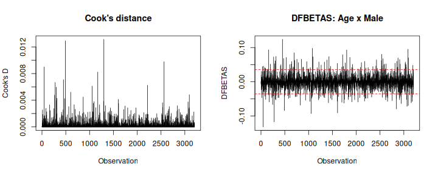
<p class="caption">plot of chunk influence</p>
</div>

``` r
par(mfrow = c(1, 1))
```

### 11.4 Refit without unusual points

We keep clinically plausible readings by default. Here we only check how much the conclusions depend on
the flagged points: drop (a) Cook's D > 4/n, and (b) high-leverage points with |r| > 3, and compare.


``` r
drop_idx <- which(cd > cd_cut | (h > h_cut & abs(r) > 3))
cat("Observations removed for sensitivity check:", length(drop_idx),
    sprintf("(%.1f%% of n)\n", 100 * length(drop_idx) / n))
```

```
## Observations removed for sensitivity check: 2 (0.1% of n)
```

``` r
model_trim <- update(model_work, data = nhanes_t[-drop_idx, ])

comp <- bind_rows(
  tidy(model_work, conf.int = TRUE) %>% mutate(Model = "Full"),
  tidy(model_trim, conf.int = TRUE) %>% mutate(Model = "Without flagged")
) %>%
  select(Model, term, estimate, conf.low, conf.high, p.value) %>%
  pivot_wider(names_from = Model,
              values_from = c(estimate, conf.low, conf.high, p.value)) %>%
  mutate(`% change in estimate` =
           round(100 * (`estimate_Without flagged` - estimate_Full) / abs(estimate_Full), 1))

comp %>%
  select(term, estimate_Full, `estimate_Without flagged`, `% change in estimate`,
         p.value_Full, `p.value_Without flagged`) %>%
  kable(digits = 5, caption = "Coefficients with and without influential points.")
```


Table: Coefficients with and without influential points.

|term              | estimate_Full| estimate_Without flagged| % change in estimate| p.value_Full| p.value_Without flagged|
|:-----------------|-------------:|------------------------:|--------------------:|------------:|-----------------------:|
|(Intercept)       |       0.01403|                  0.01407|                  0.3|      0.00000|                 0.00000|
|Age_bc            |      -0.00126|                 -0.00126|                 -0.2|      0.00000|                 0.00000|
|BMI               |      -0.00002|                 -0.00002|                 -9.7|      0.00000|                 0.00000|
|DirectChol_bc     |      -0.00004|                 -0.00006|                -67.8|      0.58761|                 0.36291|
|TotChol_bc        |      -0.00031|                 -0.00030|                  4.2|      0.00029|                 0.00050|
|Poverty           |       0.00007|                  0.00007|                 -0.9|      0.00000|                 0.00000|
|SleepHrs_bc       |       0.00000|                  0.00000|                114.5|      0.91649|                 0.82164|
|AlcoholYear       |       0.00000|                  0.00000|                 -4.9|      0.00059|                 0.00030|
|Gendermale        |      -0.00261|                 -0.00264|                 -1.4|      0.00000|                 0.00000|
|Smoke100Yes       |      -0.00001|                 -0.00001|                -46.2|      0.78934|                 0.69536|
|PhysActiveYes     |      -0.00005|                 -0.00005|                  7.0|      0.17060|                 0.20148|
|Age_bc:Gendermale |       0.00062|                  0.00063|                  1.5|      0.00000|                 0.00000|

``` r
# any change in significance or sign?
comp %>%
  filter((p.value_Full < 0.05) != (`p.value_Without flagged` < 0.05) |
           sign(estimate_Full) != sign(`estimate_Without flagged`)) %>%
  select(term, estimate_Full, `estimate_Without flagged`, p.value_Full, `p.value_Without flagged`)
```

```
## # A tibble: 0 × 5
## # ℹ 5 variables: term <chr>, estimate_Full <dbl>,
## #   estimate_Without flagged <dbl>, p.value_Full <dbl>,
## #   p.value_Without flagged <dbl>
```


``` r
par(mfrow = c(1, 2))
plot(fitted(model_trim), resid(model_trim), pch = ".", cex = 3, col = rgb(0, 0, 0, 0.4),
     main = "Residuals vs Fitted (without flagged)", xlab = "Fitted", ylab = "Residuals")
abline(h = 0, col = "red", lty = 2)
qqnorm(rstandard(model_trim), pch = ".", cex = 3, col = rgb(0, 0, 0, 0.4),
       main = "Normal Q-Q (without flagged)")
qqline(rstandard(model_trim), col = "red", lty = 2)
```

<div class="figure" style="text-align: center">
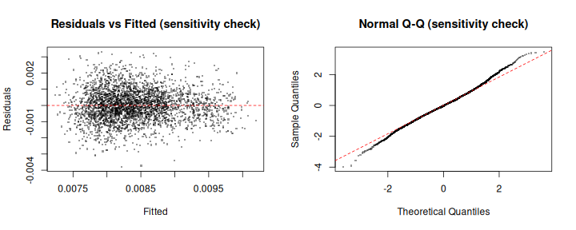
<p class="caption">plot of chunk refit-plots</p>
</div>

``` r
par(mfrow = c(1, 1))
```

### 11.5 Collinearity

Three tools: the pairs plot (already in 8.1) plus a correlation matrix, VIFs, and comparing the individual
t-tests with the overall F-test. Note: VIFs are inflated by construction for terms involved in an interaction
(Age and Age x Gender), so we compute VIFs from the model WITHOUT the interaction.


``` r
# Correlation on original scale (for context)
cor_mat <- cor(nhanes_t[, c("Age", "BMI", "DirectChol", "TotChol", "Poverty",
                            "SleepHrsNight", "AlcoholYear")])
kable(round(cor_mat, 2), caption = "Correlation matrix of numeric predictors (original scale).")
```


Table: Correlation matrix of numeric predictors (original scale).

|              |  Age|   BMI| DirectChol| TotChol| Poverty| SleepHrsNight| AlcoholYear|
|:-------------|----:|-----:|----------:|-------:|-------:|-------------:|-----------:|
|Age           | 1.00|  0.05|       0.11|    0.13|    0.15|          0.06|        0.09|
|BMI           | 0.05|  1.00|      -0.33|    0.01|   -0.08|         -0.05|       -0.15|
|DirectChol    | 0.11| -0.33|       1.00|    0.19|    0.14|          0.05|        0.24|
|TotChol       | 0.13|  0.01|       0.19|    1.00|    0.03|          0.01|        0.07|
|Poverty       | 0.15| -0.08|       0.14|    0.03|    1.00|          0.07|        0.17|
|SleepHrsNight | 0.06| -0.05|       0.05|    0.01|    0.07|          1.00|        0.05|
|AlcoholYear   | 0.09| -0.15|       0.24|    0.07|    0.17|          0.05|        1.00|

``` r
# Correlation on the transformed scale actually used in the model
cor_bc <- cor(nhanes_t[, c("Age_bc", "BMI", "DirectChol_bc", "TotChol_bc",
                            "Poverty", "SleepHrs_bc", "AlcoholYear")])
kable(round(cor_bc, 2), caption = "Correlation matrix of numeric predictors (transformed scale, as used in model_work).")
```


Table: Correlation matrix of numeric predictors (transformed scale, as used in model_work).

|              | Age_bc|   BMI| DirectChol_bc| TotChol_bc| Poverty| SleepHrs_bc| AlcoholYear|
|:-------------|------:|-----:|-------------:|----------:|-------:|-----------:|-----------:|
|Age_bc        |   1.00|  0.06|          0.10|       0.15|    0.17|        0.05|        0.09|
|BMI           |   0.06|  1.00|         -0.34|       0.02|   -0.08|       -0.04|       -0.15|
|DirectChol_bc |   0.10| -0.34|          1.00|       0.19|    0.15|        0.05|        0.23|
|TotChol_bc    |   0.15|  0.02|          0.19|       1.00|    0.04|        0.01|        0.07|
|Poverty       |   0.17| -0.08|          0.15|       0.04|    1.00|        0.06|        0.17|
|SleepHrs_bc   |   0.05| -0.04|          0.05|       0.01|    0.06|        1.00|        0.05|
|AlcoholYear   |   0.09| -0.15|          0.23|       0.07|    0.17|        0.05|        1.00|

``` r
write.csv(as.data.frame(round(cor_bc, 2)), "results/correlation_matrix_transformed.csv")

model_noint <- update(model_work, . ~ . - Gender:Age_bc)
vif_tab <- car::vif(model_noint)
kable(round(vif_tab, 2), caption = "VIF (GVIF for factors) from the model without the interaction. > 5 is a concern, > 10 is severe.")
```


Table: VIF (GVIF for factors) from the model without the interaction. > 5 is a concern, > 10 is severe.

|              |    x|
|:-------------|----:|
|Age_bc        | 1.15|
|BMI           | 1.19|
|DirectChol_bc | 1.47|
|TotChol_bc    | 1.06|
|Poverty       | 1.15|
|SleepHrs_bc   | 1.02|
|AlcoholYear   | 1.19|
|Gender        | 1.23|
|Smoke100      | 1.09|
|PhysActive    | 1.14|

``` r
write.csv(as.data.frame(round(vif_tab, 2)), "results/vif_model_work.csv")

# Overall F-test vs individual t-tests: a significant F with few significant t's is a collinearity warning sign
fs <- summary(model_work)$fstatistic
cat("Overall F =", round(fs[1], 1), "on", fs[2], "and", fs[3], "df, p =",
    format.pval(pf(fs[1], fs[2], fs[3], lower.tail = FALSE)), "\n")
```

```
## Overall F = 82.2 on 11 and 3191 df, p = < 2.22e-16
```

``` r
cat("Predictors with t-test p < 0.05:", sum(tidy(model_work)$p.value[-1] < 0.05), "of", p, "\n")
```

```
## Predictors with t-test p < 0.05: 7 of 11
```

``` r
# Do the standard errors of the key terms change if we drop the most correlated predictor?
# (e.g. TotChol vs DirectChol; edit to match whatever your VIF/correlations flag)
se_full <- tidy(model_work)$std.error
se_drop <- tidy(update(model_work, . ~ . - TotChol_bc))
kable(tibble(term = tidy(model_work)$term[tidy(model_work)$term %in% se_drop$term],
             SE_full = se_full[tidy(model_work)$term %in% se_drop$term],
             SE_without_TotChol = se_drop$std.error),
      digits = 5, caption = "Effect of dropping TotChol on standard errors.")
```


Table: Effect of dropping TotChol on standard errors.

|term              | SE_full| SE_without_TotChol|
|:-----------------|-------:|------------------:|
|(Intercept)       | 0.00024|            0.00023|
|Age_bc            | 0.00006|            0.00006|
|BMI               | 0.00000|            0.00000|
|DirectChol_bc     | 0.00007|            0.00007|
|Poverty           | 0.00001|            0.00001|
|SleepHrs_bc       | 0.00000|            0.00000|
|AlcoholYear       | 0.00000|            0.00000|
|Gendermale        | 0.00028|            0.00028|
|Smoke100Yes       | 0.00004|            0.00004|
|PhysActiveYes     | 0.00004|            0.00004|
|Age_bc:Gendermale | 0.00008|            0.00008|

### 11.6 Summary of findings


``` r
sink("results/section11_results.txt")
cat("=== Section 11: Leverage, Outliers, Influence, Collinearity ===\n\n")

cat("--- 11.1 Leverage ---\n")
cat("Cutoff 2(p+1)/n =", round(h_cut, 4), "\n")
cat("High leverage (> 2(p+1)/n):", sum(h > h_cut), "\n")
cat("Very high leverage (> 3(p+1)/n):", sum(h > 1.5 * h_cut), "\n")
cat("Maximum leverage:", round(max(h), 4), "\n\n")

cat("--- 11.2 Outliers ---\n")
cat("|r| > 2:", sum(abs(r) > 2), sprintf("(%.1f%%)\n", 100 * sum(abs(r) > 2) / n))
cat("|r| > 3:", sum(abs(r) > 3), sprintf("(%.1f%%)\n", 100 * sum(abs(r) > 3) / n))
cat("|r| > 4:", sum(abs(r) > 4), sprintf("(%.1f%%)\n\n", 100 * sum(abs(r) > 4) / n))

cat("--- 11.3 Influence ---\n")
cat("Cook's D cutoff qf(0.5, p+1, n-p-1) =", round(cd_cut, 4), "\n")
cat("Cook's D > cutoff:", sum(cd > cd_cut), "\n")
cat("Cook's D > 0.5:", sum(cd > 0.5), "  Max:", round(max(cd), 4), "\n")
cat("|DFFITS| > cutoff:", sum(abs(dffits_v) > dffits_cut), "\n")
cat("|DFBETAS| > cutoff (any coeff):", sum(apply(abs(dfb) > dfb_cut, 1, any)), "\n\n")

cat("--- 11.4 Refit sensitivity ---\n")
cat("Observations flagged for removal:", length(drop_idx),
    sprintf("(%.1f%% of n)\n\n", 100 * length(drop_idx) / n))

cat("--- 11.5 Collinearity ---\n")
cat("VIF table:\n")
print(round(vif_tab, 2))
cat("Overall F significant, number of significant t-tests:",
    sum(tidy(model_work)$p.value[-1] < 0.05), "of", p, "\n")
sink()
cat("Results written to results/section11_results.txt\n")
```

```
## Results written to results/section11_results.txt
```

## 12. Final Model: Predictor Selection, Interaction Retest, Curvature and Final Checks

Needs `nhanes_t`, `model_work`, `model_prelim` and `model_bc` from Sections 6-11 (run everything above first).
`model_work` is the **full** model (1/SBP response, transformed predictors, Age x Gender). The **reduced** model drops
DirectChol, SleepHrs, Smoke100 and PhysActive. All models below use the same response (1/SBP), so R-squared values
can be compared with each other but not with the preliminary model (response SBP).

### 12.1 Reduced model: partial F-test


``` r
model_red <- update(model_work,
                    . ~ . - DirectChol_bc - SleepHrs_bc - Smoke100 - PhysActive)

# Both main effects of the interaction stay in the model
c(Age_bc_kept = "Age_bc" %in% names(coef(model_red)),
  Gender_kept = "Gendermale" %in% names(coef(model_red)))
```

```
## Age_bc_kept Gender_kept 
##        TRUE        TRUE
```

``` r
# Partial F-test. H0: the four dropped coefficients are all 0
pf_out <- anova(model_red, model_work)
cat(sprintf("Partial F-test (drop DirectChol, SleepHrs, Smoke100, PhysActive): F(%d, %d) = %.3f, p = %.3f\n",
            pf_out$Df[2], pf_out$Res.Df[2], pf_out$F[2], pf_out$`Pr(>F)`[2]))
```

```
## Partial F-test (drop DirectChol, SleepHrs, Smoke100, PhysActive): F(4, 3191) = 0.571, p = 0.684
```

``` r
overall_F <- function(m, label) {
  fs <- summary(m)$fstatistic
  cat(sprintf("Overall F-test, %s: F(%d, %d) = %.1f, p = %.2g\n", label, fs[2], fs[3], fs[1],
              pf(fs[1], fs[2], fs[3], lower.tail = FALSE)))
}
overall_F(model_work, "full"); overall_F(model_red, "reduced")
```

```
## Overall F-test, full: F(11, 3191) = 82.2, p = 7.2e-164
```

```
## Overall F-test, reduced: F(7, 3195) = 128.9, p = 1.7e-167
```

``` r
# CIs of the dropped predictors (needed to justify dropping Smoke100 and PhysActive)
coef_cmp <- full_join(
  tidy(model_work, conf.int = TRUE) %>%
    transmute(term, Full_est = estimate, Full_SE = std.error,
              Full_CI = sprintf("[%.5f, %.5f]", conf.low, conf.high), Full_p = p.value),
  tidy(model_red, conf.int = TRUE) %>%
    transmute(term, Red_est = estimate, Red_SE = std.error,
              Red_CI = sprintf("[%.5f, %.5f]", conf.low, conf.high), Red_p = p.value),
  by = "term")
kable(coef_cmp, digits = 5, caption = "Coefficients, full vs reduced model (NA = predictor dropped).")
```


Table: Coefficients, full vs reduced model (NA = predictor dropped).

|term              | Full_est| Full_SE|Full_CI              |  Full_p|  Red_est|  Red_SE|Red_CI               |   Red_p|
|:-----------------|--------:|-------:|:--------------------|-------:|--------:|-------:|:--------------------|-------:|
|(Intercept)       |  0.01403| 0.00024|[0.01356, 0.01451]   | 0.00000|  0.01396| 0.00023|[0.01351, 0.01441]   | 0.00000|
|Age_bc            | -0.00126| 0.00006|[-0.00138, -0.00115] | 0.00000| -0.00125| 0.00006|[-0.00137, -0.00114] | 0.00000|
|BMI               | -0.00002| 0.00000|[-0.00002, -0.00001] | 0.00000| -0.00002| 0.00000|[-0.00002, -0.00001] | 0.00000|
|DirectChol_bc     | -0.00004| 0.00007|[-0.00018, 0.00010]  | 0.58761|       NA|      NA|NA                   |      NA|
|TotChol_bc        | -0.00031| 0.00009|[-0.00048, -0.00014] | 0.00029| -0.00032| 0.00008|[-0.00048, -0.00015] | 0.00017|
|Poverty           |  0.00007| 0.00001|[0.00005, 0.00009]   | 0.00000|  0.00006| 0.00001|[0.00004, 0.00009]   | 0.00000|
|SleepHrs_bc       |  0.00000| 0.00000|[-0.00001, 0.00001]  | 0.91649|       NA|      NA|NA                   |      NA|
|AlcoholYear       |  0.00000| 0.00000|[-0.00000, -0.00000] | 0.00059|  0.00000| 0.00000|[-0.00000, -0.00000] | 0.00010|
|Gendermale        | -0.00261| 0.00028|[-0.00315, -0.00206] | 0.00000| -0.00261| 0.00028|[-0.00315, -0.00206] | 0.00000|
|Smoke100Yes       | -0.00001| 0.00004|[-0.00008, 0.00006]  | 0.78934|       NA|      NA|NA                   |      NA|
|PhysActiveYes     | -0.00005| 0.00004|[-0.00012, 0.00002]  | 0.17060|       NA|      NA|NA                   |      NA|
|Age_bc:Gendermale |  0.00062| 0.00008|[0.00047, 0.00078]   | 0.00000|  0.00063| 0.00008|[0.00047, 0.00078]   | 0.00000|

``` r
write.csv(coef_cmp, "results/table2_full_vs_reduced.csv", row.names = FALSE)
```

### 12.2 Retest the Age x Gender interaction (reduced model, linear in Age^(1/3))


``` r
p_int <- ggplot(nhanes_t, aes(x = Age_bc, y = SBP_inv, colour = Gender)) +
  geom_point(alpha = 0.15, size = 0.8) +
  geom_smooth(method = "lm", se = FALSE, linewidth = 1.1) +
  labs(title = "1/SBP vs Age^(1/3) by gender", x = "Age^(1/3)", y = "1/SBP") +
  theme_bw()
print(p_int)
```

<div class="figure" style="text-align: center">
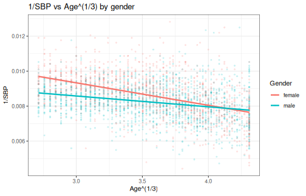
<p class="caption">plot of chunk interaction-plot</p>
</div>


``` r
int_name <- "Age_bc:Gendermale"

# t-test of H0: beta_int = 0, conditional on the other predictors in each model
get_int <- function(m, label, term = int_name) {
  s  <- summary(m)$coefficients[term, ]
  ci <- confint(m)[term, ]
  tibble(Model = label, Term = term, Estimate = unname(s["Estimate"]), SE = unname(s["Std. Error"]),
         t = unname(s["t value"]), df = df.residual(m), p = unname(s["Pr(>|t|)"]),
         CI_low = unname(ci[1]), CI_high = unname(ci[2]))
}
kable(bind_rows(get_int(model_work, "Full"), get_int(model_red, "Reduced")),
      digits = 6, caption = "t-test of the Age x Gender interaction (1/SBP scale), full and reduced models.")
```


Table: t-test of the Age x Gender interaction (1/SBP scale), full and reduced models.

|Model   |Term              | Estimate|      SE|        t|   df|  p|   CI_low|  CI_high|
|:-------|:-----------------|--------:|-------:|--------:|----:|--:|--------:|--------:|
|Full    |Age_bc:Gendermale | 0.000624| 7.8e-05| 8.007992| 3191|  0| 0.000472| 0.000777|
|Reduced |Age_bc:Gendermale | 0.000627| 7.8e-05| 8.042597| 3195|  0| 0.000474| 0.000779|

``` r
# Age slope for each gender: female = beta_Age, male = beta_Age + beta_int
# (the CI uses Var and Cov of the estimates)
slope_tab <- function(m, label) {
  b <- coef(m); V <- vcov(m); tq <- qt(0.975, df.residual(m))
  f_est <- unname(b["Age_bc"]);               f_se <- sqrt(V["Age_bc", "Age_bc"])
  m_est <- unname(b["Age_bc"] + b[int_name])
  m_se  <- sqrt(V["Age_bc", "Age_bc"] + V[int_name, int_name] + 2 * V["Age_bc", int_name])
  tibble(Model = label, Group = c("Female", "Male"), Slope = c(f_est, m_est), SE = c(f_se, m_se),
         CI_low = Slope - tq * SE, CI_high = Slope + tq * SE)
}
kable(bind_rows(slope_tab(model_work, "Full"), slope_tab(model_red, "Reduced")),
      digits = 6, caption = "Slope of 1/SBP per unit of Age^(1/3), by gender.")
```


Table: Slope of 1/SBP per unit of Age^(1/3), by gender.

|Model   |Group  |     Slope|      SE|    CI_low|   CI_high|
|:-------|:------|---------:|-------:|---------:|---------:|
|Full    |Female | -0.001263| 5.8e-05| -0.001376| -0.001149|
|Full    |Male   | -0.000638| 5.6e-05| -0.000748| -0.000529|
|Reduced |Female | -0.001254| 5.7e-05| -0.001366| -0.001143|
|Reduced |Male   | -0.000628| 5.4e-05| -0.000735| -0.000521|

``` r
# VIF on the reduced model (Module 7): remove the interaction term first to avoid
# structural multicollinearity inflating the Age_bc VIF.
model_red_noint <- update(model_red, . ~ . - Gender:Age_bc)
vif_red <- car::vif(model_red_noint)
kable(round(vif_red, 2),
      caption = "VIF (GVIF for factors) of the reduced model without the interaction. > 5 is a concern, > 10 is severe.")
```


Table: VIF (GVIF for factors) of the reduced model without the interaction. > 5 is a concern, > 10 is severe.

|            |    x|
|:-----------|----:|
|Age_bc      | 1.06|
|BMI         | 1.03|
|TotChol_bc  | 1.04|
|Poverty     | 1.06|
|AlcoholYear | 1.08|
|Gender      | 1.03|

``` r
write.csv(as.data.frame(round(vif_red, 2)), "results/vif_model_red.csv")
```

### 12.3 Curvature in Age: do we need Age^2 and Age^2 x Gender?

Age and Age^2 are mathematically related, so their correlation is structural multicollinearity (Module 7), and we do not
interpret their VIFs. VIF is checked on the model without the squared term (12.2). The squared terms are judged by
partial F-tests and fitted curves, not by their individual coefficients.


``` r
# nested sequence: linear -> + Age^2 -> + Age^2 x Gender (= final model)
model_qc1   <- lm(SBP_inv ~ Age_bc + I(Age_bc^2) + Gender + Age_bc:Gender +
                    BMI + TotChol_bc + Poverty + AlcoholYear, data = nhanes_t)
model_final <- lm(SBP_inv ~ Age_bc + I(Age_bc^2) + Gender + Age_bc:Gender + I(Age_bc^2):Gender +
                    BMI + TotChol_bc + Poverty + AlcoholYear, data = nhanes_t)
# same as the final model but with NO Age x Gender terms, to test whether any interaction remains
model_qn    <- lm(SBP_inv ~ Age_bc + I(Age_bc^2) + Gender +
                    BMI + TotChol_bc + Poverty + AlcoholYear, data = nhanes_t)

int1 <- "Age_bc:Gendermale"; int2 <- "I(Age_bc^2):Gendermale"   # check names(coef(model_final)) if this errors

# Pairwise partial F-tests: in each, the larger model supplies the residual mean square
a_age2  <- anova(model_red, model_qc1)       # H0: Age^2 coefficient = 0
a_age2g <- anova(model_qc1, model_final)     # H0: Age^2 x Gender coefficient = 0
a_int   <- anova(model_qn, model_final)      # H0: both Age x Gender terms = 0
kable(tibble(
  Test = c("Age^2 (same curvature for both genders)", "Age^2 x Gender (curvature differs by gender)",
           "Any Age x Gender term (both interaction terms = 0)"),
  df1 = c(a_age2$Df[2], a_age2g$Df[2], a_int$Df[2]),
  df2 = c(a_age2$Res.Df[2], a_age2g$Res.Df[2], a_int$Res.Df[2]),
  F   = c(a_age2$F[2], a_age2g$F[2], a_int$F[2]),
  p   = c(a_age2$`Pr(>F)`[2], a_age2g$`Pr(>F)`[2], a_int$`Pr(>F)`[2])
), digits = 4, caption = "Partial F-tests for the Age^2 terms and for the Age x Gender interaction.")
```


Table: Partial F-tests for the Age^2 terms and for the Age x Gender interaction.

|Test                                               | df1|  df2|       F|      p|
|:--------------------------------------------------|---:|----:|-------:|------:|
|Age^2 (same curvature for both genders)            |   1| 3194| 52.4129| 0.0000|
|Age^2 x Gender (curvature differs by gender)       |   1| 3193|  7.0225| 0.0081|
|Any Age x Gender term (both interaction terms = 0) |   2| 3193| 33.2710| 0.0000|

``` r
mod_stats <- function(m, label) {
  s <- summary(m)
  tibble(Model = label, n = nobs(m), p = length(coef(m)) - 1,
         R2 = s$r.squared, Adj_R2 = s$adj.r.squared, Residual_SE = s$sigma,
         AIC = round(extractAIC(m, k = 2)[2], 1),
         BIC = round(extractAIC(m, k = log(nobs(m)))[2], 1))
}
model_summary_tab <- bind_rows(
  mod_stats(model_work, "Full, linear"), mod_stats(model_red, "Reduced, linear"),
  mod_stats(model_qc1, "Reduced + Age^2"), mod_stats(model_final, "Final: + Age^2 x Gender"))
kable(model_summary_tab, digits = 5,
      caption = "Model summaries (response 1/SBP, so R^2 is comparable across rows).")
```


Table: Model summaries (response 1/SBP, so R^2 is comparable across rows).

|Model                   |    n|  p|      R2|  Adj_R2| Residual_SE|      AIC|      BIC|
|:-----------------------|----:|--:|-------:|-------:|-----------:|--------:|--------:|
|Full, linear            | 3203| 11| 0.22082| 0.21814|     0.00097| -44402.7| -44329.8|
|Reduced, linear         | 3203|  7| 0.22026| 0.21856|     0.00097| -44408.4| -44359.8|
|Reduced + Age^2         | 3203|  8| 0.23285| 0.23093|     0.00097| -44458.5| -44403.9|
|Final: + Age^2 x Gender | 3203|  9| 0.23454| 0.23238|     0.00097| -44463.6| -44402.9|

``` r
write.csv(model_summary_tab, "results/table3_model_comparison.csv", row.names = FALSE)
overall_F(model_final, "final")
```

```
## Overall F-test, final: F(9, 3193) = 108.7, p = 4.3e-178
```

### 12.4 What the Age^2 terms change


``` r
ages_grid <- seq(20, 80, by = 0.5)

mk_nd <- function(ages, g) {
  tibble(Age = ages, Age_bc = ages^(1/3)) %>%
    mutate(Gender = factor(g, levels = levels(nhanes_t$Gender)),
           BMI = mean(nhanes_t$BMI), TotChol_bc = mean(nhanes_t$TotChol_bc),
           Poverty = mean(nhanes_t$Poverty), AlcoholYear = mean(nhanes_t$AlcoholYear)) %>%
    as.data.frame()
}
pred_curve <- function(m, label) {
  bind_rows(lapply(c("female", "male"), function(g)
    tibble(Model = label, Gender = g, Age = ages_grid, fit = predict(m, mk_nd(ages_grid, g)))))
}
curves <- bind_rows(pred_curve(model_red, "Linear (reduced)"), pred_curve(model_final, "Final (with Age^2 terms)"))

p_curves <- ggplot(curves, aes(Age, fit, colour = Gender, linetype = Model)) +
  geom_line(linewidth = 1) +
  labs(title = "Fitted 1/SBP by age and gender: linear vs final model",
       subtitle = "Other predictors held at their means", x = "Age (years)", y = "Fitted 1/SBP") +
  theme_bw()
print(p_curves)
```

<div class="figure" style="text-align: center">
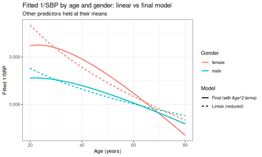
<p class="caption">plot of chunk age2-curves</p>
</div>

On the 1/SBP scale a negative male minus female difference means men have the higher SBP. We do not back-transform
to mm Hg. The CI comes from the model's covariance matrix.


``` r
gap_curve <- function(m, ages, label) {
  tt <- delete.response(terms(m))
  D  <- model.matrix(tt, mk_nd(ages, "male")) - model.matrix(tt, mk_nd(ages, "female"))
  est <- drop(D %*% coef(m))
  se  <- sqrt(rowSums((D %*% vcov(m)) * D))
  tq  <- qt(0.975, df.residual(m))
  tibble(Model = label, Age = ages, est = est, lo = est - tq * se, hi = est + tq * se)
}
cross_ages <- function(gc) {
  gc %>% group_by(Model) %>%
    summarise(`Age(s) where the difference crosses 0` =
                paste(Age[which(diff(sign(est)) != 0)], collapse = ", "), .groups = "drop")
}
gc <- bind_rows(gap_curve(model_red, ages_grid, "Linear (reduced)"),
                gap_curve(model_final, ages_grid, "Final (with Age^2 terms)"))

p_gap <- ggplot(gc, aes(Age, est, colour = Model, fill = Model)) +
  geom_hline(yintercept = 0, linetype = 2) +
  geom_ribbon(aes(ymin = lo, ymax = hi), alpha = 0.15, colour = NA) +
  geom_line(linewidth = 1) +
  labs(title = "Male minus female difference in 1/SBP, with 95% CI",
       subtitle = "Below 0 = men have higher SBP", x = "Age (years)", y = "Male - female (1/SBP)") +
  theme_bw()
print(p_gap)
```

<div class="figure" style="text-align: center">
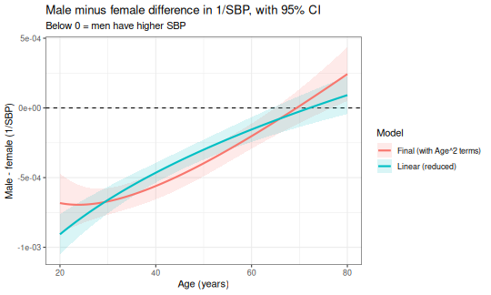
<p class="caption">plot of chunk age2-gap</p>
</div>

``` r
gap_tab <- gc %>%
  filter(Model == "Final (with Age^2 terms)", Age %in% c(30, 40, 50, 60, 70, 80)) %>%
  select(Age, `Male - female (1/SBP)` = est, CI_low = lo, CI_high = hi)
kable(gap_tab, digits = 6, caption = "Final model: male - female difference (1/SBP) at selected ages.")
```


Table: Final model: male - female difference (1/SBP) at selected ages.

| Age| Male - female (1/SBP)|    CI_low|   CI_high|
|---:|---------------------:|---------:|---------:|
|  30|             -0.000671| -0.000766| -0.000575|
|  40|             -0.000560| -0.000656| -0.000465|
|  50|             -0.000397| -0.000490| -0.000304|
|  60|             -0.000202| -0.000292| -0.000112|
|  70|              0.000013| -0.000109|  0.000135|
|  80|              0.000243|  0.000050|  0.000436|

``` r
write.csv(gap_tab, "results/table4_gender_gap.csv", row.names = FALSE)
kable(cross_ages(gc), caption = "Age at which the estimated difference changes sign (nearest 0.5 year).")
```


Table: Age at which the estimated difference changes sign (nearest 0.5 year).

|Model                    |Age(s) where the difference crosses 0 |
|:------------------------|:-------------------------------------|
|Final (with Age^2 terms) |69                                    |
|Linear (reduced)         |72                                    |

### 12.5 Confirm the final model: problematic observations

Cutoffs are the class cutoffs (Module 8), applied to the final model.


``` r
n_f <- nobs(model_final); p_f <- length(coef(model_final)) - 1
h_f  <- hatvalues(model_final); r_f <- rstandard(model_final)
cd_f <- cooks.distance(model_final); dff_f <- dffits(model_final); dfb_f <- dfbetas(model_final)

h_cut   <- 2 * (p_f + 1) / n_f
r_cut   <- 4                                      # n >= 50: standardized residual outside [-4, 4]
cd_cut  <- qf(0.5, p_f + 1, n_f - p_f - 1)        # median of F(p+1, n-p-1)
dff_cut <- 2 * sqrt((p_f + 1) / n_f)
dfb_cut <- 2 / sqrt(n_f)

kable(tibble(
  Measure = c("Leverage h_ii", "|Standardized residual|", "Cook's D", "|DFFITS|",
              "|DFBETAS| (Age x Gender)", "|DFBETAS| (Age^2 x Gender)",
              "|DFBETAS| (any coefficient)"),
  Cutoff  = c("2(p+1)/n", "4 (n >= 50)", "F_0.5(p+1, n-p-1)", "2*sqrt((p+1)/n)",
              "2/sqrt(n)", "2/sqrt(n)", "2/sqrt(n)"),
  Value   = round(c(h_cut, r_cut, cd_cut, dff_cut, dfb_cut, dfb_cut, dfb_cut), 5),
  Count   = c(sum(h_f > h_cut), sum(abs(r_f) > r_cut), sum(cd_f > cd_cut), sum(abs(dff_f) > dff_cut),
              sum(abs(dfb_f[, int1]) > dfb_cut), sum(abs(dfb_f[, int2]) > dfb_cut),
              sum(apply(abs(dfb_f) > dfb_cut, 1, any)))
), caption = "Problematic points in the final model.")
```


Table: Problematic points in the final model.

|Measure                               |Cutoff            |   Value| Count|
|:-------------------------------------|:-----------------|-------:|-----:|
|Leverage h_ii                         |2(p+1)/n          | 0.00624|   194|
|&#124;Standardized residual&#124;     |4 (n >= 50)       | 4.00000|     8|
|Cook's D                              |F_0.5(p+1, n-p-1) | 0.93438|     0|
|&#124;DFFITS&#124;                    |2*sqrt((p+1)/n)   | 0.11175|   185|
|&#124;DFBETAS&#124; (Age x Gender)    |2/sqrt(n)         | 0.03534|   194|
|&#124;DFBETAS&#124; (Age^2 x Gender)  |2/sqrt(n)         | 0.03534|   197|
|&#124;DFBETAS&#124; (any coefficient) |2/sqrt(n)         | 0.03534|   628|

``` r
cat("Maximum Cook's D:", round(max(cd_f), 4), "\n")
```

```
## Maximum Cook's D: 0.0131
```

``` r
# Do the conclusions depend on the flagged points?
drop_f <- which(cd_f > cd_cut | (h_f > h_cut & abs(r_f) > r_cut))
cat("Observations removed for the check:", length(drop_f), sprintf("(%.1f%% of n)\n", 100 * length(drop_f) / n_f))
```

```
## Observations removed for the check: 0 (0.0% of n)
```

``` r
if (length(drop_f) == 0) cat("No observation exceeds both the class cutoffs, so the refit below equals the final model.\n")
```

```
## No observation exceeds both the class cutoffs, so the refit below equals the final model.
```

``` r
trim_data <- if (length(drop_f) > 0) nhanes_t[-drop_f, ] else nhanes_t   # guard: x[-integer(0), ] would drop everything
model_final_trim <- update(model_final, data = trim_data)
model_qn_trim    <- update(model_qn,    data = trim_data)

kable(bind_rows(get_int(model_final, "Final", int1), get_int(model_final_trim, "Final, without flagged", int1),
                get_int(model_final, "Final", int2), get_int(model_final_trim, "Final, without flagged", int2)),
      digits = 6, caption = "Interaction terms with and without the flagged points.")
```


Table: Interaction terms with and without the flagged points.

|Model                  |Term                   |  Estimate|       SE|         t|   df|        p|    CI_low|   CI_high|
|:----------------------|:----------------------|---------:|--------:|---------:|----:|--------:|---------:|---------:|
|Final                  |Age_bc:Gendermale      | -0.002638| 0.001223| -2.157032| 3193| 0.031078| -0.005037| -0.000240|
|Final, without flagged |Age_bc:Gendermale      | -0.002638| 0.001223| -2.157032| 3193| 0.031078| -0.005037| -0.000240|
|Final                  |I(Age_bc^2):Gendermale |  0.000458| 0.000173|  2.650009| 3193| 0.008089|  0.000119|  0.000797|
|Final, without flagged |I(Age_bc^2):Gendermale |  0.000458| 0.000173|  2.650009| 3193| 0.008089|  0.000119|  0.000797|

``` r
a3 <- anova(model_qn_trim, model_final_trim)
cat(sprintf("Joint test of both interaction terms without flagged points: F(%d, %d) = %.2f, p = %.2g\n",
            a3$Df[2], a3$Res.Df[2], a3$F[2], a3$`Pr(>F)`[2]))
```

```
## Joint test of both interaction terms without flagged points: F(2, 3193) = 33.27, p = 5e-15
```

``` r
gc_trim <- bind_rows(gap_curve(model_final, ages_grid, "Final"),
                     gap_curve(model_final_trim, ages_grid, "Final, without flagged"))
kable(cross_ages(gc_trim), caption = "Age where the difference crosses 0, with and without flagged points.")
```


Table: Age where the difference crosses 0, with and without flagged points.

|Model                  |Age(s) where the difference crosses 0 |
|:----------------------|:-------------------------------------|
|Final                  |69                                    |
|Final, without flagged |69                                    |

### 12.6 Final residual plots

Conditions 1 and 2 hold (plots in the Appendix below). Residual plots for the final model: linearity and constant
variance from residuals vs fitted and vs each predictor; normality from the Q-Q plot of the standardized residuals.
Independence cannot be checked from row order (the NHANES package rows were resampled), and clustering within the
sampling design is a limitation.


``` r
par(mfrow = c(1, 2))
plot(fitted(model_final), resid(model_final), pch = ".", col = rgb(0, 0, 0, 0.3),
     main = "Final: Residuals vs Fitted", xlab = "Fitted 1/SBP", ylab = "Residuals")
abline(h = 0, col = "red", lty = 2)
qqnorm(rstandard(model_final), pch = ".", col = rgb(0, 0, 0, 0.3),
       main = "Final: Normal Q-Q", xlab = "Theoretical quantiles", ylab = "Standardized residuals")
qqline(rstandard(model_final), col = "red", lty = 2)
```

<div class="figure" style="text-align: center">
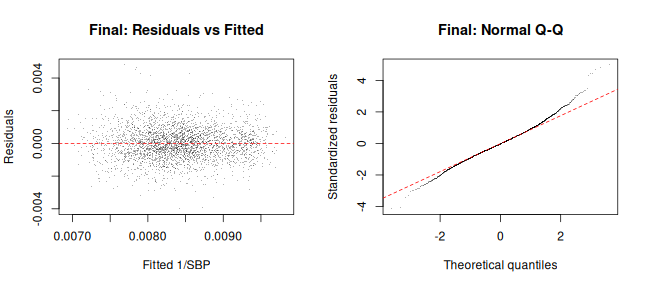
<p class="caption">plot of chunk final-resid-main</p>
</div>

``` r
par(mfrow = c(1, 1))
```


``` r
par(mfrow = c(2, 3))
for (v in c("Age_bc", "BMI", "TotChol_bc", "Poverty", "AlcoholYear")) {
  plot(nhanes_t[[v]], resid(model_final), pch = ".", col = rgb(0, 0, 0, 0.3),
       main = paste0("Residuals vs ", v), xlab = v, ylab = "Residuals")
  abline(h = 0, col = "red", lty = 2)
}
boxplot(resid(model_final) ~ nhanes_t$Gender, main = "Residuals vs Gender",
        xlab = "Gender", ylab = "Residuals", col = "grey85")
abline(h = 0, col = "red", lty = 2)
```

<div class="figure" style="text-align: center">
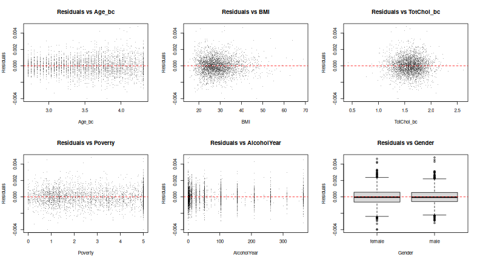
<p class="caption">plot of chunk final-resid-pred</p>
</div>

``` r
par(mfrow = c(1, 1))
```

Before and after: preliminary model, response transformed only, and the final model.


``` r
mods <- list(list(model_prelim, "Preliminary"), list(model_bc, "Transformed Y only"),
             list(model_final, "Final"))
par(mfrow = c(2, 3))
for (pair in mods) {
  plot(fitted(pair[[1]]), resid(pair[[1]]), pch = ".", col = rgb(0, 0, 0, 0.3),
       main = paste0(pair[[2]], ": Residuals vs Fitted"), xlab = "Fitted", ylab = "Residuals")
  abline(h = 0, col = "red", lty = 2)
}
for (pair in mods) {
  qqnorm(rstandard(pair[[1]]), pch = ".", col = rgb(0, 0, 0, 0.3), main = paste0(pair[[2]], ": Normal Q-Q"))
  qqline(rstandard(pair[[1]]), col = "red", lty = 2)
}
```

<div class="figure" style="text-align: center">
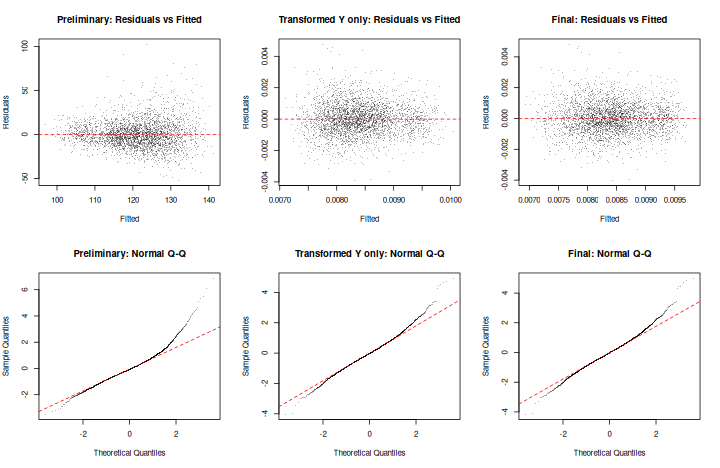
<p class="caption">plot of chunk final-compare</p>
</div>

``` r
par(mfrow = c(1, 1))
```

### Appendix: Conditions 1 and 2 (final model)


``` r
plot(fitted(model_final), nhanes_t$SBP_inv, pch = ".", col = rgb(0, 0, 0, 0.3),
     main = "Condition 1: 1/SBP vs fitted (final)", xlab = "Fitted 1/SBP", ylab = "Observed 1/SBP")
abline(0, 1, col = "red", lty = 2)
```

<div class="figure" style="text-align: center">
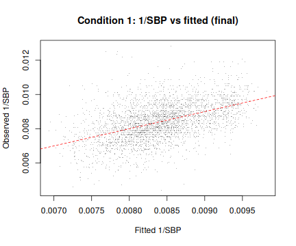
<p class="caption">plot of chunk appendix-conditions</p>
</div>


``` r
pairs(nhanes_t[, c("Age_bc", "BMI", "TotChol_bc", "Poverty", "AlcoholYear")],
      pch = ".", col = rgb(0, 0, 0, 0.3), gap = 0.3,
      main = "Pairwise plots of numeric predictors (final model)")
```

<div class="figure" style="text-align: center">
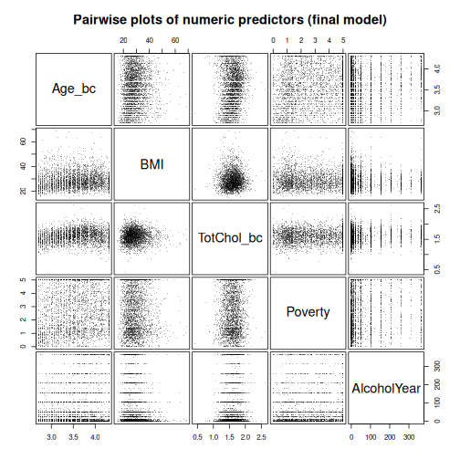
<p class="caption">plot of chunk appendix-pairs</p>
</div>
